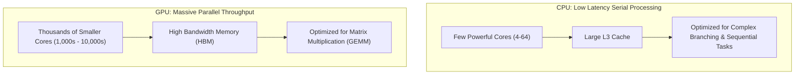

# How Computers and GPUs Work

> To challenge and direct AI engineering work, you must first understand the silicon constraints driving cost, speed, and feasibility.

**Type:** Learn
**Prerequisites:** None
**Time:** ~20 minutes

## Learning Objectives

- Explain the fundamental differences between CPU (latency-optimized) and GPU (throughput-optimized) architectures
- Describe key memory terms: VRAM, HBM, memory bandwidth, and compute-bound versus memory-bound workloads
- Explain why numeric precision (FP32, FP16, BF16, INT8, INT4) and quantization dictate infrastructure budgets
- Formulate practical questions to evaluate engineering hardware and cloud instance requests

## What It Is

Modern computers use two distinct processing models:

- **CPU (Central Processing Unit)**: a handful of powerful cores (roughly 4 to 64) with large caches, built to run complex, branching, sequential tasks with very low delay. Think of a few expert specialists.
- **GPU (Graphics Processing Unit)**: thousands of smaller cores built to do the same simple operation on huge amounts of data at once, backed by very fast **High Bandwidth Memory (HBM)**. Think of a stadium full of workers each doing one easy calculation.

AI models are, at their core, enormous numbers of multiplications and additions on grids of numbers (matrices). That fundamental operation is called **GEMM (General Matrix Multiply)**, and it parallelizes extremely well, which is why GPUs dominate AI.

## Why It Matters

Engineering teams often request expensive GPU clusters (for example NVIDIA H100s or A100s) without business or operational justification. When a TPM asks, "Why can't we run this on CPUs or smaller instances?", the reply is often buzzwords about tensor cores or model sizes.

Without fluency in memory bandwidth, parallel execution, and quantization, a TPM cannot judge whether an architecture is well optimized, overpriced, or prone to latency spikes under production traffic. Hardware decisions set the program's burn rate and the user experience: over-provisioning wastes capital, under-provisioning causes slow responses and SLA breaches.

## How It Works

**Why AI needs GPUs.** A neural network layer multiplies input data by a large table of learned weights. A CPU does these multiplications a few at a time at high clock speed. A GPU performs thousands at once across its parallel cores. For a single large matrix multiplication of 4,096 x 4,096 numbers, a GPU typically finishes one to two orders of magnitude faster than a CPU, which is the gap that makes training and serving large models practical.

**What limits a workload.** Every AI workload is held back by one of two bottlenecks:

1. **Compute-bound**: the processor is maxed out doing arithmetic. Common in training, where large batches keep every core busy.
2. **Memory-bandwidth-bound**: the processor sits idle waiting for data to travel from memory (VRAM or DRAM) to the compute units.

The crucial TPM takeaway: autoregressive LLM inference, which generates one token at a time, is almost always **memory-bandwidth-bound**. Each new token requires streaming essentially all model weights past the cores, so faster memory often helps more than more cores.

**Precision and quantization.** Each model weight is stored as a number with a chosen precision. FP32 uses 4 bytes, FP16/BF16 use 2, INT8 uses 1, INT4 uses half a byte. A 70-billion-parameter model needs about 140 GB at FP16 but about 70 GB at INT8 and about 35 GB at INT4. Lower precision means a smaller memory footprint, cheaper instances, and faster generation, at some risk of quality loss.

## Architecture and Workflow



```archify
src: diagrams/cpu-vs-gpu.html
title: CPU versus GPU: serial latency versus parallel throughput
aspect: 950/452
```

## A Real-World Example

A team proposes eight H100 GPUs at roughly $4 per GPU-hour to serve a 70B-parameter assistant. Run around the clock, that is about $2,900 per GPU per month, or roughly $23,000 per month for the cluster. A TPM asks two questions. First, is the service memory-bound under expected concurrency? The answer is yes, so raw compute is not the limit. Second, has anyone benchmarked INT8 weights? Engineering tests it: quality on the evaluation set drops under 1 percent, and weight memory halves from 140 GB to 70 GB. The model now fits on fewer, cheaper GPUs, cutting the cluster roughly in half. The program saves well over $100,000 a year without changing the product.

## What a TPM Needs to Understand

- A GPU is not "a faster CPU"; it is a different tool that wins on parallel math and loses on sequential logic.
- For LLM serving, memory size and memory bandwidth, not core count, usually decide which instance you need and how fast tokens stream out.
- Quantization is the most common lever for cutting instance cost, but it must be validated against a quality benchmark.
- Hardware sizing must be tied to expected concurrency and traffic shape, not peak benchmark numbers.
- Time To First Token (TTFT) and cost per 1,000 requests are the metrics to hold hardware requests against.

## Risks, Dependencies, and Trade-Offs

| Dimension | CPU Execution | Consumer/Tier-2 GPU (e.g. L4, T4) | Frontier GPU (e.g. A100, H100) |
| :--- | :--- | :--- | :--- |
| **Cost / Hour** | $0.05 - $0.30 | $0.50 - $1.50 | $3.00 - $5.00+ |
| **Ideal For** | Embeddings, tabular ML, small quantized SLMs | Mid-tier LLM inference, embedding generation | Training, fine-tuning, high-throughput frontier LLMs |
| **TPM Risk** | High latency under concurrent requests | VRAM exhaustion for long context windows | High idle cost if traffic patterns are variable |

Dependencies and failure scenarios:

- **GPU supply**: frontier GPUs can have multi-week procurement or quota lead times; a launch date that ignores this slips.
- **Under-provisioning**: traffic spikes cause queueing, high TTFT, and SLA breaches.
- **Over-provisioning**: idle GPUs bill by the hour whether used or not.
- **Over-aggressive quantization**: lower cost but degraded answers that only appear in edge cases.

## Questions to Ask Engineers

1. *"Is this inference service compute-bound or memory-bandwidth-bound under our expected concurrency?"*
2. *"Have we benchmarked quantized weights (INT8 or FP8) against FP16 to see if memory footprint and instance costs can be halved without measurable quality loss?"*
3. *"What is our projected cost per 1,000 requests on this instance type versus a managed model API?"*
4. *"Can we run warm pools or scale-to-zero configurations for non-peak hours?"*

## Scenario Exercise

An engineering lead asks for a cluster of frontier GPUs to host a new internal summarization feature used by about 200 employees during business hours.

1. **Easy**: Why are GPUs, rather than CPUs, the default choice for running large language models?
2. **Medium**: Traffic is high only 9 to 5 on weekdays. Which two cost levers would you raise before approving a 24/7 frontier GPU cluster?
3. **Hard**: Engineering says quantizing to INT8 "might hurt quality" and resists testing it. Describe how you would structure a time-boxed evaluation, what success criteria you would require, and how you would weigh the savings against the risk.

## Key Terms

- **VRAM (Video RAM)**: High-speed memory located directly on the GPU card.
- **HBM (High Bandwidth Memory)**: Specialized stacked memory architecture providing terabytes-per-second transfer rates for frontier AI accelerators.
- **GEMM (General Matrix Multiply)**: The fundamental mathematical operation underpinning deep learning layers.
- **Quantization**: Compressing model weights from 16-bit or 32-bit floating points to 8-bit or 4-bit integers to reduce memory usage and speed up inference.
- **TTFT (Time To First Token)**: The latency between a user request and the first generated token.
