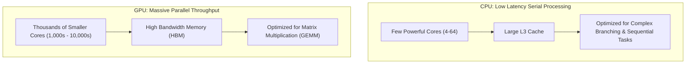

# How Computers and GPUs Work

> To challenge and direct AI engineering work, you must first understand the silicon constraints driving cost, speed, and feasibility.

**Type:** Learn
**Languages:** Python, Concept
**Prerequisites:** None
**Time:** ~30 minutes

## Learning Objectives

- Understand the fundamental differences between CPU (latency-optimized) and GPU (throughput-optimized) architectures
- Master key memory terms: VRAM, HBM, Memory Bandwidth, and Compute Bounds
- Learn why floating point precision (FP32, FP16, BF16, INT8, INT4) dictates infrastructure budgets
- Formulate practical questions to evaluate engineering hardware and cloud instance requests

## The Problem

Engineering teams often request expensive GPU clusters (e.g. NVIDIA H100s or A100s) without providing business or operational justification. When a TPM asks: *"Why can't we run this on CPUs or smaller instances?"*, they may receive buzzword-heavy replies about tensor cores or model sizes.

Without technical fluency in memory bandwidth, parallel execution, and quantization, a TPM cannot effectively assess whether an architecture is optimized, overpriced, or prone to catastrophic latency spikes under production traffic.

## The Concept

At their core, modern computers use two distinct processing models:



### Why AI Needs GPUs

Neural networks perform billions of simple mathematical operations: multiplying matrices and adding vectors ($Y = W \cdot X + b$). 

A CPU performs these operations with high clock speeds one or a few at a time. A GPU performs thousands of these operations simultaneously across parallel SIMD (Single Instruction, Multiple Data) or SIMT (Single Instruction, Multiple Threads) cores.

## Build It

Let's inspect how simple tensor operations utilize hardware acceleration in Python:

```python
import time
import torch

def benchmark_matrix_multiplication(device="cpu", size=4096):
    print(f"Allocating {size}x{size} matrices on {device}...")
    try:
        a = torch.randn(size, size, device=device)
        b = torch.randn(size, size, device=device)
    except Exception as e:
        print(f"Device {device} not available: {e}")
        return

    # Warm-up run
    _ = torch.matmul(a, b)
    if device.startswith("cuda"):
        torch.cuda.synchronize()

    start = time.perf_counter()
    iterations = 10
    for _ in range(iterations):
        c = torch.matmul(a, b)
    if device.startswith("cuda"):
        torch.cuda.synchronize()
        
    duration = (time.perf_counter() - start) / iterations
    print(f"Device: {device} | Mean Execution Time: {duration * 1000:.2f} ms")

if __name__ == "__main__":
    benchmark_matrix_multiplication("cpu")
    if torch.cuda.is_available():
        benchmark_matrix_multiplication("cuda")
    else:
        print("CUDA GPU not detected in current local environment.")
```

## Use It

When deploying an AI model for inference or training, we classify the workload by its bottleneck:

1. **Compute-Bound**: The processor is maxed out doing arithmetic operations (common in pre-training and dense training passes).
2. **Memory-Bound (Memory Bandwidth)**: The processor spends idle cycles waiting for data to travel from memory (VRAM/DRAM) into the compute registers. 
   - **Crucial TPM Takeaway**: Autoregressive LLM inference (generating tokens one by one) is almost always **memory-bandwidth bound**, not compute bound!

## TPM Perspective

### Strategic Executive Summary
Hardware decisions dictate your program's burn rate and user experience. Over-provisioning GPU capacity wastes substantial capital, while under-provisioning leads to high Time To First Token (TTFT) and SLA breaches.

### Questions to Challenge Engineering
When reviewing infrastructure requests, ask your engineering leads:
1. *"Is this inference service compute-bound or memory-bandwidth bound under our expected concurrency?"*
2. *"Have we benchmarked quantized weights (INT8 or FP8/BF16) against FP16 to see if memory footprint and instance costs can be halved without measurable quality loss?"*
3. *"What is our projected cost per 1,000 requests on this instance type vs. a managed model API?"*
4. *"Can we run warm pools or scale-to-zero configurations for non-peak operational hours?"*

### Trade-Off Matrix

| Dimension | CPU Execution | Consumer/Tier-2 GPU (e.g. L4, T4) | Frontier GPU (e.g. A100, H100) |
| :--- | :--- | :--- | :--- |
| **Cost / Hour** | \$0.05 - \$0.30 | \$0.50 - \$1.50 | \$3.00 - \$5.00+ |
| **Ideal For** | Embeddings, tabular ML, small quantized SLMs | Mid-tier LLM inference, embedding generation | Training, fine-tuning, high-throughput frontier LLMs |
| **TPM Risk** | High latency under concurrent requests | VRAM exhaustion for long context windows | High idle cost if traffic patterns are variable |

## Key Terms

- **VRAM (Video RAM)**: High-speed memory located directly on the GPU card.
- **HBM (High Bandwidth Memory)**: Specialized stacked memory architecture providing terabytes-per-second transfer rates for frontier AI accelerators.
- **GEMM (General Matrix Multiply)**: The fundamental mathematical operation underpinning deep learning layers.
- **Quantization**: Compressing model weights from 16-bit or 32-bit floating points to 8-bit or 4-bit integers to reduce memory usage and speed up inference.
- **TTFT (Time To First Token)**: The latency between a user request and the first generated token.
