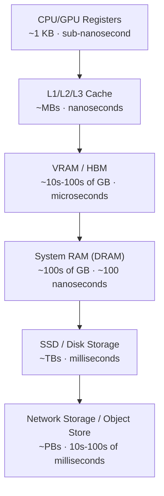

# Memory Hierarchy and Context Windows

> Every "just increase the context window" request is a request to move more data through a narrower pipe — know the pipe before you approve the ask.

**Type:** Learn
**Prerequisites:** How Computers and GPUs Work
**Time:** ~20 minutes

## Learning Objectives

- Map the full memory hierarchy (registers, cache, RAM, VRAM, disk, network storage) and know the latency/cost trade-off at each tier
- Explain why the KV cache, not model weights, is usually what runs out of memory first during long conversations
- Explain why "just double the context window" is a capacity-planning decision, not a config flag
- Formulate the right follow-up questions when engineering proposes a context-window increase or a new caching layer

## What It Is

Every computer, from a laptop to an H100 cluster, moves data through a **memory hierarchy**: tiers that trade capacity for speed. The closer memory is to the processor, the faster and smaller it is. GPUs keep model weights and active computations in VRAM because it is the only tier fast enough to feed thousands of parallel cores.

The **context window** is the maximum number of tokens (input plus output) a model can attend to in one request. The memory that holds the model's working view of that text is called the **KV cache**.

## Why It Matters

A product manager asks engineering to extend a chatbot's context window from 8K to 128K tokens so it can "remember the whole conversation." Engineering comes back saying it will cost roughly 5x more per request and needs bigger GPU instances.

Without understanding why a longer context costs more compute, not just more storage, a TPM cannot tell whether that 5x is a fair estimate, an overcautious buffer, or a sign the team is solving the problem the expensive way (larger context) instead of the cheap way (retrieval, summarization, or caching).

## How It Works

For every token already processed, the model stores two vectors (a Key and a Value) at every attention layer. Together these are the **KV cache**, and it sits in VRAM next to the model weights.

- **Model weights**: fixed size, loaded once.
- **KV cache**: grows linearly with context length and with batch size (the number of concurrent conversations).

So context size is a multiplier on memory pressure, not a one-time cost. Doubling context doubles the KV cache for every concurrent conversation.

Production systems avoid paying the full cost on every request with several techniques:

1. **Prompt/prefix caching**: reuse the cached work for a shared system prompt across requests instead of recomputing it.
2. **Paged attention** (for example in vLLM or TensorRT-LLM): allocate the KV cache in fixed-size blocks like operating-system memory pages, avoiding fragmentation and allowing more concurrency per GPU.
3. **Sliding window / summarization**: summarize or drop older turns so the cache stops growing regardless of conversation length.
4. **Quantized KV cache**: store keys and values at 8-bit instead of 16-bit, roughly halving memory at a small quality cost.

## Architecture and Workflow



```archify
src: diagrams/memory-hierarchy.html
title: Memory hierarchy from registers to network storage
aspect: 900/362
```

## A Real-World Example

Take a 70B-class model with 80 layers. Under a simplified estimate (full multi-head attention, 16-bit values), each token costs roughly 2.5 MB of KV cache.

| Scenario | Approx. KV cache |
| :--- | :--- |
| 8K context, 1 user | ~20 GB |
| 8K context, 32 concurrent users | ~650 GB |
| 128K context, 1 user | ~320 GB |
| 128K context, 32 concurrent users | ~10 TB |

The larger cases need far more memory than the model weights (about 140 GB). Real systems use techniques that shrink these numbers several-fold, but the lesson holds: concurrency times context length is the number that sizes your cluster. The cheaper alternative is often retrieval (fetch only the relevant pages) plus a cached system prompt.

## What a TPM Needs to Understand

- A context-window increase is a memory capacity-planning decision that scales with both conversation length and concurrent users. A 16x context increase can mean a 16x or worse increase in the most expensive memory tier you own.
- The fix is not always "buy more VRAM"; it is often "cache smarter" or "retrieve instead of remember everything."
- Always ask whether cost estimates were modeled at expected concurrency, not single-user.
- A bigger window does not guarantee better answers; quality can degrade on very long inputs.

## Risks, Dependencies, and Trade-Offs

| Strategy | VRAM Savings | Complexity to Implement | Risk |
| :--- | :--- | :--- | :--- |
| **Raw context increase** | None (worst case) | Low | High cost, VRAM exhaustion under concurrency |
| **Prefix/prompt caching** | Moderate–High for shared prompts | Low–Medium | Minimal, well-supported by major providers |
| **Paged attention** | High, especially at scale | Medium (usually framework-provided) | Requires compatible serving stack |
| **RAG instead of long context** | Very High | Medium–High | Retrieval quality becomes the new bottleneck |

Failure scenarios: running out of VRAM at peak concurrency (requests fail or queue), latency growth on long prompts, and quality loss from aggressive KV-cache quantization or summarization that drops important detail.

## Questions to Ask Engineers

1. *"Is this cost increase driven by the KV cache, model weights, or both, and did we model it at our expected concurrency, not just single-user?"*
2. *"Have we evaluated prefix caching or paged attention (e.g. vLLM) before assuming we need bigger instances?"*
3. *"Could retrieval-augmented generation (RAG) or conversation summarization solve the 'remember everything' requirement more cheaply than raw context expansion?"*
4. *"What is our KV cache quantization strategy, and what quality regression have we measured from it?"*

## Scenario Exercise

Sales wants a contract-review assistant that can ingest 300-page agreements (about 150K tokens) for up to 20 reviewers at the same time.

1. **Easy**: Name the two things that make the KV cache grow.
2. **Medium**: Engineering says the 128K window needs a GPU instance four times larger. What would you ask to confirm the estimate reflects concurrency, and which cheaper alternative would you ask them to evaluate?
3. **Hard**: Compare raw long context against RAG for this use case. Which risks (cost, accuracy, latency, missed clauses) does each introduce, and what pilot would you run to decide?

## Key Terms

- **KV Cache**: The stored Key and Value attention vectors for every previously processed token, kept in VRAM to avoid recomputing them on each new token.
- **Memory Hierarchy**: The layered structure of storage tiers (registers, cache, RAM, VRAM, disk) trading capacity against speed.
- **Paged Attention**: A memory management technique that allocates KV cache in fixed-size blocks to reduce fragmentation and increase serving concurrency.
- **Prefix Caching**: Reusing a precomputed KV cache for a shared prompt prefix (e.g. a system prompt) across multiple requests.
- **Context Window**: The maximum number of tokens (input + output) a model can attend to in a single request.
