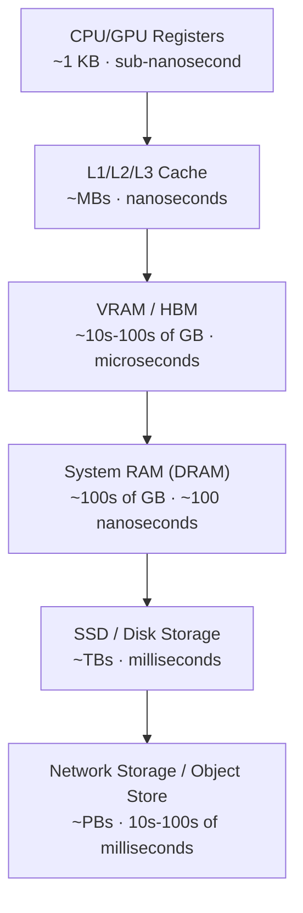

# Memory Hierarchy and Context Windows

> Every "just increase the context window" request is a request to move more data through a narrower pipe — know the pipe before you approve the ask.

**Type:** Learn
**Languages:** Python, Concept
**Prerequisites:** How Computers and GPUs Work
**Time:** ~30 minutes

## Learning Objectives

- Map the full memory hierarchy (registers → cache → RAM → VRAM → disk → network storage) and know the latency/cost trade-off at each tier
- Understand why the KV cache — not model weights — is usually what runs out of memory first during long conversations
- Explain why "just double the context window" is a capacity-planning decision, not a config flag
- Formulate the right follow-up questions when engineering proposes a context-window increase or a new caching layer

## The Problem

A product manager asks engineering to extend a chatbot's context window from 8K to 128K tokens so it can "remember the whole conversation." Engineering comes back with a number: it will cost roughly 5x more per request and needs bigger GPU instances.

Without understanding *why* a longer context costs more compute — not just more storage — a TPM cannot tell whether that 5x is a fair estimate, an overcautious buffer, or a sign the team is solving the problem the expensive way (larger context) instead of the cheap way (retrieval, summarization, or caching).

## The Concept

Every computer — from a laptop to an H100 cluster — moves data through a hierarchy of memory tiers. Each tier trades capacity for speed:



The rule is always the same: **the closer memory is to the processor, the faster and smaller it is.** GPUs keep model weights and active computations in VRAM because it's the only tier fast enough to feed thousands of parallel cores without starving them.

### Where the Context Window Lives

When an LLM processes a conversation, it doesn't just store the text — for every token it has already generated, it caches two vectors (Key and Value) per attention layer, called the **KV cache**. This cache lives in VRAM alongside the model weights.

- Model weights: fixed size, loaded once
- KV cache: **grows linearly with context length and batch size (concurrent users)**

This is why context window size is a multiplier on memory pressure, not a one-time cost. Doubling context length doubles the KV cache for every single concurrent conversation.

## Build It

A simplified estimate of KV cache memory shows why long-context, high-concurrency systems get expensive fast:

```python
def kv_cache_size_gb(
    num_layers,
    num_heads,
    head_dim,
    context_length,
    batch_size,
    bytes_per_value=2,  # FP16/BF16
):
    # 2x for Key and Value tensors
    per_token_per_layer = 2 * num_heads * head_dim * bytes_per_value
    per_token_all_layers = per_token_per_layer * num_layers
    total_bytes = per_token_all_layers * context_length * batch_size
    return total_bytes / (1024 ** 3)

configs = [
    ("8K context, 1 user", 8_000, 1),
    ("8K context, 32 concurrent users", 8_000, 32),
    ("128K context, 1 user", 128_000, 1),
    ("128K context, 32 concurrent users", 128_000, 32),
]

for label, context_length, batch_size in configs:
    size_gb = kv_cache_size_gb(
        num_layers=80,
        num_heads=64,
        head_dim=128,
        context_length=context_length,
        batch_size=batch_size,
    )
    print(f"{label:38s} -> {size_gb:8.1f} GB of KV cache")
```

Running this for a 70B-class model shows the 128K/32-user case can require several hundred GB of VRAM for KV cache alone — often more than the model weights themselves.

## Use It

Production systems avoid paying the full KV cache cost on every request through several strategies:

1. **Prompt/prefix caching**: reusing the KV cache for a shared system prompt across requests instead of recomputing it (used by most major LLM APIs).
2. **Paged attention (vLLM, TensorRT-LLM)**: allocating KV cache in fixed-size blocks like OS virtual memory pages, avoiding fragmentation and enabling higher concurrency per GPU.
3. **Sliding window / summarization**: instead of keeping every token, older turns are summarized or dropped, capping KV cache growth regardless of conversation length.
4. **Quantized KV cache**: storing Key/Value tensors in INT8 instead of FP16, roughly halving memory at a small quality cost.

## TPM Perspective

### Strategic Executive Summary
A context-window increase is a memory capacity-planning decision that scales with *both* conversation length and concurrent users. A 16x context increase can mean a 16x (or worse, with batching) increase in the most expensive memory tier your infrastructure has. The fix is not always "buy more VRAM" — it's often "cache smarter" or "retrieve instead of remember everything."

### Questions to Challenge Engineering
1. *"Is this cost increase driven by the KV cache, model weights, or both — and did we model it at our expected concurrency, not just single-user?"*
2. *"Have we evaluated prefix caching or paged attention (e.g. vLLM) before assuming we need bigger instances?"*
3. *"Could retrieval-augmented generation (RAG) or conversation summarization solve the 'remember everything' requirement more cheaply than raw context expansion?"*
4. *"What is our KV cache quantization strategy, and what quality regression have we measured from it?"*

### Trade-Off Matrix

| Strategy | VRAM Savings | Complexity to Implement | Risk |
| :--- | :--- | :--- | :--- |
| **Raw context increase** | None (worst case) | Low | High cost, VRAM exhaustion under concurrency |
| **Prefix/prompt caching** | Moderate–High for shared prompts | Low–Medium | Minimal, well-supported by major providers |
| **Paged attention** | High, especially at scale | Medium (usually framework-provided) | Requires compatible serving stack |
| **RAG instead of long context** | Very High | Medium–High | Retrieval quality becomes the new bottleneck |

## Key Terms

- **KV Cache**: The stored Key and Value attention vectors for every previously processed token, kept in VRAM to avoid recomputing them on each new token.
- **Memory Hierarchy**: The layered structure of storage tiers (registers, cache, RAM, VRAM, disk) trading capacity against speed.
- **Paged Attention**: A memory management technique that allocates KV cache in fixed-size blocks to reduce fragmentation and increase serving concurrency.
- **Prefix Caching**: Reusing a precomputed KV cache for a shared prompt prefix (e.g. a system prompt) across multiple requests.
- **Context Window**: The maximum number of tokens (input + output) a model can attend to in a single request.
