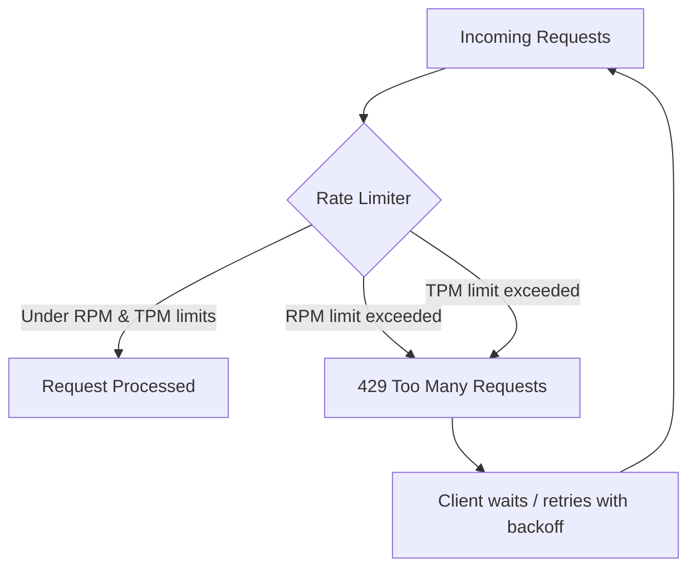

# APIs, Tokens, and Rate Limits

> Every AI feature you ship is a contract with someone else's rate limiter — read the contract before you promise the roadmap.

**Type:** Learn
**Languages:** Python, Concept
**Prerequisites:** Memory Hierarchy and Context Windows
**Time:** ~25 minutes

## Learning Objectives

- Understand how LLM APIs are billed and throttled: tokens, requests-per-minute (RPM), and tokens-per-minute (TPM)
- Distinguish hard rate limits from soft/backoff-based throttling and know which failure mode each produces
- Explain why token counting, not word counting, drives both cost and rate-limit consumption
- Formulate the right questions when engineering says a feature "can't scale" due to API limits

## The Problem

A product team wants to launch an AI feature to all 500,000 users at once. Engineering says the launch needs to be staged over two weeks "because of rate limits." Without knowing what a rate limit actually is, a TPM can't tell if that's a real constraint, a padded estimate, or a missed opportunity to request a limit increase or switch tiers.

Rate limits are not a vague inconvenience — they are a specific, quantifiable ceiling (requests per minute, tokens per minute) set by the API provider, and every feature launch plan should be built against real numbers, not folklore.

## The Concept

Every hosted LLM API enforces limits along at least two axes simultaneously:



- **RPM (Requests Per Minute)**: how many separate API calls you can make, regardless of size.
- **TPM (Tokens Per Minute)**: the total input + output tokens across all requests in a rolling window, regardless of how many requests that took.

A feature that sends short, frequent requests can hit the RPM ceiling while barely touching the TPM ceiling — and a feature that sends few but massive requests (long documents, large context windows) can do the opposite. Both are real ceilings; a launch plan must respect whichever one binds first.

### Tokens, Not Words

Billing and rate limits are measured in **tokens** — sub-word chunks the model actually processes — not words or characters. A rough rule of thumb is ~4 characters per token in English, but this varies by language and content type (code and non-English text often tokenize less efficiently).

## Build It

A simple client-side token-bucket limiter shows the same logic providers use to enforce RPM/TPM limits:

```python
import time

class TokenBucketLimiter:
    def __init__(self, capacity, refill_rate_per_sec):
        self.capacity = capacity
        self.tokens = capacity
        self.refill_rate = refill_rate_per_sec
        self.last_refill = time.monotonic()

    def _refill(self):
        now = time.monotonic()
        elapsed = now - self.last_refill
        self.tokens = min(self.capacity, self.tokens + elapsed * self.refill_rate)
        self.last_refill = now

    def try_consume(self, amount):
        self._refill()
        if self.tokens >= amount:
            self.tokens -= amount
            return True
        return False

limiter = TokenBucketLimiter(capacity=1000, refill_rate_per_sec=1000 / 60)

requests = [200, 300, 150, 400, 100]
for i, cost in enumerate(requests, start=1):
    allowed = limiter.try_consume(cost)
    status = "OK" if allowed else "429 - would be throttled"
    print(f"Request {i} (cost={cost} tokens): {status}, remaining={limiter.tokens:.0f}")
```

This mirrors real provider behavior: a bucket refills continuously, and a request is only accepted if enough capacity exists at that instant.

## Use It

Production systems handle rate limits defensively rather than assuming they'll never be hit:

1. **Exponential backoff with jitter**: on a 429, wait an increasing, randomized amount of time before retrying, to avoid all clients retrying in lockstep.
2. **Request batching**: combining multiple small requests (e.g. embedding many short texts) into fewer, larger calls to conserve RPM budget.
3. **Tiered fallback models**: routing to a smaller/cheaper model or cached response when the primary model's limit is close to being hit.
4. **Pre-launch capacity requests**: providers let you request higher RPM/TPM tiers in advance — a rollout plan should state whether this was requested and approved.

## TPM Perspective

### Strategic Executive Summary
Rate limits are a real, numeric constraint on rollout speed, not a soft excuse. A staged rollout plan should cite the actual RPM/TPM ceiling, the feature's expected token consumption per user action, and whether a limit-increase request has been filed — not just "we need two weeks to be safe."

### Questions to Challenge Engineering
1. *"What is our current RPM and TPM ceiling with this provider, and have we filed for a tier increase given expected launch volume?"*
2. *"Is our bottleneck RPM (too many small requests) or TPM (requests are too large) — and does that change which optimization we should make first?"*
3. *"Do we have exponential backoff and batching in place, or will a traffic spike produce a wall of user-facing errors?"*
4. *"What's our fallback behavior when we hit a 429 in production — silent retry, degraded response, or user-facing failure?"*

### Trade-Off Matrix

| Strategy | Reduces RPM Pressure | Reduces TPM Pressure | Implementation Cost |
| :--- | :--- | :--- | :--- |
| **Request batching** | High | None (same total tokens) | Low–Medium |
| **Exponential backoff** | None (mitigates failures) | None | Low |
| **Prompt/context trimming** | None | High | Medium |
| **Tier increase request** | High | High | Low effort, but provider-dependent turnaround |

## Key Terms

- **RPM (Requests Per Minute)**: The maximum number of API calls allowed in a rolling one-minute window.
- **TPM (Tokens Per Minute)**: The maximum total tokens (input + output) allowed across all requests in a rolling one-minute window.
- **429 Too Many Requests**: The HTTP status code returned when a rate limit is exceeded.
- **Exponential Backoff**: A retry strategy that increases the wait time between retries after each failure, often with added randomness (jitter).
- **Token**: The basic unit of text an LLM processes and is billed on — typically a sub-word chunk, not a whole word.
