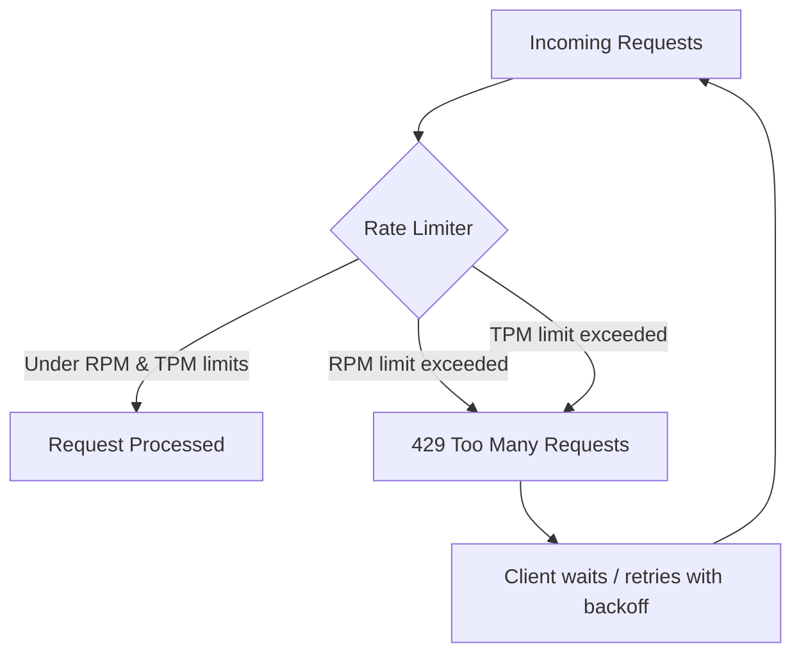

# APIs, Tokens, and Rate Limits

> Every AI feature you ship is a contract with someone else's rate limiter — read the contract before you promise the roadmap.

**Type:** Learn
**Prerequisites:** Memory Hierarchy and Context Windows
**Time:** ~20 minutes

## Learning Objectives

- Explain how LLM APIs are billed and throttled: tokens, requests-per-minute (RPM), and tokens-per-minute (TPM)
- Distinguish hard rate limits from soft/backoff-based throttling and know which failure mode each produces
- Explain why token counting, not word counting, drives both cost and rate-limit consumption
- Formulate the right questions when engineering says a feature "can't scale" due to API limits

## What It Is

A hosted LLM API enforces limits along at least two axes at once:

- **RPM (Requests Per Minute)**: how many separate API calls you can make, regardless of size.
- **TPM (Tokens Per Minute)**: the total input plus output tokens across all requests in a rolling window, regardless of how many requests that took.

Both billing and limits are measured in **tokens**: sub-word chunks the model actually processes, not words or characters. A rough rule is about 4 characters per token in English, but this varies by language and content type (code and non-English text often tokenize less efficiently).

## Why It Matters

A product team wants to launch an AI feature to all 500,000 users at once. Engineering says the launch must be staged over two weeks "because of rate limits." Without knowing what a rate limit is, a TPM cannot tell whether that is a real constraint, a padded estimate, or a missed chance to request a limit increase or switch tiers.

Rate limits are a specific, quantifiable ceiling set by the API provider. Every launch plan should be built against real numbers, not folklore.

## How It Works

A feature that sends short, frequent requests can hit the RPM ceiling while barely touching TPM. A feature that sends few but massive requests (long documents, large context) does the opposite. A launch plan must respect whichever limit binds first.

Providers enforce limits roughly like a bucket that refills continuously: each request draws down capacity, and it is accepted only if enough remains at that instant. If not, the provider returns a **429 Too Many Requests** error.

Production systems handle this defensively:

1. **Exponential backoff with jitter**: on a 429, wait an increasing, randomized time before retrying, so clients do not all retry in lockstep.
2. **Request batching**: combine many small requests (e.g. embedding many short texts) into fewer, larger calls to conserve RPM.
3. **Tiered fallback models**: route to a smaller/cheaper model or a cached response when the primary model's limit is close.
4. **Pre-launch capacity requests**: providers let you request higher RPM/TPM tiers in advance. A rollout plan should state whether this was requested and approved.

## Architecture and Workflow



```archify
src: diagrams/rate-limiter-flow.html
title: Rate limiter flow: limit check, 429 response and retry with backoff
aspect: 838/528
```

## A Real-World Example

A feature gives every user a 1,500-token summary (about 1,000 input plus 500 output tokens). The provider tier allows 1,000 requests per minute and 400,000 tokens per minute. The binding limit is TPM: 400,000 / 1,500 is about 266 requests per minute, far below the 1,000 RPM ceiling. If 500,000 users each try the feature once, that is 750 million tokens, roughly 31 hours at the TPM ceiling even with perfect smoothing. A realistic launch plan staggers cohorts, requests a higher tier before launch, trims prompts to cut tokens per request, and defines what users see on a 429 (queue, degrade to a cheaper model, or a friendly retry message).

## What a TPM Needs to Understand

- Rate limits are a numeric constraint on rollout speed, not a soft excuse. A staged plan should cite the actual RPM/TPM ceiling, expected tokens per user action, and whether a limit increase has been filed.
- Identify which limit binds first (RPM or TPM); it changes which optimization pays off.
- Retries without backoff turn a small spike into an outage by flooding the provider further.
- Token counts, not word counts, are the unit for cost forecasting.
- Fallback behavior on a 429 (silent retry, degraded response, or visible failure) is a product decision, not just an engineering detail.

## Risks, Dependencies, and Trade-Offs

| Strategy | Reduces RPM Pressure | Reduces TPM Pressure | Implementation Cost |
| :--- | :--- | :--- | :--- |
| **Request batching** | High | None (same total tokens) | Low–Medium |
| **Exponential backoff** | None (mitigates failures) | None | Low |
| **Prompt/context trimming** | None | High | Medium |
| **Tier increase request** | High | High | Low effort, but provider-dependent turnaround |

Dependencies and failure scenarios: the provider's tier approval time is outside your control; a traffic spike without backoff produces a wall of user-facing errors; one noisy feature sharing an API key can starve other features of quota; provider limits can change.

## Questions to Ask Engineers

1. *"What is our current RPM and TPM ceiling with this provider, and have we filed for a tier increase given expected launch volume?"*
2. *"Is our bottleneck RPM (too many small requests) or TPM (requests are too large), and does that change which optimization we should make first?"*
3. *"Do we have exponential backoff and batching in place, or will a traffic spike produce a wall of user-facing errors?"*
4. *"What is our fallback behavior when we hit a 429 in production: silent retry, degraded response, or user-facing failure?"*

## Scenario Exercise

Your company will launch an AI writing assistant to 100,000 customers next month. Engineering proposes a four-week staged rollout "to stay under rate limits."

1. **Easy**: What does a 429 response tell you, and which two limits might have triggered it?
2. **Medium**: What three numbers would you ask for to test whether four weeks is justified?
3. **Hard**: The limit-increase request will not be approved before launch. Propose a rollout plan that combines at least three mitigations from this lesson and state what the user sees when capacity runs out.

## Key Terms

- **RPM (Requests Per Minute)**: The maximum number of API calls allowed in a rolling one-minute window.
- **TPM (Tokens Per Minute)**: The maximum total tokens (input + output) allowed across all requests in a rolling one-minute window.
- **429 Too Many Requests**: The HTTP status code returned when a rate limit is exceeded.
- **Exponential Backoff**: A retry strategy that increases the wait time between retries after each failure, often with added randomness (jitter).
- **Token**: The basic unit of text an LLM processes and is billed on — typically a sub-word chunk, not a whole word.
