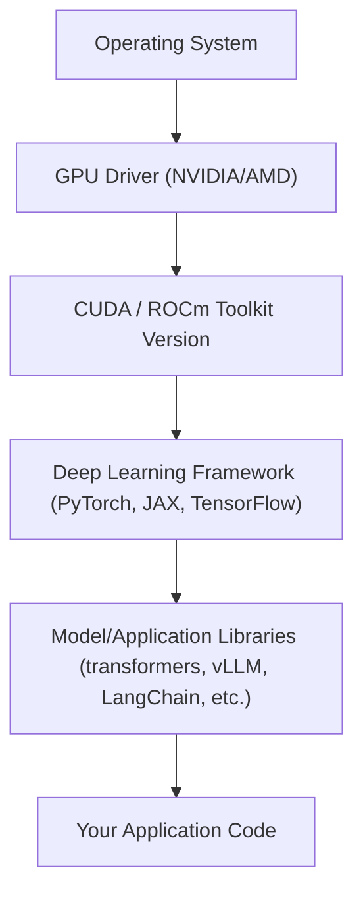

# Dev Environments for AI Engineering

> "Works on my machine" costs more in AI engineering than anywhere else — a mismatched CUDA driver can silently change your model's output.

**Type:** Learn
**Prerequisites:** APIs, Tokens, and Rate Limits
**Time:** ~20 minutes

## Learning Objectives

- Explain why AI dev environments are harder to reproduce than typical web app environments (GPU drivers, CUDA versions, dependency conflicts)
- Distinguish local development, notebook environments, and containerized/cloud environments, and know when each is appropriate
- Explain why "it worked in the notebook" often fails in production, and vice versa
- Formulate the right questions when engineering reports an environment-related delay or bug

## What It Is

An AI **development environment** is the full stack of software a model or AI application runs on: the operating system, GPU driver, CUDA toolkit (NVIDIA's platform for running computations on the GPU), the deep learning framework, model libraries, and finally your application. Every layer must be a compatible version of its neighbors.

## Why It Matters

An engineer reports a two-day delay: "the model gives different results on the new GPU box." A TPM without environment fluency hears a vague excuse. In reality this is a well-known failure mode: a mismatched CUDA/driver version, a different numeric precision default, or dependency drift between environments.

Unlike typical web software, AI systems have a much deeper dependency stack, and incompatibilities cause subtle (or not-so-subtle) bugs and performance regressions.

## How It Works

A version mismatch at any layer can produce three distinct failure classes:

1. **Hard failure**: it crashes immediately (e.g. a CUDA mismatch prevents GPU startup). Annoying but obvious.
2. **Silent numerical drift**: it runs, but outputs differ slightly (different rounding or kernel implementations). Dangerous because it passes casual testing but breaks reproducibility.
3. **Silent performance regression**: it runs correctly but much slower (e.g. falling back to a non-optimized path without any error).

Three environment styles, in increasing rigor:

- **Notebooks (Jupyter/Colab)**: fast iteration for exploration, but hidden state can persist (a value from a deleted cell still "works" until restart), masking bugs.
- **Local development**: full control, but drift between team members' machines is common without pinned dependencies.
- **Containers (Docker)**: bundle the OS, CUDA version, and dependencies into one reproducible image. The standard for anything heading to production or shared team use.

Teams that manage this well standardize on a few practices:

1. **Pinned dependencies**: exact versions or lockfiles instead of open-ended ranges.
2. **Versioned container images**, rebuilt in CI, so "the environment" is a versioned artifact rather than tribal knowledge.
3. **Environment fingerprinting**: log the exact CUDA, framework, and library versions alongside every training run or evaluation, so results trace back to the environment that produced them. Comparing fingerprints between two machines is often the fastest way to root-cause "works here, not there."
4. **Notebook-for-exploration, script-for-production** conventions.

## Architecture and Workflow



```archify
src: diagrams/ai-dev-stack.html
title: AI development environment dependency stack
aspect: 910/362
```

## A Real-World Example

A team trains a model on a developer workstation and sees 91 percent accuracy. After moving the job to a new cloud GPU node, accuracy reads 89 percent and the nightly evaluation run takes 3 hours instead of 1. Nothing in the project changed. Comparing environment fingerprints shows the new node has a newer GPU driver and a different framework minor version: the framework quietly chose a different, slower computation path (performance regression) with slightly different rounding (numerical drift). The fix is pinning both versions in a container image. The cost was two engineer-days of debugging that a fingerprint log would have reduced to ten minutes.

## What a TPM Needs to Understand

- Environment drift is one of the most underestimated sources of AI project delay and irreproducibility. Without pinned, containerized environments, a bug will eventually appear that reproduces on only one machine, usually during an incident.
- "Environment mismatch" should be an early hypothesis when results change, alongside data and code.
- Silent failures matter most: a crash is visible, drift and slowdowns are not.
- Investing in reproducibility early is cheap insurance against expensive debugging later.
- Notebook code is exploratory; it needs a hand-off to tested, pinned scripts before running unattended.

## Risks, Dependencies, and Trade-Offs

| Environment Type | Reproducibility | Iteration Speed | Best Use Case |
| :--- | :--- | :--- | :--- |
| **Notebook (local/Colab)** | Low | Very High | Exploration, prototyping, teaching |
| **Local dev (unpinned)** | Low–Medium | High | Early individual development |
| **Local dev (pinned/lockfile)** | Medium–High | Medium | Team development before containerization |
| **Container (Docker/CI-built)** | Very High | Lower (rebuild cost) | Training runs, evals, production deployment |

Dependencies and failure scenarios: GPU driver upgrades on shared infrastructure can break many projects at once; cloud providers may change default images; an unpinned dependency can update overnight and change results; results that cannot be reproduced cannot be audited.

## Questions to Ask Engineers

1. *"Are our training and inference environments pinned (exact versions) or floating (version ranges), and when did we last audit for drift?"*
2. *"If a model's output changed unexpectedly, is 'environment mismatch' one of our first three hypotheses, or does the team default to blaming data or code?"*
3. *"Do we log an environment fingerprint (CUDA version, framework version, GPU type) alongside every training run and eval result?"*
4. *"Is exploratory notebook work ever deployed directly to production, or is there a required hand-off to pinned, tested scripts?"*

## Scenario Exercise

A model evaluation that scored 88 percent last week scores 84 percent today. No one changed the model or data, but the team moved to a new GPU cluster.

1. **Easy**: Name the three failure classes an environment mismatch can cause.
2. **Medium**: What single piece of information would you ask engineering to produce from both clusters to narrow the cause?
3. **Hard**: Propose a process change that prevents this class of surprise, and describe the cost (iteration speed, build time) a TPM should weigh against the benefit.

## Key Terms

- **CUDA**: NVIDIA's parallel computing platform and API that lets frameworks like PyTorch run computations on the GPU; version mismatches with the GPU driver are a common source of failures.
- **Environment Drift**: The gradual divergence of dependency versions between machines or over time, causing inconsistent behavior.
- **Environment Fingerprint**: A recorded snapshot of the exact OS, driver, CUDA, and library versions used to produce a given result, enabling traceability.
- **Silent Numerical Drift**: A bug class where code runs without error but produces subtly different outputs due to environment differences (e.g. floating-point rounding, kernel implementation changes).
- **Pinned Dependencies**: Exact, locked versions of libraries (as opposed to open-ended ranges) recorded so an environment can be exactly reproduced.
