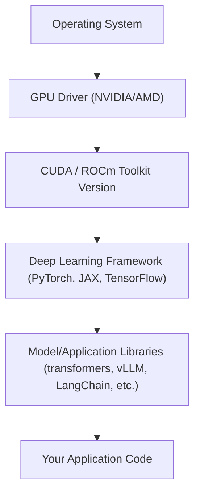

# Dev Environments for AI Engineering

> "Works on my machine" costs more in AI engineering than anywhere else — a mismatched CUDA driver can silently change your model's output.

**Type:** Learn
**Languages:** Python, Concept
**Prerequisites:** APIs, Tokens, and Rate Limits
**Time:** ~25 minutes

## Learning Objectives

- Understand why AI dev environments are harder to reproduce than typical web app environments (GPU drivers, CUDA versions, dependency conflicts)
- Know the difference between local development, notebook environments, and containerized/cloud training environments — and when each is appropriate
- Explain why "it worked in the notebook" often fails in production, and vice versa
- Formulate the right questions when engineering reports an environment-related delay or bug

## The Problem

An engineer reports a two-day delay: "the model gives different results on the new GPU box." A TPM without environment fluency hears this as a vague excuse. In reality, this is often a precise, well-known failure mode: a mismatched CUDA/driver version, a different floating-point precision default, or a dependency version drift between environments.

Unlike typical web software, AI systems have a much deeper dependency stack — the OS, GPU driver, CUDA toolkit, deep learning framework (PyTorch/TensorFlow), and model library must all be compatible versions, or subtle (or not-so-subtle) bugs and performance regressions appear.

## The Concept

An AI dev environment has more interdependent layers than a typical backend service:



A version mismatch at any layer can cause three distinct failure classes:

1. **Hard failure**: the code crashes immediately (e.g. CUDA version mismatch prevents GPU initialization).
2. **Silent numerical drift**: the code runs, but produces slightly different outputs (e.g. different floating-point rounding, different kernel implementations) — dangerous because it passes casual testing but breaks reproducibility.
3. **Silent performance regression**: the code runs correctly but much slower (e.g. falling back to a non-optimized kernel path without any error).

### Notebook vs. Local vs. Containerized

- **Notebooks (Jupyter/Colab)**: fast iteration, good for exploration, but state can persist across cells in ways that hide bugs (a variable defined in a deleted cell still "works" until restart).
- **Local development**: full control, but environment drift between team members' machines is common without strict dependency pinning.
- **Containers (Docker)**: pin the OS, CUDA version, and dependencies together into one reproducible image — the standard for anything moving toward production or shared team use.

## Build It

A minimal reproducibility check every AI team should be able to answer instantly:

```python
import sys
import platform

def environment_fingerprint():
    info = {
        "python_version": sys.version.split()[0],
        "platform": platform.platform(),
    }
    try:
        import torch
        info["torch_version"] = torch.__version__
        info["cuda_available"] = torch.cuda.is_available()
        if torch.cuda.is_available():
            info["cuda_version"] = torch.version.cuda
            info["gpu_name"] = torch.cuda.get_device_name(0)
    except ImportError:
        info["torch_version"] = "not installed"

    return info

if __name__ == "__main__":
    fingerprint = environment_fingerprint()
    for key, value in fingerprint.items():
        print(f"{key}: {value}")
```

Running this on every machine (or in every container image) and diffing the output is often the fastest way to root-cause a "works here, not there" bug.

## Use It

Teams that manage this well standardize on a small set of practices:

1. **Pinned dependency files** (`requirements.txt` with exact versions, or lockfiles) instead of open-ended version ranges.
2. **Container images** tagged and versioned per project, rebuilt in CI, so "the environment" is a versioned artifact, not tribal knowledge.
3. **Environment fingerprinting in CI**: logging the exact CUDA/framework/library versions alongside every training run or eval, so results can be traced back to the environment that produced them.
4. **Separate notebook-for-exploration vs. script-for-production** conventions — notebooks are for iterating on ideas, not for anything that will run unattended.

## TPM Perspective

### Strategic Executive Summary
Environment drift is one of the most underestimated sources of AI project delay and irreproducibility. A team without pinned, containerized environments will eventually ship a bug that only reproduces on one machine — often during an incident, not during planning. Investing in environment reproducibility early is cheap insurance against expensive debugging later.

### Questions to Challenge Engineering
1. *"Are our training and inference environments pinned (exact versions) or floating (version ranges) — and when did we last audit for drift?"*
2. *"If a model's output changed unexpectedly, is 'environment mismatch' one of our first three hypotheses, or does the team default to blaming the data or code?"*
3. *"Do we log an environment fingerprint (CUDA version, framework version, GPU type) alongside every training run and eval result?"*
4. *"Is exploratory notebook code ever being deployed directly to production, or is there a required hand-off to pinned, tested scripts?"*

### Trade-Off Matrix

| Environment Type | Reproducibility | Iteration Speed | Best Use Case |
| :--- | :--- | :--- | :--- |
| **Notebook (local/Colab)** | Low | Very High | Exploration, prototyping, teaching |
| **Local dev (unpinned)** | Low–Medium | High | Early individual development |
| **Local dev (pinned/lockfile)** | Medium–High | Medium | Team development before containerization |
| **Container (Docker/CI-built)** | Very High | Lower (rebuild cost) | Training runs, evals, production deployment |

## Key Terms

- **CUDA**: NVIDIA's parallel computing platform and API that lets frameworks like PyTorch run computations on the GPU; version mismatches with the GPU driver are a common source of failures.
- **Environment Drift**: The gradual divergence of dependency versions between machines or over time, causing inconsistent behavior.
- **Environment Fingerprint**: A recorded snapshot of the exact OS, driver, CUDA, and library versions used to produce a given result, enabling traceability.
- **Silent Numerical Drift**: A bug class where code runs without error but produces subtly different outputs due to environment differences (e.g. floating-point rounding, kernel implementation changes).
- **Pinned Dependencies**: Exact, locked versions of libraries (as opposed to open-ended ranges) recorded so an environment can be exactly reproduced.
