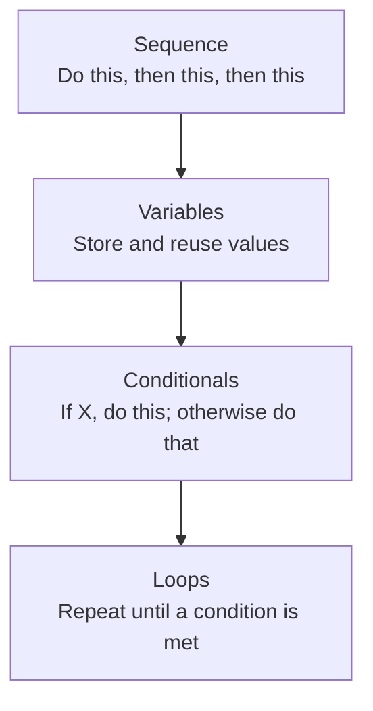

# Programming Fundamentals

> A program is just a list of precise instructions — the "precise" part is the entire skill.

**Type:** Learn
**Prerequisites:** None
**Time:** ~20 minutes

## Learning Objectives

- Explain what a program actually is: instructions executed step by step by a computer
- Recognize the four universal building blocks of programming: sequence, variables, conditionals, and loops
- Describe, from a plain-English step list, what a simple program will do and where it can go wrong
- Explain why "the AI wrote buggy code" is often a precise, diagnosable problem, not vague bad luck

## What It Is

A **program** is a list of precise instructions that a computer follows exactly, one step at a time. Every program ever written, from a calculator to the serving system behind a large language model, is built from four basic ideas:

1. **Sequence**: instructions run in order, top to bottom, one at a time.
2. **Variables**: named containers that hold a value (a number, text, a list) so it can be reused or changed later.
3. **Conditionals**: "if X, do this; otherwise do that" logic. The program takes a different path depending on a condition.
4. **Loops**: repeating a set of instructions until a condition says "stop."

Almost every bug, feature, and AI product behavior can be described using just these four ideas in different arrangements.

## Why It Matters

A TPM sits in a meeting where an engineer says "the loop never terminates" or "we hit an off-by-one error." Without knowing what a loop is or what off-by-one means, the TPM cannot tell whether this is a five-minute fix or a sign of a deeper design problem, and cannot ask a sharp follow-up.

You do not need to write production code to lead AI engineering programs. But you do need to recognize the basic shapes every program is built from, because AI-generated code and AI product behavior are both, underneath, just programs following these same rules.

## How It Works

Consider a common AI engineering pattern, described as plain steps: **retry a failed API call up to 3 times, then give up.**

1. Start a counter of attempts at 0 and fix the maximum at 3. (variables)
2. While the counter is below 3, ask the API for a response. (loop)
3. If the response succeeded, stop immediately. (conditional)
4. Otherwise add 1 to the counter and go around again. (loop, variable)
5. If the counter reached 3 with no success, tell the user the request failed. (conditional)

All four building blocks appear, in order (sequence). Reading a design doc or bug report is largely this skill: finding where the steps branch and where they repeat.

Engineering conversations use this vocabulary constantly:

- *"We're stuck in an infinite loop"*: a loop's stop condition is never met.
- *"Off-by-one error"*: a loop or condition runs one time too many or too few (for example, "less than" was used where "less than or equal" was needed).
- *"Race condition"*: two sequences of instructions run at overlapping times and interfere with each other (covered in the async programming lesson).
- *"Dead code"*: instructions that can never run, often because a condition can never be true.

## Architecture and Workflow



```archify
src: diagrams/programming-building-blocks.html
title: Programming building blocks: sequence, variables, conditionals, loops
aspect: 1140/192
```

## A Real-World Example

A support chatbot calls a model provider, which fails about 1 call in 5. Without a retry loop, 20 percent of customer questions show an error. With the 3-attempt retry above, the chance that all three tries fail is roughly 0.2 x 0.2 x 0.2 = 0.8 percent. Now suppose an engineer's version has an off-by-one mistake and the loop allows 4 attempts instead of 3. Failures drop slightly further, but each failing request now takes 33 percent longer before the user sees an error, and costs more provider calls. Suppose instead the stop condition is missing entirely: during a provider outage the loop never ends, thousands of requests pile up, and the bill and latency explode. Same four building blocks, three very different outcomes.

## What a TPM Needs to Understand

- Every AI feature, from retry logic to a recommendation ranking, is sequence, variables, conditionals, and loops arranged in a particular way.
- Bugs fall into a few diagnosable classes: logic (wrong conditional), termination (loop never stops), or data (wrong variable value).
- Fluency here lets you read a bug report, a design doc, or a summary of AI-generated code and ask precise questions instead of relying entirely on the engineer's summary.
- Loops and retries are where cost and latency hide, because they multiply work.

## Risks, Dependencies, and Trade-Offs

| Concept | What It's Good For | Common Failure Mode |
| :--- | :--- | :--- |
| **Sequence** | Predictable, ordered execution | Steps run in the wrong order due to a misplaced instruction |
| **Variables** | Reusing and tracking values | Using a stale or overwritten value ("stale state") |
| **Conditionals** | Branching decision logic | Missing an edge case (e.g. forgetting the "empty input" case) |
| **Loops** | Repeating work automatically | Infinite loops, or off-by-one errors at the boundary |

Dependency to watch: AI-generated code can look plausible while containing exactly these errors, so review and testing remain essential.

## Questions to Ask Engineers

1. *"Is this bug a logic issue (wrong conditional), a termination issue (loop never stops), or a data issue (wrong variable value)?"*
2. *"Is this an off-by-one error, and if so, what's the actual boundary condition that's wrong?"*
3. *"Walk me through the sequence of steps this feature takes, in order. Where does it branch, and where does it repeat?"*

## Scenario Exercise

A nightly job that processes customer tickets has started running for 9 hours instead of 40 minutes, and the cloud bill spiked.

1. **Easy**: In plain English, what does it mean when an engineer says "the loop never terminates"?
2. **Medium**: The retry logic was changed to allow up to 10 attempts with no wait between them. Which of the four building blocks is involved, and what two side effects would you ask about?
3. **Hard**: Engineering proposes "just add a maximum number of attempts and a rising wait between retries." Describe what failure modes that fixes, what new questions it raises (for example, what the user sees after giving up), and how you would verify the fix before the next nightly run.

## Key Terms

- **Sequence**: Instructions executed one after another, in a defined order.
- **Variable**: A named container that stores a value which can be read or changed while a program runs.
- **Conditional**: Logic that runs different instructions depending on whether a condition is true or false.
- **Loop**: A block of instructions repeated until a stopping condition is met.
- **Off-by-One Error**: A bug where a loop or condition is evaluated one iteration or index too many or too few.
