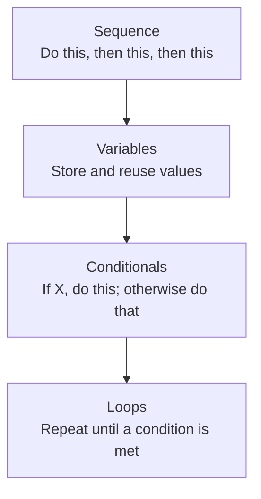

# Programming Fundamentals

> A program is just a list of precise instructions — the "precise" part is the entire skill.

**Type:** Learn
**Languages:** Concept (pseudocode)
**Prerequisites:** None
**Time:** ~30 minutes

## Learning Objectives

- Understand what a program actually is: instructions executed step by step by a computer
- Recognize the four universal building blocks of programming: sequence, variables, conditionals, and loops
- Read simple pseudocode and predict what it will do
- Explain, in plain language, why "the AI wrote buggy code" is often a precise, diagnosable problem — not vague bad luck

## The Problem

A TPM sits in a meeting where an engineer says "the loop never terminates" or "we hit an off-by-one error." Without knowing what a loop is or what "off-by-one" means, the TPM can't tell whether this is a five-minute fix or a sign of a deeper design problem — and can't ask a sharp follow-up question.

You don't need to write production code to lead AI engineering programs. But you do need to recognize the basic shapes every program is built from, because AI-generated code and AI product behavior are both, underneath, just programs following these same rules.

## The Concept

Every program ever written — from a calculator to a large language model's serving code — is built from four basic ideas:



1. **Sequence**: instructions run in order, top to bottom, one at a time.
2. **Variables**: named containers that hold a value (a number, text, a list) so it can be reused or changed later.
3. **Conditionals**: `if / else` logic — the program takes a different path depending on a condition.
4. **Loops**: repeating a set of instructions until a condition says "stop."

Almost every bug, feature, and AI model's decision-making process can be described using just these four ideas, combined in different arrangements.

### Reading Pseudocode

Pseudocode is plain-language instructions written like code, without needing a real programming language:

```
set attempts to 0
set max_attempts to 3

while attempts is less than max_attempts:
    ask the API for a response
    if the response succeeded:
        stop the loop
    otherwise:
        increase attempts by 1

if attempts reached max_attempts:
    report a failure to the user
```

This reads almost like English, but it precisely describes a common AI engineering pattern: retrying a failed API call up to 3 times before giving up.

## Build It

Here is the same logic as actual, runnable Python — you don't need to write this yourself yet, just see how closely it matches the pseudocode above:

```python
attempts = 0
max_attempts = 3
succeeded = False

def call_api_that_sometimes_fails(attempt_number):
    return attempt_number == 2

while attempts < max_attempts:
    print(f"Attempt {attempts + 1}: calling the API...")
    succeeded = call_api_that_sometimes_fails(attempts)
    if succeeded:
        print("Success! Stopping.")
        break
    else:
        attempts += 1

if attempts == max_attempts and not succeeded:
    print("Reached max attempts — reporting failure to the user.")
```

Notice all four building blocks are present: **sequence** (top to bottom), a **variable** (`attempts`), a **conditional** (`if succeeded`), and a **loop** (`while attempts < max_attempts`).

## Use It

Real-world engineering conversations use this vocabulary constantly:

- *"We're stuck in an infinite loop"* → a loop's stop condition is never met.
- *"Off-by-one error"* → a loop or condition runs one time too many or too few (e.g. using `<=` instead of `<`).
- *"Race condition"* → two sequences of instructions run at overlapping times and interfere with each other (covered more in the async programming lesson).
- *"Dead code"* → instructions that can never actually run, often because a conditional can never be true.

## Exercises

1. **Easy**: Read this pseudocode and write in plain English what it does: `set count to 0 / while count is less than 5: print count / increase count by 1`.
2. **Medium**: Rewrite the retry-loop pseudocode above so it waits longer between each retry attempt (a common real pattern called backoff).
3. **Hard**: Describe, in pseudocode, how you would check a list of 100 API responses and count how many failed, without writing any real code syntax.

## TPM Perspective

### Strategic Executive Summary
Every AI feature — from a chatbot's retry logic to a recommendation engine's ranking — is ultimately sequence, variables, conditionals, and loops arranged in a particular way. Fluency in these four concepts lets a TPM read a bug report, a design doc, or even AI-generated code and ask precise questions instead of relying entirely on the engineer's summary.

### Questions to Challenge Engineering
1. *"Is this bug a logic issue (wrong conditional), a termination issue (loop never stops), or a data issue (wrong variable value)?"*
2. *"Is this an off-by-one error, and if so, what's the actual boundary condition that's wrong?"*
3. *"Walk me through the sequence of steps this feature takes, in order — where does it branch, and where does it repeat?"*

### Trade-Off Matrix

| Concept | What It's Good For | Common Failure Mode |
| :--- | :--- | :--- |
| **Sequence** | Predictable, ordered execution | Steps run in the wrong order due to a misplaced instruction |
| **Variables** | Reusing and tracking values | Using a stale or overwritten value ("stale state") |
| **Conditionals** | Branching decision logic | Missing an edge case (e.g. forgetting the "empty input" case) |
| **Loops** | Repeating work automatically | Infinite loops, or off-by-one errors at the boundary |

## Key Terms

- **Sequence**: Instructions executed one after another, in a defined order.
- **Variable**: A named container that stores a value which can be read or changed while a program runs.
- **Conditional**: Logic that runs different instructions depending on whether a condition is true or false.
- **Loop**: A block of instructions repeated until a stopping condition is met.
- **Off-by-One Error**: A bug where a loop or condition is evaluated one iteration or index too many or too few.
