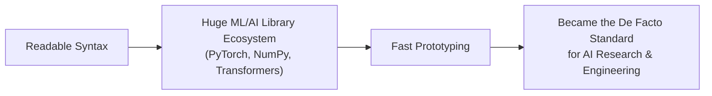

# Python Fundamentals

> Python is the closest thing AI engineering has to a universal language — most model code, tooling, and research is written in it first.

**Type:** Learn
**Prerequisites:** Programming Fundamentals
**Time:** ~20 minutes

## Learning Objectives

- Explain why Python is the dominant language for AI/ML engineering
- Describe the core Python concepts engineers discuss daily: variables, data types, dictionaries, and configuration values
- Interpret common Python vocabulary (indentation, `None`, exceptions) when it appears in standups, bug reports, and reviews
- Ask the right questions about configuration, error handling, and failure behavior in a Python service

## What It Is

Python is a programming language designed to read almost like English. That readability, plus a huge ecosystem of AI libraries (PyTorch, NumPy, Transformers), made it the default language for AI/ML research and engineering.

Core ideas engineers refer to every day:

- **Variables**: named values (a model name, a temperature setting). No type has to be declared up front.
- **Data types**: text, whole numbers, decimals, true/false, ordered lists, and dictionaries (key-value pairs, for example model name to price).
- **Indentation matters**: Python uses spacing, not braces, to define what belongs inside a loop or condition. Wrong indentation is a real, common bug.
- **`None`**: Python's "no value." A large share of real-world bugs are "expected a value, got `None`."
- **Exceptions**: Python's way of reporting errors at runtime (for example a divide-by-zero or a missing key). An *unhandled* exception is what crashes a script.

## Why It Matters

Nearly every AI model, training script, and internal tool a TPM encounters is written in Python. When engineers say "the script threw an exception" or "check the requirements file," a TPM without basic literacy either nods along or interrupts with a question that stalls the conversation.

You do not need to write production Python. You need enough fluency to follow a code-review conversation, understand what an error message class means, and know what to ask when a script fails in production.

## How It Works

A typical AI engineering script has a predictable shape:

1. **Configuration at the top**: model name, temperature, maximum retries, and similar values stored as plain variables.
2. **Lookup tables as dictionaries**: for example a table mapping each model name to its price per 1,000 tokens.
3. **Small functions** that do one job, such as estimating the cost of a request. If the model is not in the table, the function returns `None` ("unknown price").
4. **A loop** that applies the function to every model and prints or logs the result.
5. **Error handling** around risky steps (API calls, file reads): the script catches the exception and decides what to do (retry, log, fall back) instead of crashing.

Cost example: at $0.002 per 1,000 tokens, a 5,000-token request costs 5 x $0.002 = $0.01. If a lookup for an unknown model name silently returns "no value" and downstream code then does arithmetic on it, the result is an exception, and without error handling the whole service stops for every user.

## Architecture and Workflow



```archify
src: diagrams/python-ai-flywheel.html
title: Why Python became the standard for AI
aspect: 1160/192
```

## A Real-World Example

A team runs a Python script every night to score 50,000 documents with a hosted model. One night the provider has a 10-minute outage. Version one of the script has no error handling: the first failed call raises an exception, the script exits at document 312, and nobody notices until morning, when 49,688 documents are unscored. Version two wraps each call in error handling with 3 retries and logs failures to a list, so the job finishes with 40 documents flagged for re-run. Both are "the same Python"; the difference is whether anyone planned for failure.

Other places these concepts show up: configuration values are almost always plain variables near the top of a script; pricing and model registries are almost always dictionaries; and error-handling blocks around API calls are the standard way to survive a provider being temporarily down.

## What a TPM Needs to Understand

- Python reading comprehension is the highest-leverage language skill for a TPM, because nearly all AI tooling (training, evaluation, agents, MCP servers) is Python-first.
- You can follow a code review or a stack trace (the error report showing where a script failed) without writing code.
- Ask what a "quick script" actually does before it runs against production data.
- Configuration that is hardcoded needs a code change and redeploy to adjust; configuration read from a file or environment setting does not.

## Risks, Dependencies, and Trade-Offs

| Approach | Readability | Safety | Common In |
| :--- | :--- | :--- | :--- |
| **Hardcoded values in script** | High for a single script | Low — requires code changes to adjust | Prototypes, one-off experiments |
| **Config file / env variables** | Medium | High — changeable without redeploy | Production services |
| **No error handling** | Simple code | Very low — one bad input crashes everything | Early prototypes only |
| **Explicit error handling** | Slightly more code | High — predictable failure behavior | Production-grade code |

Dependencies and failure scenarios: scripts rely on pinned library versions (see the dev environments lesson); a "no value" slipping through is the most common crash cause; Python is slower than compiled languages, but AI workloads spend most time in GPU libraries, so this rarely matters in practice.

## Questions to Ask Engineers

1. *"Is this configuration value (temperature, max retries, model name) hardcoded, or pulled from a config file or environment variable we can change without a redeploy?"*
2. *"When this script hits an unhandled exception, what happens to in-flight user requests: do they fail silently or loudly?"*
3. *"Is there error handling around every external API call, or could one provider outage crash the whole service?"*

## Scenario Exercise

A pricing-estimate service used by sales crashed for two hours after finance added a new model to the catalog. The engineer says "it returned None and then we got an exception."

1. **Easy**: In plain English, what do `None` and "unhandled exception" mean here?
2. **Medium**: Which of the Trade-Off table rows would have limited the blast radius, and what would you ask to confirm it is now in place?
3. **Hard**: Propose a lightweight process (checks before release, monitoring after) so that adding a new model or price never takes the service down, and describe the trade-off in engineering effort.

## Key Terms

- **Variable**: A named value in Python, created without declaring its type.
- **Dictionary (`dict`)**: A Python data type storing key-value pairs, used constantly for configuration and lookups (e.g. model name to price).
- **Exception**: An error Python raises while running, which can be caught and handled instead of crashing the whole program.
- **`None`**: Python's representation of "no value," frequently the root cause of bugs when code expects a real value.
- **Indentation**: Spacing used by Python to define which lines belong inside a loop, conditional, or function; incorrect indentation is a real syntax error.
