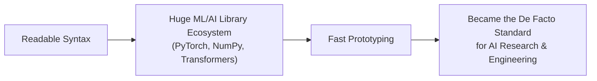

# Python Fundamentals

> Python is the closest thing AI engineering has to a universal language — most model code, tooling, and research is written in it first.

**Type:** Learn
**Languages:** Python
**Prerequisites:** Programming Fundamentals
**Time:** ~35 minutes

## Learning Objectives

- Read and understand basic Python syntax: variables, data types, if/else, and loops
- Recognize why Python is the dominant language for AI/ML engineering
- Run a simple Python script and predict its output before executing it
- Explain common Python-specific vocabulary (indentation, `None`, exceptions) engineers use daily

## The Problem

Nearly every AI model, training script, and internal tool a TPM will encounter is written in Python. When engineers say "the script threw an exception" or "check the `requirements.txt`," a TPM without basic Python literacy has to either nod along or interrupt with a question that stalls the conversation.

You don't need to be able to write production Python. You need enough fluency to read a short script, understand an error message, and follow a code review conversation without translation.

## The Concept

Python was designed to read almost like English, which is part of why it became the default language for AI/ML research and engineering.



### Core Building Blocks in Python

- **Variables**: `name = "Alice"`, `age = 30` — no need to declare a type up front.
- **Data types**: `str` (text), `int` (whole numbers), `float` (decimals), `bool` (`True`/`False`), `list` (ordered collection), `dict` (key-value pairs).
- **Indentation matters**: unlike many languages, Python uses indentation (spaces) instead of `{ }` to define which code belongs inside a loop or conditional. Wrong indentation is a real, common bug.
- **`None`**: Python's way of representing "no value" — similar to "null" in other languages. A huge share of real-world bugs are "expected a value, got `None`."
- **Exceptions**: Python's way of reporting errors while a program is running (e.g. `ZeroDivisionError`, `KeyError`). An "unhandled exception" is what crashes a script.

## Build It

A short script that touches all the fundamentals above:

```python
model_name = "gpt-tpm-demo"
max_retries = 3
temperature = 0.7
is_production = False

available_models = ["gpt-tpm-demo", "gpt-tpm-lite", "gpt-tpm-pro"]

model_costs = {
    "gpt-tpm-demo": 0.002,
    "gpt-tpm-lite": 0.001,
    "gpt-tpm-pro": 0.01,
}

def estimate_cost(model, num_tokens):
    if model not in model_costs:
        return None
    price_per_1k = model_costs[model]
    return (num_tokens / 1000) * price_per_1k

for model in available_models:
    cost = estimate_cost(model, 5000)
    if cost is None:
        print(f"{model}: unknown pricing")
    else:
        print(f"{model}: estimated cost for 5,000 tokens = ${cost:.4f}")

try:
    unknown_cost = estimate_cost("nonexistent-model", 1000)
    print(1 / len(str(unknown_cost)) if unknown_cost else 1 / 0)
except ZeroDivisionError:
    print("Caught an error: tried to divide by zero because the model was unknown.")
```

Reading it line by line: variables are set, a list and a dictionary store data, a function (`estimate_cost`) is defined and reused in a loop, and a `try/except` block catches an error instead of letting the whole script crash.

## Use It

In real AI engineering codebases, these concepts show up constantly:

- Configuration values (`temperature`, `max_retries`) are almost always plain variables at the top of a script.
- Model registries and pricing tables are almost always Python dictionaries, exactly like `model_costs` above.
- `try/except` blocks around API calls are the standard way to handle a model provider being temporarily down.

## Exercises

1. **Easy**: Predict what this prints, then explain why: `x = 5 / "text"` (hint: this raises an exception — what error class do you think it is?).
2. **Medium**: Add a new model, `"gpt-tpm-nano"`, with a price of `0.0005`, to the `model_costs` dictionary above and predict the new loop output.
3. **Hard**: Rewrite the `estimate_cost` function so that instead of returning `None` for an unknown model, it raises a custom, readable error message using `raise ValueError(...)`.

## TPM Perspective

### Strategic Executive Summary
Python fluency — even just reading comprehension — lets a TPM sit in code reviews, read a stack trace, and understand what a "quick script" actually does before it's run against production data. Since nearly all AI tooling (training, evaluation, agents, MCP servers) is Python-first, this is the highest-leverage language to be conversant in.

### Questions to Challenge Engineering
1. *"Is this configuration value (temperature, max retries, model name) hardcoded, or pulled from a config file/environment variable we can change without a redeploy?"*
2. *"When this script hits an unhandled exception, what happens to in-flight user requests — do they fail silently or loudly?"*
3. *"Is there a `try/except` around every external API call, or could one provider outage crash the whole service?"*

### Trade-Off Matrix

| Approach | Readability | Safety | Common In |
| :--- | :--- | :--- | :--- |
| **Hardcoded values in script** | High for a single script | Low — requires code changes to adjust | Prototypes, one-off experiments |
| **Config file / env variables** | Medium | High — changeable without redeploy | Production services |
| **No error handling (`try/except`)** | Simple code | Very low — one bad input crashes everything | Early prototypes only |
| **Explicit error handling** | Slightly more code | High — predictable failure behavior | Production-grade code |

## Key Terms

- **Variable**: A named value in Python, created with `name = value`, with no type declaration required.
- **Dictionary (`dict`)**: A Python data type storing key-value pairs, used constantly for configuration and lookups (e.g. model name → price).
- **Exception**: An error Python raises while running, which can be caught with `try/except` instead of crashing the whole program.
- **`None`**: Python's representation of "no value," frequently the root cause of bugs when code expects a real value.
- **Indentation**: Spacing used by Python to define which lines belong inside a loop, conditional, or function — incorrect indentation is a real syntax error.
