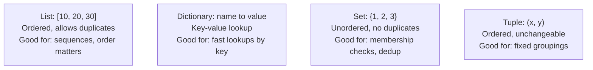

# Data Structures

> Every "slow" complaint eventually traces back to a program searching through data the wrong way.

**Type:** Learn
**Prerequisites:** Python Fundamentals
**Time:** ~20 minutes

## Learning Objectives

- Describe the four most common data structures (lists, dictionaries, sets, tuples) and what each is best for
- Explain why choosing the right data structure affects speed, not just style
- Use the vocabulary of complexity ("this is O(n)") at a conceptual level, without the math
- Formulate the right questions when engineering says a feature is "slow because of how the data is stored"

## What It Is

A **data structure** is the shape in which a program stores data. Four cover the overwhelming majority of real-world code:

- **List**: an ordered collection you can add to, remove from, and search one item at a time. Allows duplicates.
- **Dictionary**: key-value pairs, like a real dictionary (word to definition). Lookup by key is extremely fast regardless of size.
- **Set**: like a list with no duplicates and no guaranteed order. Extremely fast for "have we seen this before?"
- **Tuple**: like a list that cannot be changed once created. Used for small, fixed groupings such as coordinates or one row of data.

## Why It Matters

A feature that looks up a user's permissions takes 3 seconds with 10,000 users and 5 minutes with 10 million. Engineering explains: "we were doing a linear search through a list; we switched to a dictionary lookup and now it's instant." Without understanding lists versus dictionaries, that sentence sounds like magic instead of a well-understood trade-off.

Data structures are not academic trivia. The shape data is stored in directly determines how fast a program can find, add, or check for something, often by orders of magnitude.

## How It Works

Checking "is this item in the list?" on a list of 10 million items may require checking up to 10 million items one by one. That is called a **linear search**, or O(n): the work grows in step with the data. The same check on a dictionary or set takes roughly the same tiny amount of time whether there are 10 items or 10 million. Engineers call this a hash lookup, or O(1).

A concrete comparison: checking whether a user ID exists among 200,000 IDs. The list approach may examine all 200,000 entries; the set approach does about one step. In practice the set approach is commonly 100x or more faster, and the gap widens as data grows.

Real systems choose deliberately:

- A **list of chat messages** in order: a list, because order matters and repeats are valid.
- A **user ID to user profile** table: a dictionary, for fast retrieval by unique key.
- A **set of already-processed request IDs** (to avoid double-processing): a set, because only "have we seen this?" matters.
- One API response's **status code and latency**: a tuple, a small fixed unchanging pair.

## Architecture and Workflow



```archify
src: diagrams/core-data-structures.html
title: Core data structures: list, dictionary, set, tuple
aspect: 750/358
```

## A Real-World Example

An AI support tool must skip any ticket it has already answered. At launch there are 5,000 answered tickets and the check is instant. Eighteen months later there are 5 million, and each incoming ticket triggers a scan through a list. Response time creeps from 50 ms to 40 seconds, and the team considers buying larger servers. An engineer instead changes the "already answered" store from a list to a set. The check drops back to well under a millisecond, with no new hardware. The data did not change; only the shape it was stored in.

## What a TPM Needs to Understand

- "Slow" is rarely a mystery; it is very often a data-structure mismatch, such as searching a list where a dictionary or set would do the same job in a fraction of the time.
- Asking "are we doing a linear search here?" can surface a quick, high-impact fix without reading code.
- Growth is the key lens: an approach that is fine at 10,000 records may collapse at 10 million, so always ask what happens at 10x and 100x scale.
- Structure choice has memory costs too; speed is often bought with extra memory.

## Risks, Dependencies, and Trade-Offs

| Structure | Lookup Speed | Preserves Order | Allows Duplicates | Best For |
| :--- | :--- | :--- | :--- | :--- |
| **List** | Slow at scale (checks one by one) | Yes | Yes | Ordered sequences, small datasets |
| **Dictionary** | Very fast by key | Yes (insertion order in modern Python) | Keys: no, Values: yes | Fast lookups by a unique identifier |
| **Set** | Very fast for membership checks | No | No | Deduplication, "have we seen this" checks |
| **Tuple** | N/A (fixed, small) | Yes | Yes | Small, unchangeable groupings of values |

Failure scenarios: performance that degrades quietly as data grows (fine in test, slow in production); extra memory use from lookup structures; and a set silently dropping duplicates or order when the business logic needed them.

## Questions to Ask Engineers

1. *"Is this slowdown caused by a linear search through a list, and would switching to a dictionary or set lookup fix it?"*
2. *"Does this data need to preserve order and allow duplicates (list), or just support fast 'have we seen this' checks (set)?"*
3. *"As this dataset grows 10x or 100x, will this operation's speed stay roughly the same, or degrade proportionally?"*

## Scenario Exercise

Your document-processing pipeline must avoid reprocessing any of 5 million previously handled document IDs, and the nightly job is slowing down every week.

1. **Easy**: A shopping cart needs to allow repeated items and keep order. Which structure fits: list, dictionary, set, or tuple?
2. **Medium**: Which structure would you expect engineering to use for the 5-million-ID duplicate check, and what question confirms the current code is not scanning a list?
3. **Hard**: The team must also answer "which users have seen which announcement," quickly from both directions (by user and by announcement). Describe in plain English how you would expect them to organize the data and what trade-off (memory versus speed) you would ask about.

## Key Terms

- **List**: An ordered, changeable collection of items that may contain duplicates.
- **Dictionary**: A collection of key-value pairs enabling fast lookup by a unique key.
- **Set**: An unordered collection with no duplicate values, optimized for fast membership checks.
- **Tuple**: An ordered, unchangeable (immutable) collection, typically used for small fixed groupings.
- **Linear Search**: Checking each item in a list one at a time until a match is found (or the list ends) — slow for large lists.
