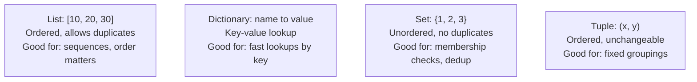

# Data Structures

> Every "slow" complaint eventually traces back to a program searching through data the wrong way.

**Type:** Learn
**Languages:** Python
**Prerequisites:** Python Fundamentals
**Time:** ~30 minutes

## Learning Objectives

- Understand the four most common data structures: lists, dictionaries, sets, and tuples
- Know why choosing the right data structure affects speed, not just style
- Recognize the vocabulary of complexity ("this is O(n)") at a conceptual level, without needing the math
- Formulate the right questions when engineering says a feature is "slow because of how the data is stored"

## The Problem

A feature that looks up a user's permissions takes 3 seconds when there are 10,000 users, and 5 minutes when there are 10 million. Engineering explains: "we were doing a linear search through a list — we switched to a dictionary lookup and now it's instant." Without understanding what a list vs. a dictionary is, that sentence sounds like magic instead of a specific, well-understood engineering trade-off.

Data structures aren't academic trivia — the *shape* data is stored in directly determines how fast a program can find, add, or check for something, often by orders of magnitude.

## The Concept

Four data structures cover the overwhelming majority of real-world code:



- **List**: an ordered collection you can add to, remove from, and search through one item at a time. Searching a list for a specific item can require checking every single element — this gets slow as the list grows.
- **Dictionary**: stores data as key-value pairs (like a real dictionary: word → definition). Looking up a value by its key is extremely fast, regardless of how many items exist.
- **Set**: like a list, but with no duplicates and no guaranteed order. Extremely fast for answering "have we seen this before?"
- **Tuple**: like a list, but once created it cannot be changed — useful for representing a fixed, small group of related values (like coordinates, or a single row of data).

### Why This Matters for Speed

Checking "is this item in the list?" on a list of 10 million items may require checking up to 10 million items one by one. The same check on a dictionary or set takes roughly the same tiny amount of time whether there are 10 items or 10 million — this is the difference engineers mean when they say "we switched to a hash map/dictionary lookup."

## Build It

The same "does this user exist?" check, implemented two ways:

```python
import time

users_list = [f"user_{i}" for i in range(200_000)]
users_set = set(users_list)

target = "user_199999"

start = time.perf_counter()
found_in_list = target in users_list
list_time = time.perf_counter() - start

start = time.perf_counter()
found_in_set = target in users_set
set_time = time.perf_counter() - start

print(f"List search found={found_in_list} in {list_time * 1000:.4f} ms")
print(f"Set search  found={found_in_set} in {set_time * 1000:.4f} ms")
print(f"Set lookup was roughly {list_time / set_time:.0f}x faster")
```

On most machines, the set lookup is dramatically faster — often 100x or more — because it doesn't need to check every item one by one.

## Use It

Real systems choose data structures deliberately:

- A **list of chat messages** in order → a `list`, because order matters and duplicates (repeated messages) are valid.
- A **user ID → user profile** lookup table → a `dictionary`, because you need fast retrieval by a unique key.
- A **set of already-processed request IDs** (to avoid double-processing) → a `set`, because you only care "have we seen this ID," not order or count.
- A **single API response's status code and latency** → a `tuple`, because it's a small, fixed, unchanging pair of values.

## Exercises

1. **Easy**: You need to store a shopping cart where items can repeat (2x the same item) and order matters. Which data structure fits best — list, dictionary, set, or tuple?
2. **Medium**: You need to quickly check whether an email address has already signed up, out of 5 million existing emails. Which data structure minimizes lookup time, and why?
3. **Hard**: Design (in plain English, no code required) a data structure combination to track "which users have already seen which announcement," optimizing for fast lookups in both directions (by user, and by announcement).

## TPM Perspective

### Strategic Executive Summary
"Slow" is rarely a mysterious problem — it is very often a data structure mismatch: searching a list when a dictionary or set would do the same job in a fraction of the time. A TPM who can ask "are we doing a linear search here?" can often identify a quick, high-impact performance fix without needing to read the code itself.

### Questions to Challenge Engineering
1. *"Is this slowdown caused by a linear search through a list, and would switching to a dictionary or set lookup fix it?"*
2. *"Does this data need to preserve order and allow duplicates (list), or just support fast 'have we seen this' checks (set)?"*
3. *"As this dataset grows 10x or 100x, will this operation's speed stay roughly the same, or degrade proportionally?"*

### Trade-Off Matrix

| Structure | Lookup Speed | Preserves Order | Allows Duplicates | Best For |
| :--- | :--- | :--- | :--- | :--- |
| **List** | Slow at scale (checks one by one) | Yes | Yes | Ordered sequences, small datasets |
| **Dictionary** | Very fast by key | Yes (insertion order, Python 3.7+) | Keys: no, Values: yes | Fast lookups by a unique identifier |
| **Set** | Very fast for membership checks | No | No | Deduplication, "have we seen this" checks |
| **Tuple** | N/A (fixed, small) | Yes | Yes | Small, unchangeable groupings of values |

## Key Terms

- **List**: An ordered, changeable collection of items that may contain duplicates.
- **Dictionary**: A collection of key-value pairs enabling fast lookup by a unique key.
- **Set**: An unordered collection with no duplicate values, optimized for fast membership checks.
- **Tuple**: An ordered, unchangeable (immutable) collection, typically used for small fixed groupings.
- **Linear Search**: Checking each item in a list one at a time until a match is found (or the list ends) — slow for large lists.
