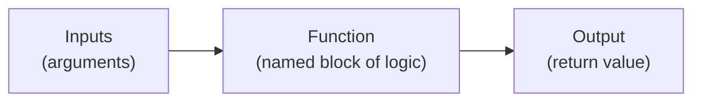

# Functions and Modules

> "Don't repeat yourself" isn't a style preference — it's how large AI codebases stay fixable at all.

**Type:** Learn
**Prerequisites:** Data Structures
**Time:** ~20 minutes

## Learning Objectives

- Explain what a function is and why breaking code into functions makes it reusable and testable
- Explain what a module, package, and library are, and why AI engineering relies heavily on reusing them
- Distinguish writing custom code from using an existing library like PyTorch or an LLM provider's SDK
- Formulate the right questions when engineering debates "build vs. use an existing library"

## What It Is

A **function** is a named, reusable block of instructions that takes inputs and usually produces an output, like a small machine you can call repeatedly instead of rewriting the same steps.

A **module** is a file of related functions grouped together. A **package** or **library** is a collection of modules, often published so other teams can install and reuse it. Engineers "import" a library to bring its capabilities into their project: a single line can pull in already-written, already-tested code for running a neural network or calling an LLM API.

## Why It Matters

An engineer says "we shouldn't write our own retry logic, let's just use the `tenacity` library." Without knowing what a library or import is, a TPM cannot evaluate whether this is a reasonable shortcut or a risky external dependency. The decision to reuse code someone else wrote or build your own comes up dozens of times in every AI project, with real cost, risk, and speed trade-offs.

## How It Works

Why functions matter beyond convenience:

- **Reusability**: write the logic once, call it from many places.
- **Testability**: a function with clear inputs and outputs can be tested in isolation without running the whole program.
- **Readability**: a well-named function such as `estimate_cost` documents intent better than a wall of raw logic.

A typical example: a function that retries a flaky API call up to a maximum number of attempts. Its input is the action to try and the maximum attempts; its output is the result or "nothing" if every attempt failed. A second pair of functions estimates cost from token counts and formats it as a dollar amount. If those three functions live in their own file, that file is a module, and other scripts reuse it rather than copying the logic.

Nearly every AI codebase is a mix of:

1. **Custom functions and modules** written for this project's specific needs.
2. **Imported libraries** (PyTorch, Transformers, LangChain, the OpenAI and Anthropic SDKs) that solve well-understood problems.

The engineering judgment call is almost always: is this a well-solved, generic problem (use a library) or a project-specific need (write a custom function)?

## Architecture and Workflow



```archify
src: diagrams/function-flow.html
title: Anatomy of a function: inputs, function, output
aspect: 810/192
```

## A Real-World Example

A team copies its cost-estimation logic into 7 different services. Finance changes the price from $0.002 to $0.003 per 1,000 tokens. Five services get updated; two are missed, so dashboards show costs that disagree by 33 percent and a quarterly forecast is off by roughly $40,000. The fix: one shared cost function in a shared module that all 7 services use, so one change updates everywhere. Contrast with the retry case: the team could write retry logic in a day, but an established library already handles randomized waiting, maximum delays, and edge cases that took years to discover. Using it saves a week and removes a class of bugs, at the price of depending on an outside maintainer.

## What a TPM Needs to Understand

- "Build vs. buy" happens at the code level constantly, as "write a custom function vs. import a library."
- A well-maintained library for a solved problem (retries, HTTP requests, tokenization) reduces risk and speeds delivery.
- Custom code makes sense when the logic is specific to the product, or when a dependency introduces unacceptable risk (security, licensing, maintenance burden).
- Duplicated logic is a hidden risk: bugs and changes must be applied everywhere it was copied.
- Every library is a dependency: someone else's release schedule, vulnerabilities, and abandonment risk become yours.

## Risks, Dependencies, and Trade-Offs

| Approach | Speed to Build | Maintenance Burden | Risk |
| :--- | :--- | :--- | :--- |
| **Write custom function** | Slower initially | Owned entirely by your team | Full control, but full responsibility for bugs |
| **Import established library** | Fast | Low, if well-maintained | Dependent on library's maintainers and update cadence |
| **Copy-paste logic in multiple places** | Fastest short-term | High — bugs must be fixed everywhere it was copied | High — inconsistent behavior across the codebase |

Failure scenarios: a library update changes behavior and breaks the product; a library is abandoned or has a security vulnerability; a license is incompatible with commercial use.

## Questions to Ask Engineers

1. *"Is this a well-solved, generic problem that an established library already handles well, or is it specific enough to our product that custom code is warranted?"*
2. *"If we depend on this library, who maintains it, how actively, and what happens if it stops being updated?"*
3. *"Is this logic currently duplicated in multiple places in the codebase, and would turning it into a shared function or module reduce the risk of inconsistent behavior?"*

## Scenario Exercise

Your team is about to add a third-party library for PDF text extraction, and another engineer proposes writing it in-house.

1. **Easy**: What is the difference between a function and a library?
2. **Medium**: Which three questions would you ask about the library's maintenance and licensing before approving it?
3. **Hard**: Describe one situation in this project where custom code is clearly the better choice and one where the library wins, and how you would document the decision so it can be revisited if the library is abandoned.

## Key Terms

- **Function**: A named, reusable block of code that takes inputs (arguments) and typically returns an output.
- **Module**: A single file containing related functions, classes, or variables that can be imported elsewhere.
- **Package / Library**: A collection of modules, often published externally, that can be installed and reused (e.g. PyTorch, the OpenAI SDK).
- **Import**: The statement that brings a module's or library's functionality into your current script.
- **Argument / Return Value**: The input(s) a function receives, and the output value it produces.
