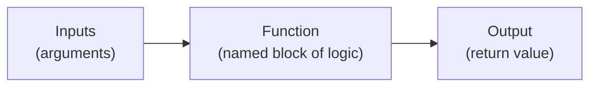

# Functions and Modules

> "Don't repeat yourself" isn't a style preference — it's how large AI codebases stay fixable at all.

**Type:** Learn
**Languages:** Python
**Prerequisites:** Data Structures
**Time:** ~25 minutes

## Learning Objectives

- Understand what a function is and why breaking code into functions makes it reusable and testable
- Understand what a module (and a package/library) is, and why AI engineering relies heavily on importing them
- Recognize the difference between writing code from scratch and using an existing library like PyTorch or the OpenAI SDK
- Formulate the right questions when engineering debates "build vs. use an existing library"

## The Problem

An engineer says "we shouldn't write our own retry logic — let's just import `tenacity`." Without knowing what an "import" or a "library" is, a TPM can't evaluate whether this is a reasonable shortcut or a risky external dependency. This decision — reuse a function/module someone else wrote, or build your own — happens dozens of times in every AI project, and it has real cost, risk, and speed trade-offs.

## The Concept

A **function** is a named, reusable block of instructions that takes inputs and (usually) produces an output — like a small machine you can call repeatedly instead of rewriting the same steps every time.



A **module** is simply a file containing related functions (and other code) grouped together. A **package** or **library** is a collection of modules, often published so other people can install and reuse it instead of writing it themselves.

This is why nearly every AI script starts with lines like:

```python
import torch
from openai import OpenAI
import numpy as np
```

Each of those lines pulls in someone else's already-written, already-tested code — massive amounts of functionality (like running a neural network, or calling an LLM API) in a single line.

### Why Functions Matter Beyond Convenience

- **Reusability**: write the logic once, call it from many places.
- **Testability**: a function with clear inputs and outputs can be tested in isolation, without running the whole program.
- **Readability**: a well-named function (`estimate_cost(...)`) documents intent better than a wall of raw logic.

## Build It

Turning repeated logic into a reusable function, then organizing related functions into a "module":

```python
def call_with_retries(action, max_attempts=3):
    attempts = 0
    while attempts < max_attempts:
        result = action()
        if result is not None:
            return result
        attempts += 1
    return None

def fake_flaky_api_call():
    import random
    return "success" if random.random() > 0.6 else None

result = call_with_retries(fake_flaky_api_call, max_attempts=5)
print(f"Final result after retries: {result}")


def estimate_cost(num_tokens, price_per_1k=0.002):
    return (num_tokens / 1000) * price_per_1k

def format_cost(cost):
    return f"${cost:.4f}"

tokens_used = 12_500
cost = estimate_cost(tokens_used)
print(f"Estimated cost for {tokens_used} tokens: {format_cost(cost)}")
```

If `call_with_retries`, `estimate_cost`, and `format_cost` lived in their own file (e.g. `ai_helpers.py`), that file would be a **module** — and other scripts could reuse it with `from ai_helpers import estimate_cost`.

## Use It

Nearly every AI engineering codebase is a mix of:

1. **Custom functions/modules** written specifically for this project's needs.
2. **Imported libraries** (PyTorch, Transformers, LangChain, the OpenAI/Anthropic SDKs) that handle complex, well-solved problems so the team doesn't reinvent them.

The engineering judgment call is almost always: *"Is this a well-solved, generic problem (use a library) or a project-specific need (write a custom function)?"*

## Exercises

1. **Easy**: Identify which part of `call_with_retries(action, max_attempts=3)` is the input (argument) and which part represents the output (return value).
2. **Medium**: Write (in pseudocode or Python) a function called `is_within_budget(cost, budget)` that returns `True` or `False`.
3. **Hard**: Describe a scenario where writing a custom function is clearly better than importing an existing library, and one where the opposite is true — justify each choice.

## TPM Perspective

### Strategic Executive Summary
"Build vs. buy" happens at the code level constantly, in the form of "write a custom function vs. import an existing library." Using a well-maintained library for a solved problem (retries, HTTP requests, tokenization) reduces risk and speeds delivery. Writing custom code makes sense when the logic is specific to the product's needs or when a dependency would introduce unacceptable risk (security, licensing, maintenance burden).

### Questions to Challenge Engineering
1. *"Is this a well-solved, generic problem that an established library already handles well, or is it specific enough to our product that custom code is warranted?"*
2. *"If we depend on this library, who maintains it, how actively, and what happens if it stops being updated?"*
3. *"Is this logic currently duplicated in multiple places in the codebase, and would turning it into a shared function/module reduce the risk of inconsistent behavior?"*

### Trade-Off Matrix

| Approach | Speed to Build | Maintenance Burden | Risk |
| :--- | :--- | :--- | :--- |
| **Write custom function** | Slower initially | Owned entirely by your team | Full control, but full responsibility for bugs |
| **Import established library** | Fast | Low, if well-maintained | Dependent on library's maintainers and update cadence |
| **Copy-paste logic in multiple places** | Fastest short-term | High — bugs must be fixed everywhere it was copied | High — inconsistent behavior across the codebase |

## Key Terms

- **Function**: A named, reusable block of code that takes inputs (arguments) and typically returns an output.
- **Module**: A single file containing related functions, classes, or variables that can be imported elsewhere.
- **Package / Library**: A collection of modules, often published externally, that can be installed and reused (e.g. PyTorch, the OpenAI SDK).
- **Import**: The statement that brings a module's or library's functionality into your current script.
- **Argument / Return Value**: The input(s) a function receives, and the output value it produces.
