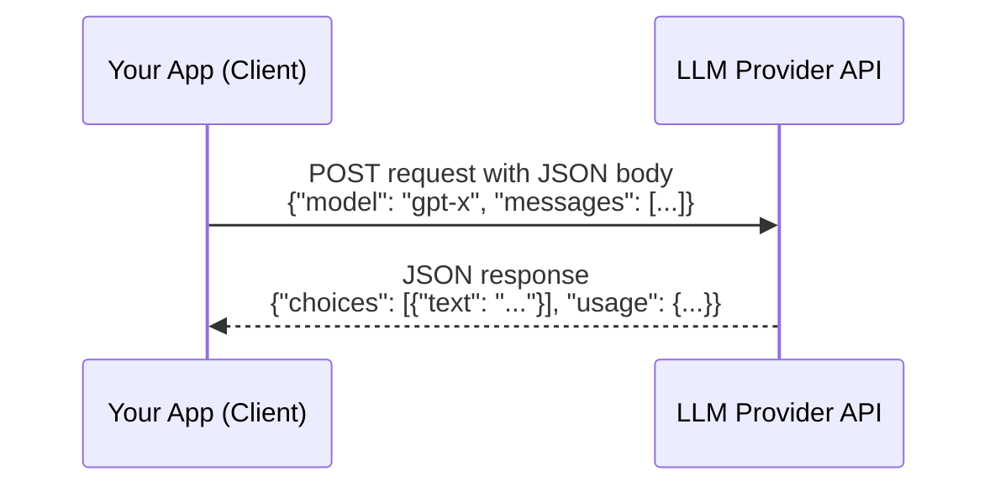

# APIs and JSON

> Almost every AI feature is, mechanically, just sending JSON to a URL and getting JSON back.

**Type:** Learn
**Languages:** Python, JSON
**Prerequisites:** Functions and Modules
**Time:** ~30 minutes

## Learning Objectives

- Understand what an API request actually is: a structured message sent to a server, and a structured response sent back
- Read and understand JSON, the format almost all modern APIs use to exchange data
- Recognize common HTTP methods (GET, POST) and status codes (200, 404, 429, 500)
- Formulate the right questions when engineering discusses an "API contract" or "schema"

## The Problem

A PM asks "why can't we just add a new field to the response?" and an engineer says "that would break the API contract for existing clients." Without knowing what an API contract or a JSON schema is, this sounds like engineering being overly cautious. In reality, it's a precise technical concern: other systems (including your own frontend, or a partner's integration) may depend on the exact shape of that response, and changing it can silently break them.

## The Concept

An **API (Application Programming Interface)** is a defined way for one piece of software to ask another for something and get a structured answer back — think of it as a very formal, precisely worded conversation between two programs.



Most modern APIs exchange data as **JSON (JavaScript Object Notation)** — a lightweight, human-readable text format that looks almost exactly like Python dictionaries and lists:

```json
{
  "model": "gpt-tpm-demo",
  "messages": [
    { "role": "user", "content": "Summarize this document." }
  ],
  "temperature": 0.7
}
```

### HTTP Methods and Status Codes

- **GET**: "give me data" (e.g. fetch a user's profile) — doesn't change anything on the server.
- **POST**: "here's data, do something with it" (e.g. send a prompt to an LLM, create a new record).
- **200 OK**: the request succeeded.
- **404 Not Found**: the requested resource doesn't exist.
- **429 Too Many Requests**: you hit a rate limit (covered in the Level 0 lesson on APIs and rate limits).
- **500 Internal Server Error**: something broke on the server's side, not the client's.

## Build It

A real (simplified) request/response pair, shown as Python dictionaries that map directly to JSON:

```python
import json

request_body = {
    "model": "gpt-tpm-demo",
    "messages": [
        {"role": "user", "content": "What is 2 + 2?"}
    ],
    "temperature": 0,
}

print("Request JSON sent to the API:")
print(json.dumps(request_body, indent=2))

def fake_api_call(body):
    return {
        "id": "chatcmpl-abc123",
        "choices": [
            {"message": {"role": "assistant", "content": "2 + 2 is 4."}}
        ],
        "usage": {"prompt_tokens": 12, "completion_tokens": 6, "total_tokens": 18},
    }

response_body = fake_api_call(request_body)
print("\nResponse JSON received from the API:")
print(json.dumps(response_body, indent=2))

answer = response_body["choices"][0]["message"]["content"]
tokens_used = response_body["usage"]["total_tokens"]
print(f"\nExtracted answer: {answer}")
print(f"Tokens used: {tokens_used}")
```

Notice how the response is navigated: `response_body["choices"][0]["message"]["content"]` — this is exactly the kind of "path into the JSON" that breaks if the API's response shape changes.

## Use It

This exact request/response pattern — JSON in, JSON out — is how virtually every AI product feature works under the hood:

- Calling an LLM provider (OpenAI, Anthropic, etc.) to get a completion.
- Calling an internal microservice to fetch a user's data before building a prompt.
- A frontend calling your own backend to display AI-generated results to a user.

## Exercises

1. **Easy**: In the JSON response above, what field would you check to know how many tokens the request used?
2. **Medium**: Write the JSON (or a Python dictionary) you'd expect to send for a POST request that asks an image-generation API for one image of "a red bicycle."
3. **Hard**: Explain why changing `response_body["choices"][0]["message"]["content"]` to `response_body["choices"][0]["text"]` on the provider's side (without warning) would break existing client code, and propose one way providers avoid this ("versioning" an API).

## TPM Perspective

### Strategic Executive Summary
Every AI feature roadmap decision eventually comes down to "what does the API send, and what does it get back?" Reading JSON and understanding HTTP status codes lets a TPM read actual request/response logs during an incident, instead of waiting for an engineer to translate. "API contract" and "schema" are not abstract terms — they are the literal, exact shape of the JSON both sides have agreed to send and expect.

### Questions to Challenge Engineering
1. *"If we change this API response's JSON shape, which existing clients (internal or external) would break, and do we need to version the API instead of changing it in place?"*
2. *"When this feature failed, what HTTP status code did we get back — was it a 429 (rate limit), a 500 (server error), or something else entirely?"*
3. *"Is this a GET (read-only, safe to retry) or a POST (may have side effects, retrying could duplicate an action)?"*

### Trade-Off Matrix

| Change Type | Risk to Existing Clients | Common Mitigation |
| :--- | :--- | :--- |
| **Adding a new optional field** | Low — old clients usually ignore unknown fields | Document the addition, no version bump needed |
| **Removing or renaming a field** | High — breaks any client reading that field | Requires a new API version, deprecation notice |
| **Changing a field's data type** | High — silent parsing failures | Requires a new API version, strong testing |
| **Changing error/status code behavior** | Medium — breaks retry/error-handling logic | Communicate clearly, monitor client error rates after release |

## Key Terms

- **API (Application Programming Interface)**: A defined way for one program to request data or actions from another and receive a structured response.
- **JSON**: A lightweight, human-readable text format for exchanging structured data, used by most modern APIs.
- **HTTP Method**: The type of request being made — most commonly `GET` (read) or `POST` (write/submit).
- **Status Code**: A three-digit code in an API response indicating success (`200`), client error (`404`), rate limiting (`429`), or server error (`500`).
- **API Contract / Schema**: The agreed-upon exact shape (fields, types, structure) of requests and responses that clients rely on.
