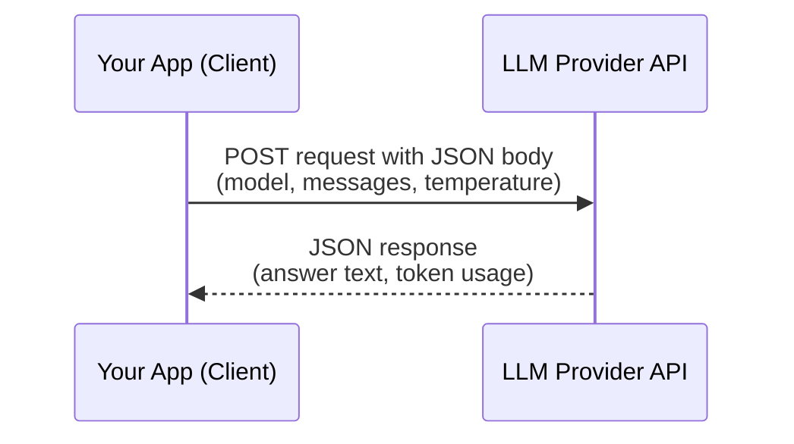

# APIs and JSON

> Almost every AI feature is, mechanically, just sending structured data to a URL and getting structured data back.

**Type:** Learn
**Prerequisites:** Functions and Modules
**Time:** ~25 minutes

## Learning Objectives

- Explain what an API request actually is: a structured message sent to a server, and a structured response sent back
- Read a JSON payload and describe in plain English what it is asking for or returning
- Recognize common HTTP methods (GET, POST) and status codes (200, 404, 429, 500)
- Ask the right questions when engineering discusses an "API contract" or "schema"

## What It Is

An **API (Application Programming Interface)** is a defined way for one piece of software to ask another for something and get a structured answer back. Think of it as a very formal, precisely worded conversation between two programs.

**JSON (JavaScript Object Notation)** is the text format most APIs use for that conversation. It is just labeled values: a field name on the left, a value on the right, with lists and nested groups where needed. A request to an LLM provider, described in plain English, contains:

| Field | What it says | Example value |
| :--- | :--- | :--- |
| **model** | Which model should answer | A named model version |
| **messages** | The conversation so far, each tagged with who said it (user or assistant) | "Summarize this document." |
| **temperature** | How much randomness is allowed in the answer | A low number for predictable output |

The response is the same idea in reverse: an ID for the call, the generated answer, and a **usage** block reporting how many input and output tokens were consumed.

## Why It Matters

A PM asks "why can't we just add a new field to the response?" and an engineer says "that would break the API contract for existing clients." Without knowing what an API contract is, this sounds like engineering being overly cautious. In reality, it is a precise technical concern: other systems (your own frontend, a partner's integration) may depend on the exact shape of that response, and changing it can silently break them.

Every AI feature roadmap decision eventually comes down to "what does the API send, and what does it get back?"

## How It Works

1. **The client builds a request.** It picks a method (GET to read, POST to submit), a URL, and a JSON body.
2. **The server processes it.** For an LLM provider this means running the model; for an internal service it might mean a database lookup.
3. **The server replies with a status code and a JSON body.** The status code says whether it worked; the body carries the data or the error details.
4. **The client reads specific fields from the reply.** It expects the answer text and the token count to be in particular places. This is the fragile part: if a provider renames or moves a field, the client's lookup finds nothing.

### HTTP Methods and Status Codes

- **GET**: "give me data" (e.g. fetch a user's profile). Does not change anything on the server.
- **POST**: "here's data, do something with it" (e.g. send a prompt to an LLM, create a record).
- **200 OK**: the request succeeded.
- **404 Not Found**: the requested resource doesn't exist.
- **429 Too Many Requests**: you hit a rate limit (see the Level 0 lesson on APIs and rate limits).
- **500 Internal Server Error**: something broke on the server's side, not the client's.

## Architecture and Workflow



```archify
src: diagrams/llm-api-request.html
title: API request and JSON response between client and LLM provider
aspect: 800/480
```

## A Real-World Example

A support-assistant feature sends a customer's question to an LLM provider. The request names the model, includes the question, and sets temperature low so answers stay consistent. The reply contains the generated answer plus a usage block showing, say, 12 input tokens and 6 output tokens. The app displays the answer and records the 18 total tokens against that customer for cost tracking.

Now suppose the provider moves the answer text from one field to another without warning. The app still gets a successful 200 response, but its lookup for the answer now finds nothing, so customers see blank replies and no error is logged. That is what "breaking the API contract" looks like in production.

The same request/response pattern shows up when:

- Calling an LLM provider (OpenAI, Anthropic, etc.) to get a completion.
- Calling an internal microservice to fetch a user's data before building a prompt.
- A frontend calling your own backend to display AI-generated results.

## What a TPM Needs to Understand

- An **API contract** or **schema** is not an abstract term. It is the literal, exact shape of the data both sides agreed to send and expect.
- You can read an incident log yourself once you know what a request, a response, and a status code look like. You no longer have to wait for an engineer to translate.
- Whether a call is a GET (read-only, safe to retry) or a POST (may have side effects, retrying could duplicate an action) changes how failures should be handled.
- The usage block in every LLM response is where cost data comes from.

## Risks, Dependencies, and Trade-Offs

| Change Type | Risk to Existing Clients | Common Mitigation |
| :--- | :--- | :--- |
| **Adding a new optional field** | Low — old clients usually ignore unknown fields | Document the addition, no version bump needed |
| **Removing or renaming a field** | High — breaks any client reading that field | Requires a new API version, deprecation notice |
| **Changing a field's data type** | High — silent parsing failures | Requires a new API version, strong testing |
| **Changing error/status code behavior** | Medium — breaks retry/error-handling logic | Communicate clearly, monitor client error rates after release |

Dependency to track: every external provider's response format is a dependency you do not control. Providers avoid breaking customers by **versioning** the API, so old clients keep working on the old version while new ones adopt the new one.

## Questions to Ask Engineers

1. *"If we change this API response's shape, which existing clients (internal or external) would break, and do we need to version the API instead of changing it in place?"*
2. *"When this feature failed, what status code did we get back: a 429 (rate limit), a 500 (server error), or something else?"*
3. *"Is this call a GET (read-only, safe to retry) or a POST (may have side effects, retrying could duplicate an action)?"*

## Scenario Exercise

Your team's AI feature suddenly shows blank answers to users, but monitoring shows every call to the provider returning 200 OK.

1. **Easy**: Which part of the response would you ask engineering to check to learn how many tokens a request used?
2. **Medium**: A partner team wants to add a new optional field to your API response. Is this high or low risk to existing clients, and what do you ask before approving?
3. **Hard**: Explain why a provider renaming a response field without warning would produce blank answers instead of an error, and propose one way providers avoid this problem.

## Key Terms

- **API (Application Programming Interface)**: A defined way for one program to request data or actions from another and receive a structured response.
- **JSON**: A lightweight, human-readable text format for exchanging structured data, used by most modern APIs.
- **HTTP Method**: The type of request being made, most commonly `GET` (read) or `POST` (write/submit).
- **Status Code**: A three-digit code in an API response indicating success (`200`), client error (`404`), rate limiting (`429`), or server error (`500`).
- **API Contract / Schema**: The agreed-upon exact shape (fields, types, structure) of requests and responses that clients rely on.
