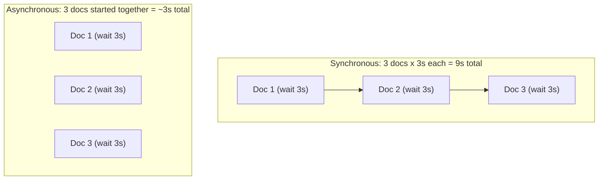

# Async Programming

> LLM API calls take seconds, not milliseconds — a system that waits for one at a time will never feel fast.

**Type:** Learn
**Prerequisites:** APIs and JSON
**Time:** ~20 minutes

## Learning Objectives

- Explain the difference between synchronous ("wait, then continue") and asynchronous ("start many things, handle them as they finish") execution
- Explain why AI applications rely heavily on async design, given slow LLM API response times
- Use basic concurrency vocabulary: blocking, non-blocking, concurrency versus parallelism
- Formulate the right questions when engineering says a feature is "blocking" or needs to be "made async"

## What It Is

**Synchronous** execution does one thing at a time, waiting for each to finish before starting the next, like a single checkout line where every customer must finish before the next begins.

**Asynchronous** execution starts a task (such as an API call), moves on to start other tasks while waiting, and handles each result as it arrives, like a barista starting several drinks at once and serving whichever is ready first.

- **Blocking**: a task that halts everything else until it finishes.
- **Non-blocking**: a task that is started and "let go of" so other work proceeds meanwhile.
- **Concurrency**: managing multiple tasks in progress at overlapping times. One worker can juggle many waiting tasks.
- **Parallelism**: literally running multiple tasks at the same instant, which needs multiple CPU cores.

Async for API calls is almost always about concurrency (efficiently juggling many "waiting on a response" tasks), not parallelism.

## Why It Matters

A feature summarizes 50 documents by calling an LLM API once per document. Done one at a time at 3 seconds each, it takes 150 seconds. Done asynchronously, with many calls in flight and responses handled as they arrive, it can finish in under 10 seconds.

A TPM who misses this distinction might read "150 seconds" as a data problem when it is a concurrency design problem with a well-known, standard fix.

## How It Works

The time spent in an LLM call is almost entirely waiting for the provider, not computing locally. A synchronous design wastes that waiting time; an asynchronous design overlaps it.

- **Synchronous**: total time is the sum of all waits. Three documents at 3 seconds each takes 9 seconds.
- **Asynchronous**: total time is close to the longest single wait. The same three documents take about 3 seconds.

Async is not free. Firing everything at once hits provider rate limits abruptly (see the APIs, Tokens, and Rate Limits lesson), so mature systems use **async with a concurrency limit**: for example at most 10 calls in flight at a time, with backoff on 429 errors.

Where AI systems use it:

- **Batch summarization or classification**: many LLM calls concurrently instead of sequentially.
- **Chat applications**: many users' conversations at once, so one slow response does not block everyone.
- **RAG pipelines**: querying the vector database and calling an LLM concurrently when the steps do not depend on each other.

## Architecture and Workflow



```archify
src: diagrams/sync-vs-async.html
title: Synchronous vs asynchronous processing of three documents
aspect: 760/388
```

## A Real-World Example

A legal-tech team summarizes 20 contracts per request at 3 seconds per call. Synchronous: 60 seconds, and users abandon the page. Fully async: about 3 to 4 seconds. But the provider allows 10 requests per second, and during a demo with 15 simultaneous users, 300 calls fire at once, producing a wall of 429 errors and blank summaries. The team adds a concurrency limit of 10 in flight with retry-after-delay. Total time rises to roughly 6 seconds per request, with no failures. The lesson: speed came from overlapping waits, reliability came from limiting how many.

## What a TPM Needs to Understand

- For any AI feature that makes external API calls, sync versus async is often the single biggest lever on perceived speed, sometimes 10x or more, without more powerful hardware.
- Async interacts directly with rate limits: more concurrency reaches RPM/TPM ceilings sooner.
- Async only helps when the bottleneck is waiting. If the real bottleneck is a single shared resource that cannot be parallelized, it will not help.
- Async code is harder to reason about and debug (ordering, partial failures, timeouts), so complexity is a real cost.

## Risks, Dependencies, and Trade-Offs

| Approach | Total Time for 20 Slow API Calls | Complexity | Risk |
| :--- | :--- | :--- | :--- |
| **Fully synchronous (one at a time)** | Slowest (sum of all delays) | Low | Safe, but poor user experience for slow batches |
| **Fully async (all at once)** | Fastest (close to a single delay) | Medium — requires async-aware code | Can hit rate limits abruptly if not throttled |
| **Async with a concurrency limit** | Fast, but controlled | Medium-High | Best balance — speed without instantly hitting limits |

Failure scenarios: a burst of calls triggers rate limiting; one slow or failed call among many needs a timeout so it does not stall the whole batch; partial results need a decision (return what we have, or fail entirely).

## Questions to Ask Engineers

1. *"Is this slow feature making API calls one at a time (synchronous), and if so, is there a reason it can't be made concurrent?"*
2. *"If we make this fully async, will we hit our rate limits faster, and do we have backoff and retry logic ready for that?"*
3. *"Is the bottleneck actually waiting time (a good fit for async), or something else like a single shared resource that can't be parallelized?"*

## Scenario Exercise

A report-generation feature calls an LLM 40 times per report and takes about 2 minutes. Customers complain.

1. **Easy**: In plain English, explain "blocking" versus "non-blocking" using an everyday analogy of your own.
2. **Medium**: If each call takes 3 seconds and the calls are independent, roughly how long should the report take with unrestricted async calls, and what new risk appears?
3. **Hard**: Describe a case where making the feature "more async" would not help (for example all calls hitting the same rate limit at once, or a final step that needs all results), and what you would propose instead.

## Key Terms

- **Synchronous**: Execution that handles one step at a time, waiting for each to complete before starting the next.
- **Asynchronous**: Execution that can start a task, move on to other work, and handle results as they complete, rather than waiting idly.
- **Blocking**: A task that halts all other progress until it finishes.
- **Concurrency**: Managing multiple in-progress tasks over overlapping time periods (does not require multiple CPU cores).
- **Parallelism**: Executing multiple tasks at the exact same instant, requiring multiple CPU cores.
