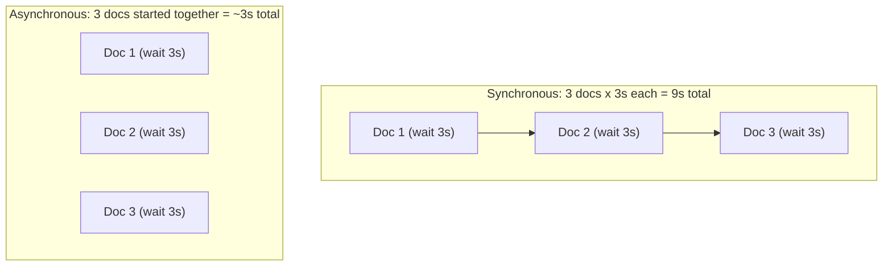

# Async Programming

> LLM API calls take seconds, not milliseconds — a system that waits for one at a time will never feel fast.

**Type:** Learn
**Languages:** Python
**Prerequisites:** APIs and JSON
**Time:** ~30 minutes

## Learning Objectives

- Understand the difference between synchronous ("wait, then continue") and asynchronous ("start many things, handle them as they finish") execution
- Recognize why AI applications rely heavily on async programming, given slow LLM API response times
- Understand basic concurrency vocabulary: blocking, non-blocking, concurrency vs. parallelism
- Formulate the right questions when engineering says a feature is "blocking" or needs to be "made async"

## The Problem

A product feature summarizes 50 documents by calling an LLM API once per document. Done the naive way (one at a time, waiting for each to finish before starting the next), if each call takes 3 seconds, the whole feature takes 150 seconds. Done asynchronously (starting many calls at once and handling responses as they arrive), the same feature might finish in under 10 seconds.

A TPM who doesn't understand this distinction might think "150 seconds sounds like a data problem" when it's actually a concurrency design problem with a well-known, standard fix.

## The Concept

**Synchronous** code runs one instruction at a time, waiting for each to fully finish before starting the next — like standing in a single checkout line where every customer must finish before the next one starts.

**Asynchronous** code can start a task (like an API call), move on to start other tasks while waiting, and come back to handle each one as it completes — like a barista starting several drinks at once and finishing whichever is ready first.



### Blocking vs. Non-Blocking

- **Blocking**: a task that halts everything else until it finishes (e.g. waiting for a slow API response with nothing else happening).
- **Non-blocking**: a task that can be started and then "let go of," so other work can proceed while it's in progress.

### Concurrency vs. Parallelism (a common mix-up)

- **Concurrency**: managing multiple tasks that are in progress at overlapping times (doesn't require multiple CPUs — one worker can juggle many waiting tasks).
- **Parallelism**: literally running multiple tasks at the exact same instant, which does require multiple CPU cores.

Async programming for API calls is almost always about **concurrency** (juggling many "waiting on a response" tasks efficiently), not parallelism.

## Build It

The same "summarize 3 documents" task, written synchronously and asynchronously, to show the structural difference:

```python
import asyncio
import time

async def fake_llm_call(doc_id, delay=1.5):
    print(f"Started summarizing document {doc_id}")
    await asyncio.sleep(delay)
    print(f"Finished summarizing document {doc_id}")
    return f"Summary of document {doc_id}"

async def synchronous_style():
    start = time.perf_counter()
    results = []
    for doc_id in range(1, 4):
        result = await fake_llm_call(doc_id)
        results.append(result)
    print(f"Synchronous-style total time: {time.perf_counter() - start:.2f}s\n")
    return results

async def asynchronous_style():
    start = time.perf_counter()
    tasks = [fake_llm_call(doc_id) for doc_id in range(1, 4)]
    results = await asyncio.gather(*tasks)
    print(f"Asynchronous total time: {time.perf_counter() - start:.2f}s\n")
    return results

asyncio.run(synchronous_style())
asyncio.run(asynchronous_style())
```

The synchronous-style version takes roughly 4.5 seconds (1.5s x 3, one after another). The asynchronous version takes roughly 1.5 seconds total, because all three "waits" happen at the same time.

## Use It

Real AI systems use async programming for exactly this reason:

- **Batch summarization/classification**: processing many documents by firing off many LLM calls concurrently instead of one at a time.
- **Chat applications**: handling many users' concurrent conversations without one slow response blocking everyone else.
- **RAG pipelines**: fetching from a vector database and calling an LLM API concurrently instead of sequentially when they don't depend on each other.

## Exercises

1. **Easy**: In plain English, explain the difference between "blocking" and "non-blocking" using a real-life analogy other than the barista example above.
2. **Medium**: If summarizing 20 documents synchronously takes 60 seconds (3 seconds each), roughly how long would you expect it to take if fully parallelized with async calls, assuming no other bottlenecks?
3. **Hard**: Describe a scenario where making a feature "more async" would *not* help — i.e., where the bottleneck isn't waiting time but something else (hint: think about what happens if all 20 async calls hit the same rate limit at once).

## TPM Perspective

### Strategic Executive Summary
For any AI feature that makes external API calls, "synchronous vs. asynchronous" is often the single biggest lever on perceived speed — sometimes a 10x or greater difference — without needing more powerful hardware. But async isn't free: it interacts directly with rate limits (Level 0), since firing off many requests at once can hit RPM/TPM ceilings faster than a slow, sequential approach would.

### Questions to Challenge Engineering
1. *"Is this slow feature making API calls one at a time (synchronous), and if so, is there a reason it can't be made concurrent?"*
2. *"If we make this fully async, will we hit our rate limits faster — and do we have backoff/retry logic ready for that?"*
3. *"Is the bottleneck actually waiting time (a good fit for async), or something else like a single shared resource that can't be parallelized?"*

### Trade-Off Matrix

| Approach | Total Time for 20 Slow API Calls | Complexity | Risk |
| :--- | :--- | :--- | :--- |
| **Fully synchronous (one at a time)** | Slowest (sum of all delays) | Low | Safe, but poor user experience for slow batches |
| **Fully async (all at once)** | Fastest (close to a single delay) | Medium — requires async-aware code | Can hit rate limits abruptly if not throttled |
| **Async with a concurrency limit** | Fast, but controlled | Medium-High | Best balance — speed without instantly hitting limits |

## Key Terms

- **Synchronous**: Code that executes one instruction at a time, waiting for each to complete before starting the next.
- **Asynchronous**: Code that can start a task, move on to other work, and handle results as they complete, rather than waiting idly.
- **Blocking**: A task that halts all other progress until it finishes.
- **Concurrency**: Managing multiple in-progress tasks over overlapping time periods (does not require multiple CPU cores).
- **Parallelism**: Executing multiple tasks at the exact same instant, requiring multiple CPU cores.
