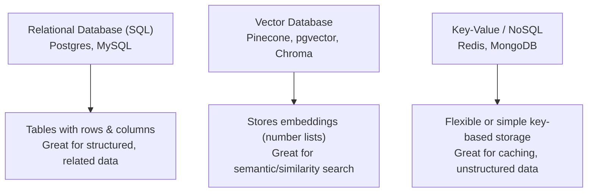

# Database Basics

> An AI model's answer is only as good as the data behind it — and that data almost always lives in a database.

**Type:** Learn
**Languages:** SQL, Concept
**Prerequisites:** Async Programming
**Time:** ~30 minutes

## Learning Objectives

- Understand what a database is and why applications don't just store everything in plain files
- Know the difference between relational (SQL) databases and vector databases used in AI/RAG systems
- Read a simple SQL query and understand what it retrieves
- Formulate the right questions when engineering discusses schema changes, migrations, or query performance

## The Problem

A feature that shows a user's chat history takes 8 seconds to load once a customer has 10,000 past messages. Engineering says "we need to add an index" or "the query isn't using the right index." Without knowing what a database index is, a TPM can't judge whether this is a quick, low-risk fix or a bigger structural problem.

Databases are where almost all persistent application data lives — user accounts, chat history, embeddings for retrieval — and basic fluency here is essential for evaluating both cost and performance trade-offs.

## The Concept

A **database** is organized, persistent storage designed for fast, reliable reading and writing of structured data — the alternative to storing everything in loose text files, which becomes unmanageable and slow at scale.



### Relational Databases (SQL)

Data is organized into **tables** (like spreadsheets), with **rows** (individual records) and **columns** (fields). Tables can be linked together — a `users` table and a `messages` table can be joined by a shared `user_id`.

### Vector Databases

AI applications (especially RAG systems) also use **vector databases**, which store **embeddings** — lists of numbers representing the meaning of text — and are optimized for finding "similar meaning" content instead of exact matches. This is covered in depth in the RAG & Vector Databases level; here it's enough to know it's a different tool for a different job.

### Why Indexes Matter

An **index** is a separate, sorted structure that lets a database jump directly to matching rows instead of scanning every row — similar to a book's index letting you jump to a page instead of reading cover to cover. Without an index on a frequently searched column, a query that should take milliseconds can take seconds as the table grows.

## Build It

A simple SQL query, read step by step:

```sql
SELECT id, content, created_at
FROM messages
WHERE user_id = 42
ORDER BY created_at DESC
LIMIT 20;
```

Reading this in plain English: "From the `messages` table, get the `id`, `content`, and `created_at` columns, but only for rows where `user_id` equals 42, sorted newest first, and give me only the first 20 results."

```sql
CREATE INDEX idx_messages_user_id ON messages (user_id);
```

This creates an index on the `user_id` column specifically, so the query above no longer has to scan the entire `messages` table — it can jump straight to the relevant rows.

## Use It

Real AI applications typically combine multiple database types:

- **Relational database (Postgres)**: user accounts, subscription status, chat session metadata.
- **Vector database (pgvector, Pinecone)**: document embeddings for a RAG system's retrieval step.
- **Cache (Redis)**: frequently accessed, temporary data (e.g. rate-limit counters, session tokens) that doesn't need full database durability.

## Exercises

1. **Easy**: In the SQL query above, which part filters to a single user, and which part limits how many results come back?
2. **Medium**: Explain, in plain English, why adding an index speeds up a search but can slightly slow down every future write (insert/update) to that table.
3. **Hard**: A table has 50 million rows and a query filtering by `email` takes 4 seconds. Propose a hypothesis for why, and one specific fix to test.

## TPM Perspective

### Strategic Executive Summary
Database design decisions directly drive both cost and latency at scale. A missing index, an unoptimized query, or storing the wrong kind of data in the wrong kind of database (e.g. using a relational database for pure similarity search) are common, well-understood root causes of "the feature got slow as we grew" — not mysterious scaling problems.

### Questions to Challenge Engineering
1. *"Is this slow query missing an index on the column it's filtering or sorting by?"*
2. *"Are we using the right tool for this data — relational for structured/related records, vector for similarity search, cache for ephemeral fast-access data?"*
3. *"Before we run a schema migration on this table in production, what's the rollback plan if it fails partway through?"*

### Trade-Off Matrix

| Database Type | Best For | Weakness |
| :--- | :--- | :--- |
| **Relational (SQL)** | Structured, related data with strong consistency needs | Not built for semantic similarity search |
| **Vector Database** | Semantic/similarity search over embeddings (RAG) | Not ideal for complex relational queries or strict transactions |
| **Key-Value / Cache** | Extremely fast, simple lookups; temporary data | Not durable or structured enough for core business data |

## Key Terms

- **Database**: Organized, persistent storage designed for fast, reliable reading and writing of structured data.
- **Table / Row / Column**: The structure of a relational database — a table holds rows (records), each with values across defined columns (fields).
- **Index**: A separate, sorted data structure that lets a database find matching rows quickly instead of scanning the whole table.
- **Vector Database**: A database optimized for storing and searching embeddings (numeric representations of meaning), central to RAG systems.
- **Schema Migration**: A structured change to a database's table structure (e.g. adding a column), which must be planned carefully to avoid downtime or data loss.
