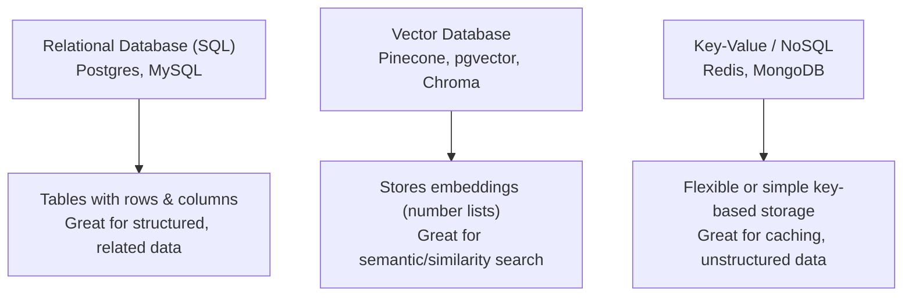

# Database Basics

> An AI model's answer is only as good as the data behind it — and that data almost always lives in a database.

**Type:** Learn
**Prerequisites:** Async Programming
**Time:** ~20 minutes

## Learning Objectives

- Explain what a database is and why applications do not just store everything in plain files
- Distinguish relational (SQL) databases, vector databases used in AI/RAG systems, and key-value stores or caches
- Describe in plain English what a typical database query retrieves and why an index speeds it up
- Formulate the right questions when engineering discusses schema changes, migrations, or query performance

## What It Is

A **database** is organized, persistent storage designed for fast, reliable reading and writing of data. It is the alternative to loose files, which become slow and unmanageable at scale. Three families matter for AI work:

- **Relational (SQL), e.g. Postgres, MySQL**: data in **tables** (like spreadsheets) of **rows** (records) and **columns** (fields). Tables link through shared identifiers; a users table and a messages table can be joined by a user ID. Great for structured, related data.
- **Vector database, e.g. Pinecone, pgvector, Chroma**: stores **embeddings**, lists of numbers representing the meaning of text, and finds "similar meaning" content rather than exact matches. Central to RAG systems.
- **Key-value / NoSQL, e.g. Redis, MongoDB**: simple or flexible key-based storage, great for caching and unstructured data.

## Why It Matters

A feature that shows a user's chat history takes 8 seconds to load once a customer has 10,000 past messages. Engineering says "we need to add an index" or "the query isn't using the right index." Without knowing what an index is, a TPM cannot judge whether this is a quick, low-risk fix or a bigger structural problem.

Databases hold almost all persistent application data: user accounts, chat history, embeddings for retrieval. Basic fluency is essential for evaluating cost and performance trade-offs.

## How It Works

**Reading a query in plain English.** Typical request: "From the messages table, get the ID, content, and creation time, only for rows belonging to user 42, newest first, and return only the first 20." Each clause has a job: which table, which columns, which rows (the filter), what order, and how many. A TPM can read this as a sentence without knowing the syntax.

**Why indexes matter.** An **index** is a separate sorted structure that lets the database jump directly to matching rows instead of scanning every row, like a book's index versus reading cover to cover. Without an index on the user column, the query above scans every message from every user; adding one lets it go straight to user 42's rows. The cost: indexes take extra storage and slightly slow every future write, because the index must be updated too.

**Schema migrations.** A change to a table's structure, such as adding a column, must be planned: on a large production table it can lock the table, take hours, or fail partway through.

Real AI applications combine database types: Postgres for accounts and chat metadata, a vector database for document embeddings, and Redis for rate-limit counters and session tokens that do not need full durability.

## Architecture and Workflow



```archify
src: diagrams/database-types.html
title: Relational, vector, and key-value databases and what each is best for
aspect: 700/428
```

## A Real-World Example

A chat product stores 80 million messages in one table. Loading a user's last 20 messages takes 4 seconds because the database scans all 80 million rows. Engineering adds an index on the user column: the same query drops to about 5 milliseconds. The migration itself, building the index on a live table, takes 40 minutes and is scheduled for a low-traffic window with a tested rollback plan. Separately, the team's "find similar past tickets" feature does not live in Postgres at all: it uses a vector database, because exact-match columns cannot answer "which tickets mean the same thing?"

## What a TPM Needs to Understand

- Database design directly drives cost and latency at scale. A missing index, an unoptimized query, or the wrong kind of database for the data are common, well-understood root causes of "the feature got slow as we grew," not mysterious scaling problems.
- Choose the tool to fit the data: relational for structured records, vector for similarity, cache for ephemeral fast access.
- Schema migrations on live tables carry real risk and need a schedule and a rollback plan.
- Indexes are a trade: faster reads, slower writes, more storage.

## Risks, Dependencies, and Trade-Offs

| Database Type | Best For | Weakness |
| :--- | :--- | :--- |
| **Relational (SQL)** | Structured, related data with strong consistency needs | Not built for semantic similarity search |
| **Vector Database** | Semantic/similarity search over embeddings (RAG) | Not ideal for complex relational queries or strict transactions |
| **Key-Value / Cache** | Extremely fast, simple lookups; temporary data | Not durable or structured enough for core business data |

Failure scenarios: a migration failing partway through and leaving the table half changed; a cache losing data on restart and users being logged out; a vector index drifting out of sync with the source documents so retrieval returns stale answers; database costs growing faster than traffic because of unbounded history.

## Questions to Ask Engineers

1. *"Is this slow query missing an index on the column it's filtering or sorting by?"*
2. *"Are we using the right tool for this data: relational for structured/related records, vector for similarity search, cache for ephemeral fast-access data?"*
3. *"Before we run a schema migration on this table in production, what's the rollback plan if it fails partway through?"*

## Scenario Exercise

Your analytics team reports that the "order lookup by customer email" screen takes 4 seconds on a table of 50 million rows, and a new RAG feature needs to find documents by meaning.

1. **Easy**: In plain English, what is a database index and what problem does it solve?
2. **Medium**: Explain why adding an index speeds up searches but can slightly slow every future write, and what you would ask before approving it on a live table.
3. **Hard**: Propose which database type you would use for the order lookup and which for the RAG feature, and describe the risks of a migration plan that builds the new index during business hours.

## Key Terms

- **Database**: Organized, persistent storage designed for fast, reliable reading and writing of structured data.
- **Table / Row / Column**: The structure of a relational database — a table holds rows (records), each with values across defined columns (fields).
- **Index**: A separate, sorted data structure that lets a database find matching rows quickly instead of scanning the whole table.
- **Vector Database**: A database optimized for storing and searching embeddings (numeric representations of meaning), central to RAG systems.
- **Schema Migration**: A structured change to a database's table structure (e.g. adding a column), which must be planned carefully to avoid downtime or data loss.
