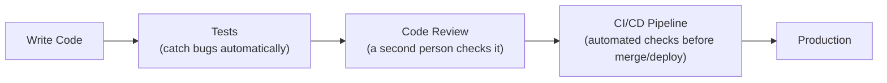

# Software Engineering Fundamentals

> Writing code that works once is easy. Writing code a team can trust six months from now is the actual job.

**Type:** Learn
**Languages:** Concept
**Prerequisites:** Database Basics
**Time:** ~25 minutes

## Learning Objectives

- Understand why "it works on my machine" isn't the bar for production software
- Know the purpose of testing, code review, and CI/CD at a conceptual level
- Understand what "technical debt" really means and why it's a legitimate cost, not just a complaint
- Formulate the right questions when engineering says something needs "more testing" or has "technical debt"

## The Problem

A stakeholder asks "why can't we just ship this today, it works when I tried it?" Engineering says it still needs tests, a code review, and to pass CI. Without understanding what these steps actually protect against, this sounds like process for its own sake — when in reality, each step exists because of a specific, well-known failure mode it prevents.

## The Concept

Software engineering (as distinct from just "writing code that runs") is the set of practices that make code reliable, changeable, and trustworthy over time, not just correct in the moment it was written.



### Testing

A **test** is code that automatically checks whether other code behaves correctly, without a human needing to manually click through the feature every time. Tests catch regressions — cases where a change accidentally breaks something that used to work.

### Code Review

Before code is merged, another engineer reviews it — catching bugs, design issues, and knowledge gaps a single author might miss, and spreading understanding of the codebase across the team.

### CI/CD (Continuous Integration / Continuous Deployment)

An automated pipeline that runs tests, checks code style, and (for CD) deploys code automatically once checks pass — removing manual, error-prone steps from shipping code.

### Technical Debt

**Technical debt** is the accumulated cost of shortcuts taken to ship faster now, which make future changes slower or riskier — like financial debt, it can be a reasonable short-term trade, but it accrues "interest" (growing difficulty) if never addressed.

## Build It

A simple example of a test, which is just code that checks other code:

```python
def estimate_cost(num_tokens, price_per_1k=0.002):
    return (num_tokens / 1000) * price_per_1k

def test_estimate_cost_basic():
    result = estimate_cost(1000, price_per_1k=0.002)
    assert result == 0.002, f"Expected 0.002, got {result}"

def test_estimate_cost_zero_tokens():
    result = estimate_cost(0)
    assert result == 0, f"Expected 0, got {result}"

def test_estimate_cost_large_input():
    result = estimate_cost(1_000_000, price_per_1k=0.002)
    assert result == 2.0, f"Expected 2.0, got {result}"

for test in [test_estimate_cost_basic, test_estimate_cost_zero_tokens, test_estimate_cost_large_input]:
    try:
        test()
        print(f"PASS: {test.__name__}")
    except AssertionError as e:
        print(f"FAIL: {test.__name__} -> {e}")
```

If someone later changes `estimate_cost` and accidentally breaks the zero-tokens case, this test catches it immediately — instead of a customer noticing a wrong invoice weeks later.

## Use It

Real engineering teams wire these practices into their daily workflow:

- Every code change (a "pull request") triggers CI, which runs the full test suite automatically.
- A pull request typically requires at least one approving code review before it can be merged.
- Teams track technical debt deliberately (e.g. a backlog of "should fix eventually" items) rather than letting it accumulate silently.

## Exercises

1. **Easy**: In plain English, explain what a "regression" is and why automated tests help catch it.
2. **Medium**: Write one additional test for `estimate_cost` that checks a negative number of tokens — what should happen, and does the current function handle it correctly?
3. **Hard**: Describe a realistic scenario where taking on technical debt deliberately (shipping a known shortcut) was the right call, and explain what would make it the wrong call.

## TPM Perspective

### Strategic Executive Summary
Testing, code review, and CI/CD are not bureaucracy — they are specific, well-understood defenses against specific, well-understood failure modes (regressions, single-reviewer blind spots, manual deployment mistakes). Technical debt is a real, trackable cost that should be discussed in roadmap planning the same way financial debt is discussed in a budget — not treated as an embarrassing secret or dismissed as unimportant.

### Questions to Challenge Engineering
1. *"What specific regression or bug class would our test suite have caught, if we'd had it, for our last production incident?"*
2. *"Is this technical debt tracked anywhere, and what's the cost of not addressing it for another quarter?"*
3. *"Does this change have test coverage for the edge cases (empty input, extremely large input, invalid input), not just the happy path?"*

### Trade-Off Matrix

| Practice | Upfront Cost | Long-Term Benefit | Risk If Skipped |
| :--- | :--- | :--- | :--- |
| **Automated tests** | Time to write and maintain | Catches regressions automatically, enables confident changes | Bugs reach production silently |
| **Code review** | Reviewer's time, slight delay | Catches design issues, spreads knowledge | Single point of failure in understanding/quality |
| **CI/CD pipeline** | Setup and maintenance time | Removes manual, error-prone deploy steps | Inconsistent, risky manual deployments |
| **Addressing technical debt** | Time not spent on new features | Faster, safer future changes | Compounding slowdown ("interest") on all future work |

## Key Terms

- **Test**: Code that automatically checks whether other code behaves correctly, catching regressions before they reach users.
- **Regression**: A bug where a change accidentally breaks something that previously worked correctly.
- **Code Review**: The practice of having another engineer review code changes before they are merged.
- **CI/CD (Continuous Integration / Continuous Deployment)**: An automated pipeline that runs checks (and optionally deploys) code as changes are made.
- **Technical Debt**: The accumulated future cost of shortcuts taken to ship faster now, which make future changes slower or riskier if left unaddressed.
