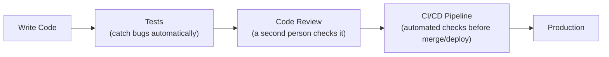

# Software Engineering Fundamentals

> Writing code that works once is easy. Writing code a team can trust six months from now is the actual job.

**Type:** Learn
**Prerequisites:** Database Basics
**Time:** ~20 minutes

## Learning Objectives

- Explain why "it works on my machine" is not the bar for production software
- Describe the purpose of testing, code review, and CI/CD at a conceptual level
- Explain what "technical debt" really means and why it is a legitimate cost, not just a complaint
- Formulate the right questions when engineering says something needs "more testing" or has "technical debt"

## What It Is

Software engineering, as distinct from just writing code that runs, is the set of practices that make code reliable, changeable, and trustworthy over time, not just correct at the moment it was written.

- **Testing**: automated checks that verify other code behaves correctly, without a human clicking through the feature each time. They catch **regressions**: changes that accidentally break something that used to work.
- **Code review**: another engineer examines a change before it is merged, catching bugs, design issues, and knowledge gaps, and spreading understanding across the team.
- **CI/CD (Continuous Integration / Continuous Deployment)**: an automated pipeline that runs tests and style checks on every change and, for CD, deploys once checks pass, removing manual, error-prone steps.
- **Technical debt**: the accumulated cost of shortcuts taken to ship faster now, which make future changes slower or riskier. Like financial debt, it can be a reasonable short-term trade but accrues "interest" if never addressed.

## Why It Matters

A stakeholder asks "why can't we just ship this today, it works when I tried it?" Engineering says it still needs tests, a code review, and to pass CI. Without understanding what these steps protect against, this sounds like process for its own sake. In reality each step exists because of a specific, well-known failure mode it prevents.

## How It Works

Every code change (a "pull request") flows through the same gates:

1. The author writes the change and the tests that prove it works, including edge cases (empty input, huge input, invalid input), not just the happy path.
2. Opening the pull request triggers CI, which runs the full test suite automatically.
3. At least one other engineer reviews and approves it.
4. Once checks pass and review is approved, the change merges and the pipeline deploys it.

Example of a test's value: a small function that estimates cost from a token count has three checks: 1,000 tokens at $0.002 per thousand costs $0.002; zero tokens costs zero; one million tokens costs $2. If someone later changes the function and accidentally breaks the zero case, the test fails within minutes, instead of a customer noticing a wrong invoice weeks later.

Teams also track technical debt deliberately, for example as a backlog of "should fix eventually" items, instead of letting it accumulate silently.

## Architecture and Workflow



```archify
src: diagrams/quality-pipeline.html
title: From writing code through tests, review, and CI/CD to production
aspect: 730/328
```

## A Real-World Example

A team ships a prompt-formatting change on a Friday with no tests "because it's a one-line fix." It breaks the handling of messages with empty fields, so 12 percent of support replies go out blank over the weekend, and 3 engineers spend Monday on cleanup and customer apology emails. A 20-minute test for the empty case, running in CI, would have blocked the merge. Later the same team deliberately skips polishing an internal admin screen to hit a customer deadline, logs it as technical debt with an owner and a target quarter, and pays it down in the next sprint. One shortcut was reckless; the other was a tracked, conscious trade.

## What a TPM Needs to Understand

- Testing, code review, and CI/CD are not bureaucracy; they are defenses against specific failure modes (regressions, single-reviewer blind spots, manual deployment mistakes).
- Technical debt is a real, trackable cost to discuss in roadmap planning the way financial debt appears in a budget: neither a secret nor dismissible.
- "It works when I tried it" is a sample of one; tests are what generalize it.
- Schedules that cut testing and review do not remove the work; they move it to production incidents, at higher cost.
- For AI features, add evaluation tests (does the model still answer well?), since ordinary tests cannot judge model quality.

## Risks, Dependencies, and Trade-Offs

| Practice | Upfront Cost | Long-Term Benefit | Risk If Skipped |
| :--- | :--- | :--- | :--- |
| **Automated tests** | Time to write and maintain | Catches regressions automatically, enables confident changes | Bugs reach production silently |
| **Code review** | Reviewer's time, slight delay | Catches design issues, spreads knowledge | Single point of failure in understanding/quality |
| **CI/CD pipeline** | Setup and maintenance time | Removes manual, error-prone deploy steps | Inconsistent, risky manual deployments |
| **Addressing technical debt** | Time not spent on new features | Faster, safer future changes | Compounding slowdown ("interest") on all future work |

Failure scenarios: flaky tests that teams learn to ignore; reviews that become rubber stamps; CI that takes 45 minutes and tempts people to bypass it; debt that is tracked but never scheduled.

## Questions to Ask Engineers

1. *"What specific regression or bug class would our test suite have caught, if we'd had it, for our last production incident?"*
2. *"Is this technical debt tracked anywhere, and what's the cost of not addressing it for another quarter?"*
3. *"Does this change have test coverage for the edge cases (empty input, extremely large input, invalid input), not just the happy path?"*

## Scenario Exercise

A sales leader pushes to ship an AI feature one week early by skipping the test and review steps.

1. **Easy**: In plain English, what is a regression and why do automated tests help catch it?
2. **Medium**: Which of the Trade-Off table rows would you ask about first, and what risk would you quantify for the sales leader?
3. **Hard**: Describe a situation where taking on technical debt deliberately is the right call, what you would require (owner, due date, tracking), and what would make it the wrong call.

## Key Terms

- **Test**: Automated check that verifies other code behaves correctly, catching regressions before they reach users.
- **Regression**: A bug where a change accidentally breaks something that previously worked correctly.
- **Code Review**: The practice of having another engineer review code changes before they are merged.
- **CI/CD (Continuous Integration / Continuous Deployment)**: An automated pipeline that runs checks (and optionally deploys) code as changes are made.
- **Technical Debt**: The accumulated future cost of shortcuts taken to ship faster now, which make future changes slower or riskier if left unaddressed.
