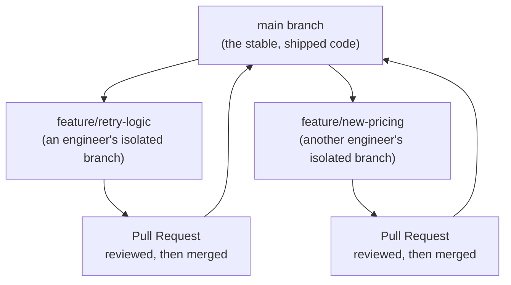

# Git and GitHub Workflow

> "Merge conflict" sounds scary until you know it just means two people edited the same lines and someone has to pick.

**Type:** Learn
**Prerequisites:** Software Engineering Fundamentals
**Time:** ~20 minutes

## Learning Objectives

- Explain what version control is and why every serious codebase relies on it
- Use the core Git vocabulary correctly: commit, branch, merge, pull request
- Explain what a merge conflict is and why it happens
- Formulate the right questions when engineering discusses branching strategy or release timing

## What It Is

**Git** is a version control system. It tracks every change ever made to a codebase, who made it, and when, so teams can collaborate on the same code without overwriting each other's work and anyone can rewind to a previous state. Git works entirely on a developer's own machine; **GitHub** (or GitLab, Bitbucket) is a hosted service built around Git that adds collaboration features: pull requests, a code review interface, issue tracking, and CI/CD integration.

Core vocabulary:

- **Commit**: a saved snapshot of changes, with a message describing what changed and why.
- **Branch**: an isolated copy of the codebase where changes can be made without affecting the stable version until ready.
- **Merge**: combining changes from one branch into another, usually a feature branch back into `main`.
- **Pull Request (PR)**: a request to merge one branch into another, which triggers code review and CI checks before approval.
- **Merge Conflict**: two branches changed the exact same lines differently. Git cannot decide which is correct, so a human must choose.

## Why It Matters

Two engineers both edit the same file to fix related bugs. When they try to combine their work they hit a "merge conflict" and the release slips half a day. Without knowing what Git is doing, this looks like a process failure. It is actually Git correctly refusing to silently guess which change should win when both touched the same lines.

## How It Works

A typical day-to-day flow:

1. An engineer creates a new branch from `main` for one change, such as "add retry logic."
2. They make changes and save them as commits with descriptive messages.
3. They upload the branch to GitHub so others can see it.
4. They open a pull request into `main`. Reviewers comment, CI runs the tests.
5. Once approved and green, the branch is merged and `main` now contains the change.
6. Everyone else pulls the latest `main` to stay current.

If another engineer changed the same lines on a different branch and merged first, the second merge reports a conflict in that file. A human opens the file, decides which version (or combination) is correct, saves that resolution as a new commit, and the merge proceeds.

Teams standardize this to stay coordinated at scale:

- `main` is always kept deployable and stable.
- New work happens on short-lived feature branches, never directly on `main`.
- Pull requests are the checkpoint where review, CI, and team visibility happen before code reaches production.

## Architecture and Workflow



```archify
src: diagrams/branch-pr-flow.html
title: Feature branches and pull requests flowing back into main
aspect: 940/468
```

## A Real-World Example

Two teams work on an AI assistant for 3 weeks on long-lived branches: one rewrites the prompt templates, the other changes how pricing is displayed, and both touch the same configuration file. When the release branch is assembled, 41 files conflict, and it takes two engineers a full day to reconcile them. A third team that merged small branches every 2 days over the same period hit only 2 trivial conflicts, each solved in minutes. Conflicts are not failures of people; they are a measure of how long work stayed apart and how many people touched the same places.

## What a TPM Needs to Understand

- "Merge conflict" and "branching strategy" are not vague blockers; they are precise parts of how teams coordinate concurrent work safely.
- A release delayed by one merge conflict is usually a quick, mechanical fix, not a sign of a broken process, unless conflicts happen constantly, which points to poor branch hygiene or many engineers touching the same code without coordination.
- Pull requests are where quality gates live; code that bypasses them bypasses review and CI.
- Git history is an audit trail: you can find who changed what and when, and revert a bad change.
- Ready to ship versus still in review is visible in pull requests; use that instead of status meetings.

## Risks, Dependencies, and Trade-Offs

| Practice | Coordination Overhead | Risk of Breaking `main` |
| :--- | :--- | :--- |
| **Everyone commits directly to `main`** | Very low | High — no review checkpoint, frequent breakage |
| **Feature branches + Pull Requests** | Moderate — requires review cycles | Low — changes are vetted before merging |
| **Long-lived feature branches (weeks/months)** | High — merge conflicts grow with time apart | Medium — large, risky merges when finally combined |
| **Short-lived feature branches (days)** | Low-Moderate | Low — small, easy-to-review, easy-to-merge changes |

Dependencies and failure scenarios: a hosting outage on GitHub blocks merges and deployments; a wrongly resolved conflict can silently drop someone's change; large pull requests get shallow reviews; secrets accidentally committed stay in history and must be rotated.

## Questions to Ask Engineers

1. *"Is this delay a one-off merge conflict (quick to resolve) or a sign of a deeper coordination problem (multiple teams constantly colliding on the same files)?"*
2. *"Does every change go through a pull request with review and CI, or can code reach `main` without those checks?"*
3. *"What's our branching strategy for coordinating a release across multiple in-progress features? Do we have a clear picture of what's ready to ship versus still in review?"*

## Scenario Exercise

Your release is blocked: two feature branches, one for new pricing and one for a prompt update, both changed the same configuration file.

1. **Easy**: In plain English, what is the difference between a commit and a branch?
2. **Medium**: Why do teams avoid letting many engineers work directly on `main`, and what does a pull request add?
3. **Hard**: Conflicts have blocked three of the last five releases. Diagnose likely causes, propose two process changes (for example shorter branch lifetimes, clearer file ownership), and say how you would measure improvement.

## Key Terms

- **Commit**: A saved snapshot of changes in Git, with a message describing what changed and why.
- **Branch**: An isolated line of development, letting changes be made without affecting the stable main codebase until ready.
- **Merge**: Combining changes from one branch into another.
- **Pull Request (PR)**: A request to merge a branch, which triggers code review and automated checks before approval.
- **Merge Conflict**: A situation where two branches changed the same lines differently, requiring a human to manually resolve which change to keep.
