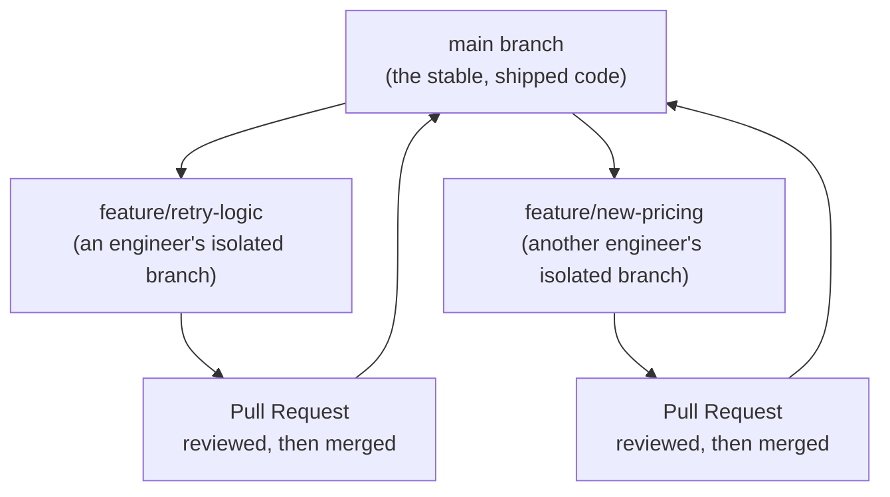

# Git and GitHub Workflow

> "Merge conflict" sounds scary until you know it just means two people edited the same lines and someone has to pick.

**Type:** Learn
**Languages:** Concept, Git
**Prerequisites:** Software Engineering Fundamentals
**Time:** ~25 minutes

## Learning Objectives

- Understand what version control is and why every serious codebase relies on it
- Know the core Git vocabulary: commit, branch, merge, pull request
- Understand what a merge conflict is and why it happens
- Formulate the right questions when engineering discusses branching strategy or release timing

## The Problem

Two engineers both edit the same file to fix related bugs. When they try to combine their work, they hit a "merge conflict" and the release is delayed by half a day. Without knowing what Git is doing, this looks like a process failure — but it's actually Git correctly refusing to silently guess which change should win when both touched the same lines.

## The Concept

**Git** is a version control system: it tracks every change ever made to a codebase, who made it, and when — letting teams collaborate on the same code without overwriting each other's work, and letting anyone rewind to any previous state.



### Core Vocabulary

- **Commit**: a saved snapshot of changes, with a message describing what changed and why.
- **Branch**: an isolated copy of the codebase where changes can be made without affecting the main, stable version until they're ready.
- **Merge**: combining changes from one branch into another (usually a feature branch back into `main`).
- **Pull Request (PR)**: a request to merge one branch into another, which triggers code review and CI checks before it's approved.
- **Merge Conflict**: occurs when two branches change the exact same lines of a file differently — Git can't automatically decide which change is correct, so a human must choose.

### GitHub vs. Git

**Git** is the underlying version control tool (works entirely on your own machine, no internet required). **GitHub** (or GitLab, Bitbucket) is a hosted service built around Git that adds collaboration features: pull requests, code review UI, issue tracking, and CI/CD integration.

## Build It

A typical day-to-day Git workflow, shown as commands with plain-English explanations:

```bash
git checkout -b feature/retry-logic
# Creates and switches to a new, isolated branch for this change.

git add retry_helper.py
git commit -m "Add exponential backoff retry logic for API calls"
# Saves a snapshot of the change with a descriptive message.

git push origin feature/retry-logic
# Uploads this branch to GitHub so others can see and review it.

# On GitHub: open a Pull Request from feature/retry-logic into main.
# A reviewer approves it, CI passes, and it gets merged.

git checkout main
git pull origin main
# Switches back to main and downloads the latest merged changes.
```

If another engineer had also changed `retry_helper.py` on a different branch and merged first, merging the second branch might show:

```
CONFLICT (content): Merge conflict in retry_helper.py
```

This means Git found overlapping changes it can't automatically reconcile — a human needs to open the file, decide which version (or combination) is correct, and commit the resolution.

## Use It

Real engineering teams standardize this workflow to stay coordinated at scale:

- `main` (or `master`) is always kept in a deployable, stable state.
- All new work happens on short-lived feature branches, not directly on `main`.
- Pull requests are the checkpoint where code review, CI, and team visibility all happen before code reaches production.

## Exercises

1. **Easy**: In plain English, explain the difference between a "commit" and a "branch."
2. **Medium**: Explain why teams generally avoid letting multiple engineers work directly on `main` instead of using feature branches.
3. **Hard**: Two engineers both modify the same function in the same file on separate branches. Describe, step by step, what happens when the second person tries to merge, and what they need to do to resolve it.

## TPM Perspective

### Strategic Executive Summary
"Merge conflict" and "branching strategy" are not vague blockers — they are precise, well-understood parts of how teams coordinate concurrent work safely. A release delayed by a merge conflict is usually a quick, mechanical fix (a human picking the right combination of changes), not a sign of a broken process — unless conflicts are happening constantly, which can indicate poor branch hygiene or too many engineers touching the same code without coordination.

### Questions to Challenge Engineering
1. *"Is this delay a one-off merge conflict (quick to resolve) or a sign of a deeper coordination problem (multiple teams constantly colliding on the same files)?"*
2. *"Does every change go through a pull request with review and CI, or can code reach `main` without those checks?"*
3. *"What's our branching strategy for coordinating a release across multiple in-progress features — do we have a clear picture of what's ready to ship vs. still in review?"*

### Trade-Off Matrix

| Practice | Coordination Overhead | Risk of Breaking `main` |
| :--- | :--- | :--- |
| **Everyone commits directly to `main`** | Very low | High — no review checkpoint, frequent breakage |
| **Feature branches + Pull Requests** | Moderate — requires review cycles | Low — changes are vetted before merging |
| **Long-lived feature branches (weeks/months)** | High — merge conflicts grow with time apart | Medium — large, risky merges when finally combined |
| **Short-lived feature branches (days)** | Low-Moderate | Low — small, easy-to-review, easy-to-merge changes |

## Key Terms

- **Commit**: A saved snapshot of changes in Git, with a message describing what changed and why.
- **Branch**: An isolated line of development, letting changes be made without affecting the stable main codebase until ready.
- **Merge**: Combining changes from one branch into another.
- **Pull Request (PR)**: A request to merge a branch, which triggers code review and automated checks before approval.
- **Merge Conflict**: A situation where two branches changed the same lines differently, requiring a human to manually resolve which change to keep.
