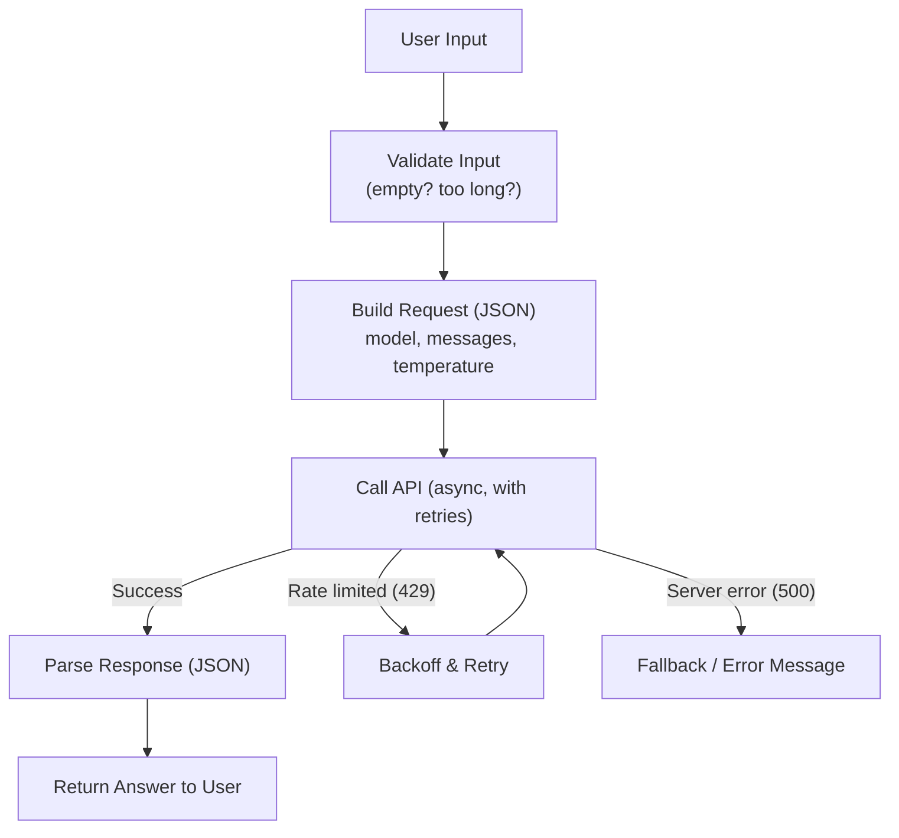

# API Engineering for AI Applications

> Every AI feature you've ever used is a small pipeline: fetch context, build a prompt, call a model, handle the response, handle the failure.

**Type:** Learn
**Languages:** Python
**Prerequisites:** Git and GitHub Workflow
**Time:** ~35 minutes

## Learning Objectives

- Combine everything from this level (functions, JSON/APIs, async, databases, error handling) into a single realistic AI application pattern
- Understand the standard shape of an AI API integration: request building, calling the model, parsing the response, and handling failure
- Recognize why production AI API code needs more defensive handling than a demo notebook
- Formulate the right questions when reviewing a proposed AI feature's technical design

## The Problem

A team proposes an AI feature: "users type a question, we call the LLM, and show the answer." In a demo, this works perfectly. In production, it needs to handle: the API being slow or down, the response being malformed, the user's input being empty or enormous, hitting a rate limit mid-conversation, and the cost per request staying within budget. The gap between "works in the demo" and "safe to ship" is exactly the gap this lesson closes.

## The Concept

A production-grade AI API integration is a small pipeline combining nearly every concept from this level:



This single diagram touches: **functions** (each box is a function), **JSON/APIs** (the request/response), **async programming** (calling concurrently, retrying without blocking everything else), and **error handling** (from the software engineering fundamentals lesson).

## Build It

A realistic (simplified) end-to-end example combining functions, JSON, async, and error handling:

```python
import asyncio
import random

class RateLimitError(Exception):
    pass

class ProviderServerError(Exception):
    pass

def validate_input(user_message):
    if not user_message or not user_message.strip():
        raise ValueError("User message cannot be empty.")
    if len(user_message) > 4000:
        raise ValueError("User message is too long (max 4000 characters).")
    return user_message.strip()

def build_request(user_message, model="gpt-tpm-demo", temperature=0.7):
    return {
        "model": model,
        "messages": [{"role": "user", "content": user_message}],
        "temperature": temperature,
    }

async def call_model_api(request_body):
    await asyncio.sleep(0.3)
    roll = random.random()
    if roll < 0.1:
        raise RateLimitError("429 Too Many Requests")
    if roll < 0.15:
        raise ProviderServerError("500 Internal Server Error")
    return {
        "choices": [{"message": {"content": f"Response to: {request_body['messages'][0]['content']}"}}],
        "usage": {"total_tokens": 42},
    }

def parse_response(response_body):
    return response_body["choices"][0]["message"]["content"]

async def get_ai_answer(user_message, max_retries=3):
    try:
        clean_message = validate_input(user_message)
    except ValueError as e:
        return f"Input error: {e}"

    request_body = build_request(clean_message)

    attempts = 0
    delay = 0.5
    while attempts < max_retries:
        try:
            response_body = await call_model_api(request_body)
            return parse_response(response_body)
        except RateLimitError:
            attempts += 1
            print(f"Rate limited, retrying in {delay}s (attempt {attempts}/{max_retries})...")
            await asyncio.sleep(delay)
            delay *= 2
        except ProviderServerError:
            return "The AI service is temporarily unavailable. Please try again shortly."

    return "The AI service is currently overloaded. Please try again in a moment."

async def main():
    for message in ["What is a rate limit?", "", "x" * 5000]:
        answer = await get_ai_answer(message)
        print(f"Input: {message[:30]!r}... -> Output: {answer}\n")

asyncio.run(main())
```

Every earlier lesson shows up here: `validate_input` and `build_request` are plain **functions**; `request_body`/`response_body` are **JSON-shaped dictionaries**; `call_model_api` is **async**; the `while` loop with `delay *= 2` is **exponential backoff** from the rate-limits lesson; and the `try/except` blocks are **error handling** from the software engineering lesson.

## Use It

This pattern — validate, build request, call with retries, parse, handle failure gracefully — is essentially the shape of every real-world LLM-powered feature, whether it's a customer-facing chatbot, an internal summarization tool, or an autonomous agent's single tool call.

## Exercises

1. **Easy**: Identify which line(s) in `get_ai_answer` handle input validation, and what happens if the input is empty.
2. **Medium**: Add a check so that if `max_retries` is reached due to rate limiting, the function logs how many total attempts were made before giving up.
3. **Hard**: Extend this pipeline to track total tokens used across all calls in `main()`, and print a running cost estimate using the `estimate_cost` function pattern from the Functions and Modules lesson.

## TPM Perspective

### Strategic Executive Summary
The distance between a demo and a production-ready AI feature is almost entirely made up of the concepts in this level: input validation, structured request/response handling, concurrency, retries with backoff, and graceful failure handling. When a team says a feature is "production-ready," a TPM can now ask specifically whether each of these pieces exists — not just whether the happy path works.

### Questions to Challenge Engineering
1. *"Walk me through what happens, step by step, if the model API returns a 429, a 500, or a malformed response — not just what happens when it succeeds."*
2. *"Is there input validation before we ever send a request to the model, to avoid wasting cost on empty or oversized inputs?"*
3. *"If we call this API concurrently for multiple users, do we have a retry/backoff strategy, or could a rate limit spike take down the whole feature at once?"*

### Trade-Off Matrix

| Design Choice | Robustness | Complexity | Cost Impact |
| :--- | :--- | :--- | :--- |
| **No validation, no retries (demo-quality)** | Very low | Very low | Risk of wasted spend on bad inputs, poor user experience on failures |
| **Validation only** | Medium | Low | Avoids wasted calls on bad input, but no resilience to provider issues |
| **Validation + retries + backoff** | High | Medium | Slightly higher latency on failures, much better reliability |
| **Full pipeline (validation, retries, fallback, cost tracking)** | Very high | Medium-High | Best reliability and cost visibility, more code to maintain |

## Key Terms

- **Input Validation**: Checking that user-provided data meets expected constraints (not empty, not too long) before using it, to avoid wasted cost and errors.
- **Request/Response Pipeline**: The end-to-end flow of building a request, calling an API, and parsing its response.
- **Exponential Backoff**: A retry strategy where wait time between retries increases (e.g. doubles) after each failure.
- **Graceful Failure Handling**: Returning a clear, safe fallback message to the user instead of crashing or showing a raw error when something goes wrong.
- **Production-Ready**: Code that handles not just the successful case, but validation, concurrency, retries, and failure modes reliably.
