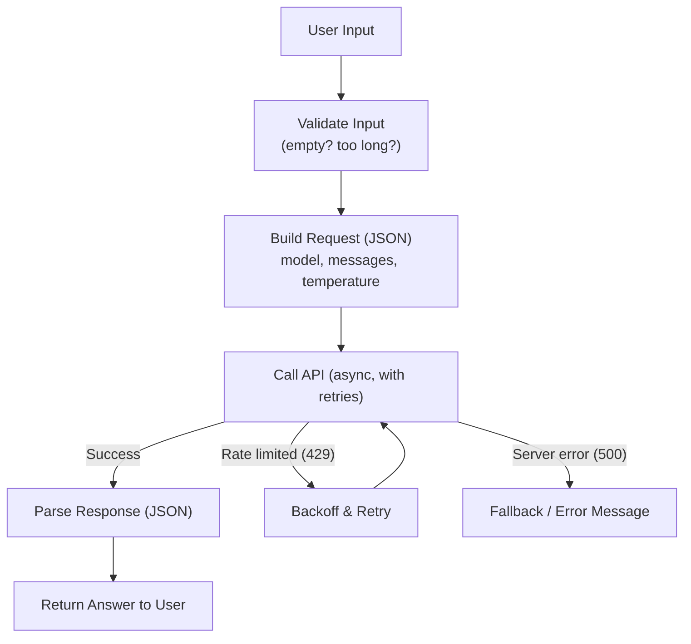

# API Engineering for AI Applications

> Every AI feature you've ever used is a small pipeline: fetch context, build a prompt, call a model, handle the response, handle the failure.

**Type:** Learn
**Prerequisites:** Git and GitHub Workflow
**Time:** ~25 minutes

## Learning Objectives

- Combine everything from this level (functions, JSON/APIs, async, databases, error handling) into one realistic AI application pattern
- Describe the standard shape of an AI API integration: input checking, request building, calling the model, parsing the response, and handling failure
- Explain why production AI integrations need far more defensive handling than a demo
- Formulate the right questions when reviewing a proposed AI feature's technical design

## What It Is

A production-grade AI API integration is a small pipeline that combines nearly every concept in this level:

1. **Validate input**: reject empty or oversized user messages before spending money on them.
2. **Build the request**: a structured message naming the model, the conversation, and settings such as temperature.
3. **Call the API**: concurrently (async) and with retries.
4. **Parse the response**: pull the answer text and token usage out of the structured reply.
5. **Handle failure**: back off and retry on rate limits, show a friendly fallback on server errors.

Each step maps to an earlier lesson: functions (each step is a small unit), JSON/APIs (request and response), async programming (concurrent calls without blocking), and error handling from the software engineering lesson.

## Why It Matters

A team proposes: "users type a question, we call the LLM, and show the answer." In a demo this works perfectly. In production it must also handle the API being slow or down, a malformed response, empty or enormous input, a rate limit mid-conversation, and cost per request staying within budget. The gap between "works in the demo" and "safe to ship" is exactly what this lesson closes.

## How It Works

Walk through the pipeline with the failure paths, which matter more than the happy path:

- **Empty or oversized input** (for example more than 4,000 characters): stopped at step 1 with a clear message. No provider call, no cost.
- **Rate limit (429)**: the system waits, then retries, doubling the wait each time (for example 0.5 s, 1 s, 2 s) up to a maximum number of attempts. After the limit it tells the user the service is busy.
- **Server error (500)**: retrying immediately rarely helps, so the system returns a friendly "temporarily unavailable" message, or switches to a fallback model.
- **Malformed response**: the parsing step cannot find the expected fields; the system must log it and fail gracefully rather than show users a raw error.
- **Success**: the answer is returned and the token usage is recorded for cost tracking.

This pattern, validate, build, call with retries, parse, handle failure, is the shape of every real LLM feature, whether a customer-facing chatbot, an internal summarizer, or an autonomous agent's single tool call.

## Architecture and Workflow



```archify
src: diagrams/api-call-flow.html
title: An AI API call with validation, retries, and fallback
aspect: 1490/628
```

## A Real-World Example

A company launches an internal HR assistant. Version one has no validation and no retries. In the first week, a user pastes a 60-page policy document into the question box (about 40,000 tokens, roughly $0.40 for a single request), one provider hiccup returns a 500 and shows employees a raw error, and a morning traffic spike causes a burst of 429s that users experience as "the bot is broken." Version two adds a 4,000-character input limit, retries with doubling waits (up to 3 attempts), a friendly fallback message, and a running token tally per team. Costs fall by about a third, the visible error rate drops from roughly 8 percent to under 1 percent, and finance can finally see spend per department.

## What a TPM Needs to Understand

- The distance between a demo and a production-ready AI feature is almost entirely made up of this level's concepts: input validation, structured request/response handling, concurrency, retries with backoff, and graceful failure handling.
- When a team says "production-ready," ask whether each piece exists, not just whether the happy path works.
- Every failure path needs a decided user experience: silent retry, degraded answer, or visible error.
- Cost control lives in the pipeline: validation limits waste, token tracking creates visibility.
- Retries without limits or backoff can multiply cost and worsen an outage.

## Risks, Dependencies, and Trade-Offs

| Design Choice | Robustness | Complexity | Cost Impact |
| :--- | :--- | :--- | :--- |
| **No validation, no retries (demo-quality)** | Very low | Very low | Risk of wasted spend on bad inputs, poor user experience on failures |
| **Validation only** | Medium | Low | Avoids wasted calls on bad input, but no resilience to provider issues |
| **Validation + retries + backoff** | High | Medium | Slightly higher latency on failures, much better reliability |
| **Full pipeline (validation, retries, fallback, cost tracking)** | Very high | Medium-High | Best reliability and cost visibility, more code to maintain |

Dependencies and failure scenarios: the model provider's uptime and rate limits; changes to the provider's response format (see the APIs and JSON lesson); a fallback model that behaves differently from the primary; retry storms during a provider outage.

## Questions to Ask Engineers

1. *"Walk me through what happens, step by step, if the model API returns a 429, a 500, or a malformed response, not just what happens when it succeeds."*
2. *"Is there input validation before we ever send a request to the model, to avoid wasting cost on empty or oversized inputs?"*
3. *"If we call this API concurrently for multiple users, do we have a retry/backoff strategy, or could a rate limit spike take down the whole feature at once?"*

## Scenario Exercise

Your team's design doc for a customer-facing summarization feature describes only the successful path, and the launch is in two weeks.

1. **Easy**: List the five stages of the pipeline described in this lesson.
2. **Medium**: Pick two failure paths (for example a 429 and a malformed response) and describe what you would require the user to see in each case.
3. **Hard**: Using the Trade-Off table, argue which design level the launch should require, what monitoring you would ask for in the first week (error rate, retry rate, cost per request), and what threshold would trigger a rollback.

## Key Terms

- **Input Validation**: Checking that user-provided data meets expected constraints (not empty, not too long) before using it, to avoid wasted cost and errors.
- **Request/Response Pipeline**: The end-to-end flow of building a request, calling an API, and parsing its response.
- **Exponential Backoff**: A retry strategy where wait time between retries increases (e.g. doubles) after each failure.
- **Graceful Failure Handling**: Returning a clear, safe fallback message to the user instead of crashing or showing a raw error when something goes wrong.
- **Production-Ready**: A feature that handles not just the successful case, but validation, concurrency, retries, and failure modes reliably.
