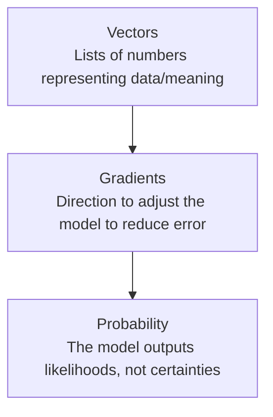

# Math Intuition for AI

> You don't need to solve the equations — you need to know what they're trying to do, and why engineers argue about them.

**Type:** Learn
**Prerequisites:** API Engineering for AI Applications
**Time:** ~20 minutes

## Learning Objectives

- Build intuition for the three math concepts underpinning nearly all AI: vectors, gradients, and probability
- Explain what "the model learns" actually means in mathematical terms, without needing to do the math yourself
- Recognize why AI outputs are probabilistic, not deterministic, and what that implies for product behavior
- Formulate the right questions when engineering discusses "the loss landscape" or "gradient descent"

## What It Is

Three mathematical ideas explain almost everything about how AI models are built and how they behave:

- **Vectors** are ordered lists of numbers, like 0.2, -1.4, 0.9. AI converts everything (words, images, sounds) into vectors, because computers can only do math on numbers, not raw meaning. An **embedding** is a vector designed to capture the *meaning* of something, so similar things end up as similar vectors.
- **Gradients** are the signal that tells training which direction, and how much, to adjust each internal number (weight) to make predictions less wrong. **Gradient descent** repeats small adjustments until error is as low as is practical.
- **Probability** is how models express answers. LLMs do not output one guaranteed answer; they output a **probability distribution** over possible answers, and a selection step picks one.

## Why It Matters

An engineer says "the model is stuck in a local minimum" or "the gradients are exploding." Without intuition for what a gradient is, these sound like jargon rather than precise descriptions of a diagnosable situation. A TPM does not need to derive calculus, but does need enough intuition to ask "what does that mean for whether we can fix it, and how long will that take?"

It also explains a core product truth: because outputs are probabilistic, "the model was 95% accurate in testing" does not mean every individual answer is guaranteed correct.

## How It Works

**Learning as walking downhill in fog.** Training adjusts millions of weights to reduce error. The gradient is like a hiker in fog feeling which way is downhill without seeing the whole mountain. Gradient descent is taking small steps that way, repeatedly.

**A worked example with real numbers.** Imagine error is lowest when a single setting equals 3, and we start at 10. With a step-size setting (the **learning rate**) of 0.1, each update closes 10% of the gap's slope, so the distance from the target shrinks by 20% every step: 7 away, then 5.6, then 4.5, and so on. After 20 steps the setting is about 3.08, nearly perfect. Now set the learning rate to 2.0: each step overshoots so far that the distance grows by 3x and flips sides (7, then -21, then 63...). Training diverges. Same method, different step size, opposite outcome. That is why "we tried one learning rate and it didn't work" is not a diagnosis.

**Failure modes engineers name:**

- **Local minimum**: a spot that looks like the bottom of a valley from where you stand but is not the lowest point overall; training gets stuck.
- **Exploding gradients**: the adjustment signal becomes too large across many layers, making training unstable.
- **Vanishing gradients**: the signal shrinks toward zero as it travels back through many layers, so early layers barely learn (the hiker in fog feels no slope at all).

**Probability at output time.** The model assigns a likelihood to each candidate answer. A sampling setting called **temperature** controls whether it picks the most likely one (consistent) or samples more freely (varied). This is why the same prompt can yield slightly different answers.

## Architecture and Workflow



```archify
src: diagrams/math-foundations.html
title: Vectors lead to gradients, which lead to probability
aspect: 1180/188
```

## A Real-World Example

A team trains a ticket-routing model. Week one, training error stops improving. An engineer reports "gradients are vanishing in the deep layers." A TPM with the intuition above asks the right follow-ups: is this an architecture issue (days to weeks of rework) or a configuration issue (hours to retry with a different learning rate)? Meanwhile, in production, the same ticket sometimes routes to different queues on re-submission. That is not a bug in the usual sense: temperature is set at 0.8, so the model samples among close-probability options. Lowering it to near 0 gives consistent routing at the cost of less varied behavior, which for routing is the right trade.

## What a TPM Needs to Understand

- Intuition, not derivation, lets you separate a real training blocker ("gradients are exploding, we need architecture changes") from an exaggerated one ("we tried one learning rate").
- Probabilistic outputs mean consistency must be tested by repeated runs, not assumed.
- Learning rate, temperature, and depth are tunable dials with trade-offs, not magic.
- A single accuracy number hides the probability distribution behind each prediction.

## Risks, Dependencies, and Trade-Offs

| Concept | Low Setting Effect | High Setting Effect |
| :--- | :--- | :--- |
| **Learning Rate** | Slow, stable training; may take very long to converge | Fast training, but risk of instability/overshooting the minimum |
| **Temperature** | Consistent, conservative, near-deterministic outputs | Creative, varied, but less predictable outputs |
| **Model Depth (layers)** | Simpler patterns learned, faster training | Can learn complex patterns, but higher risk of vanishing/exploding gradients |

Failure scenarios: training diverges after days of paid compute because of a bad learning rate; a team declares "model can't learn this" after one configuration; production outputs vary between runs and downstream systems assumed determinism. Dependencies: training compute budget and experiment-tracking discipline.

## Questions to Ask Engineers

1. *"Is this a genuine optimization problem (e.g. exploding/vanishing gradients, stuck in a poor local minimum), or have we only tried one learning rate/configuration?"*
2. *"Given that outputs are probabilistic, what temperature or sampling settings are we using in production, and have we tested for consistency across repeated runs?"*
3. *"What does our evaluation set actually measure, given that a single 'accuracy' number hides the probability distribution behind every prediction?"*

## Scenario Exercise

Your team's training run shows error rising instead of falling after a configuration change, and a customer-facing chatbot gives different answers to the same question.

1. **Easy**: If the learning rate were set far too high, what would you expect to see in the training progress, and why?
2. **Medium**: Explain in plain English why a model output being "a probability distribution" explains why re-running the same prompt can give different results.
3. **Hard**: Using the "hiker in fog" analogy, explain why vanishing gradients make a very deep network hard to train, and what you would ask engineering to decide between an architecture change and a configuration retry.

## Key Terms

- **Vector**: An ordered list of numbers, used to represent data (text, images, sound) so a computer can perform math on it.
- **Gradient**: A signal indicating the direction and magnitude to adjust a model's internal numbers to reduce error.
- **Gradient Descent**: The iterative process of adjusting a model's weights step by step in the direction that reduces error.
- **Local Minimum**: A point where error looks minimized locally but isn't the best possible outcome overall.
- **Probability Distribution**: A set of likelihoods over possible outputs, which an AI model produces instead of a single guaranteed answer.
