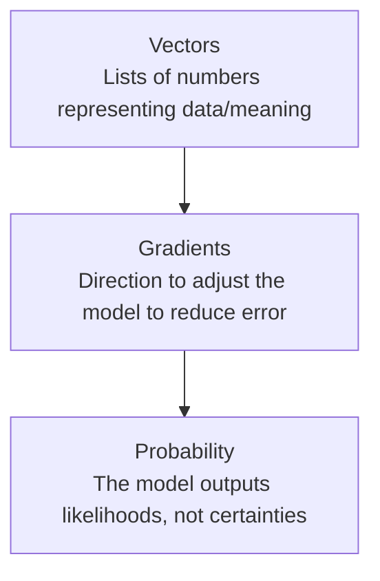

# Math Intuition for AI

> You don't need to solve the equations — you need to know what they're trying to do, and why engineers argue about them.

**Type:** Learn
**Languages:** Python, Concept
**Prerequisites:** API Engineering for AI Applications
**Time:** ~30 minutes

## Learning Objectives

- Build intuition for the three math concepts underpinning nearly all AI: vectors, gradients, and probability
- Understand what "the model learns" actually means in mathematical terms, without needing to do the math yourself
- Recognize why AI outputs are probabilistic, not deterministic, and what that implies for product behavior
- Formulate the right questions when engineering discusses "the loss landscape" or "gradient descent"

## The Problem

An engineer says "the model is stuck in a local minimum" or "the gradients are exploding." Without any intuition for what a gradient is, these phrases sound like jargon rather than precise descriptions of a specific, diagnosable mathematical situation. A TPM doesn't need to derive calculus by hand, but needs enough intuition to ask "what does that mean for whether we can fix it, and how long that takes."

## The Concept

Three mathematical ideas explain almost everything about how AI models are built and how they behave:



### Vectors: Data as Lists of Numbers

A **vector** is simply an ordered list of numbers, like `[0.2, -1.4, 0.9]`. AI models convert everything — words, images, sounds — into vectors, because computers can only do math on numbers, not raw meaning. An **embedding** (mentioned in earlier levels) is just a vector meant to capture the *meaning* of something, positioned so that similar things end up as similar vectors.

### Gradients: How a Model Learns

Training a model means repeatedly adjusting its internal numbers (weights) to make its predictions less wrong. A **gradient** tells the training process which direction, and how much, to adjust each weight to reduce error — like a hiker in fog feeling which way is downhill without seeing the whole mountain. **Gradient descent** is the process of repeatedly taking small steps in that "downhill" direction until error is as low as it can practically get.

- **Local minimum**: a spot that looks like the bottom of a valley from where you're standing, but isn't the lowest point overall — training can get "stuck" here.
- **Exploding/vanishing gradients**: a technical failure mode where the adjustment signal becomes too large (unstable training) or too small (training stalls, barely learning) as it's calculated across many layers.

### Probability: Why AI Outputs Aren't Certain

Modern AI models, especially LLMs, don't output one guaranteed answer — they output a **probability distribution** over possible answers, and then a selection process picks one (sometimes the most likely, sometimes a randomly sampled one, controlled by the "temperature" setting from earlier lessons). This is why the same prompt can produce slightly different answers each time.

## Build It

A tiny, real gradient descent example — finding the minimum of a simple function by "feeling for downhill," without any deep learning library:

```python
def f(x):
    return (x - 3) ** 2 + 2

def gradient(x):
    return 2 * (x - 3)

x = 10.0
learning_rate = 0.1

for step in range(20):
    grad = gradient(x)
    x = x - learning_rate * grad
    if step % 4 == 0:
        print(f"Step {step:2d}: x = {x:.4f}, f(x) = {f(x):.4f}")

print(f"\nFinal x = {x:.4f} (true minimum is at x = 3)")
```

Each step, the code computes the gradient (the "slope" at the current point) and moves a little in the opposite direction — exactly the mechanism used to train neural networks, just on a function simple enough to see clearly.

## Use It

These concepts show up directly in day-to-day AI engineering language:

- **"Learning rate"**: how big a step to take at each gradient descent update — too high and training becomes unstable (overshoots), too low and training is painfully slow.
- **"Loss landscape"**: the overall shape of the error function across all possible weight values — a metaphor for the "terrain" gradient descent is navigating.
- **"Temperature"**: controls how much randomness is used when sampling from the model's output probability distribution (covered again in the Generative AI level).

## Exercises

1. **Easy**: In the gradient descent example above, what happens if `learning_rate` is set much higher, like `2.0`? (Try it and observe.)
2. **Medium**: Explain in plain English why a model output being "a probability distribution" rather than a single fixed answer explains why re-running the same prompt can give different results.
3. **Hard**: Describe, without doing the math, why "vanishing gradients" would make a very deep neural network hard to train, using the "hiker in fog" analogy.

## TPM Perspective

### Strategic Executive Summary
Math fluency at the intuition level — not the derivation level — lets a TPM distinguish a real training blocker ("gradients are exploding, we need architecture changes") from an exaggerated one ("we tried one learning rate and it didn't work"). It also explains a core AI product truth: outputs are probabilistic, so "the model was 95% accurate in testing" does not mean every individual answer is guaranteed correct.

### Questions to Challenge Engineering
1. *"Is this a genuine optimization problem (e.g. exploding/vanishing gradients, stuck in a poor local minimum), or have we only tried one learning rate/configuration?"*
2. *"Given that outputs are probabilistic, what temperature or sampling settings are we using in production, and have we tested for consistency across repeated runs?"*
3. *"What does our evaluation set actually measure, given that a single 'accuracy' number hides the probability distribution behind every prediction?"*

### Trade-Off Matrix

| Concept | Low Setting Effect | High Setting Effect |
| :--- | :--- | :--- |
| **Learning Rate** | Slow, stable training; may take very long to converge | Fast training, but risk of instability/overshooting the minimum |
| **Temperature** | Consistent, conservative, near-deterministic outputs | Creative, varied, but less predictable outputs |
| **Model Depth (layers)** | Simpler patterns learned, faster training | Can learn complex patterns, but higher risk of vanishing/exploding gradients |

## Key Terms

- **Vector**: An ordered list of numbers, used to represent data (text, images, sound) so a computer can perform math on it.
- **Gradient**: A signal indicating the direction and magnitude to adjust a model's internal numbers to reduce error.
- **Gradient Descent**: The iterative process of adjusting a model's weights step by step in the direction that reduces error.
- **Local Minimum**: A point where error looks minimized locally but isn't the best possible outcome overall.
- **Probability Distribution**: A set of likelihoods over possible outputs, which an AI model produces instead of a single guaranteed answer.
