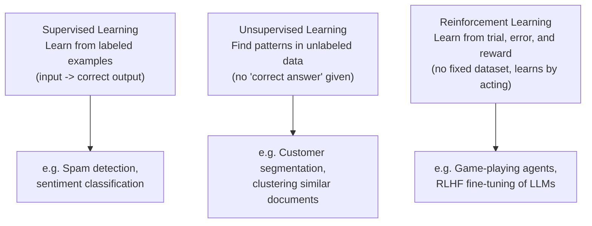

# Supervised vs Unsupervised Learning

> "What kind of learning is this?" is the fastest way to tell if a proposed AI feature even needs labeled data.

**Type:** Learn
**Languages:** Python, Concept
**Prerequisites:** Math Intuition for AI
**Time:** ~25 minutes

## Learning Objectives

- Understand the difference between supervised, unsupervised, and reinforcement learning
- Know why "we need labeled data" is a specific, checkable requirement, not a vague ask
- Recognize which category common AI product features fall into
- Formulate the right questions when a data science team proposes a new modeling approach

## The Problem

A team wants to build a feature that groups similar support tickets together. Someone asks "do we need to label all our historical tickets first?" The honest answer depends entirely on which category of learning the approach uses — and a TPM who doesn't know the difference can't tell whether "we need 10,000 labeled examples" is a real blocker or an avoidable one.

## The Concept

Machine learning approaches fall into three broad categories, distinguished by what kind of data and feedback they use:



### Supervised Learning

The model is trained on examples where the "correct answer" is already known (labeled data): given an email and a label ("spam" or "not spam"), it learns to predict the label for new, unseen emails. This requires a labeled dataset — often the single biggest cost and bottleneck in a supervised learning project.

### Unsupervised Learning

The model finds structure or patterns in data *without* being told the "correct answer" — for example, grouping similar customers together (clustering) without anyone pre-labeling which group each customer belongs to. This avoids the labeling cost, but the resulting groups need human interpretation to be useful ("what do these three clusters actually represent?").

### Reinforcement Learning (RL)

The model (called an "agent") learns by taking actions and receiving rewards or penalties, gradually improving its strategy through trial and error rather than a fixed labeled dataset. This underlies both classic examples (a program learning to play a game) and a technique central to modern LLMs: **RLHF (Reinforcement Learning from Human Feedback)**, used to align a model's responses with human preferences.

## Build It

A simplified supervised learning example — a tiny "spam or not spam" classifier trained on labeled examples, without any external library:

```python
training_data = [
    ("win free money now", "spam"),
    ("meeting moved to 3pm", "not_spam"),
    ("claim your prize today", "spam"),
    ("please review the attached document", "not_spam"),
    ("limited time offer, click now", "spam"),
]

spam_keywords = {"free", "win", "prize", "click", "now", "claim", "offer"}

def extract_features(text):
    words = set(text.lower().split())
    return len(words & spam_keywords)

def train_simple_model(data):
    threshold_scores = [extract_features(text) for text, label in data if label == "spam"]
    return min(threshold_scores) if threshold_scores else 1

threshold = train_simple_model(training_data)
print(f"Learned threshold: if spam-keyword count >= {threshold}, predict spam\n")

test_messages = [
    "win a free prize now",
    "let's schedule the review meeting",
]

for message in test_messages:
    score = extract_features(message)
    prediction = "spam" if score >= threshold else "not_spam"
    print(f"'{message}' -> score={score} -> predicted: {prediction}")
```

This is a deliberately simplified stand-in for supervised learning: it learns a rule *from labeled examples* (`training_data`), then applies that rule to new, unlabeled input.

## Use It

Recognizing the category clarifies real project requirements immediately:

- **"Classify tickets by urgency"** → supervised (needs labeled examples of "urgent" vs. "not urgent" tickets).
- **"Group similar customers for a marketing campaign"** → unsupervised (no predefined "correct" grouping needed upfront).
- **"Make our chatbot's tone more helpful based on user thumbs-up/down feedback"** → reinforcement learning (RLHF-style, learning from reward signals over time).

## Exercises

1. **Easy**: A team wants to detect duplicate support tickets without any pre-labeled "duplicate" examples. Is this more likely a supervised or unsupervised approach?
2. **Medium**: In the spam classifier example, what would happen if the training data only contained spam examples with no `not_spam` examples at all? Would the model still learn something useful?
3. **Hard**: Propose a project where you'd start with unsupervised learning (to explore the data) and then switch to supervised learning (once patterns are understood) — explain why that order makes sense.

## TPM Perspective

### Strategic Executive Summary
"Do we need labeled data?" is one of the highest-leverage questions in early AI project scoping — it directly predicts cost (labeling is expensive and slow) and timeline. Correctly identifying whether a proposed feature is supervised, unsupervised, or reinforcement-learning-based lets a TPM push back on inflated data requirements or catch a genuinely underestimated labeling effort before it derails a roadmap.

### Questions to Challenge Engineering
1. *"Is this feature supervised (needs labeled examples), unsupervised (finds patterns without labels), or reinforcement-learning-based (learns from ongoing feedback/reward)?"*
2. *"If this is supervised, how many labeled examples do we actually need, who will label them, and how will we validate labeling quality?"*
3. *"If this is unsupervised, who will interpret and validate that the resulting patterns/clusters are actually meaningful and useful?"*

### Trade-Off Matrix

| Approach | Data Requirement | Upfront Cost | Best For |
| :--- | :--- | :--- | :--- |
| **Supervised Learning** | Labeled examples (input + correct output) | High (labeling cost/time) | Well-defined prediction tasks (classification, scoring) |
| **Unsupervised Learning** | Unlabeled data only | Lower data cost, but needs human interpretation | Exploratory pattern discovery, segmentation |
| **Reinforcement Learning** | Reward/feedback signal, often no fixed dataset | High engineering complexity, ongoing feedback loop | Sequential decision-making, preference alignment (RLHF) |

## Key Terms

- **Supervised Learning**: Training a model on labeled examples (input paired with the correct output) to predict outputs for new inputs.
- **Unsupervised Learning**: Finding structure or patterns in unlabeled data without a predefined "correct answer."
- **Reinforcement Learning (RL)**: Training an agent to improve its behavior through trial, error, and reward signals rather than a fixed labeled dataset.
- **RLHF (Reinforcement Learning from Human Feedback)**: A technique using human preference signals as the reward to align a model's behavior, widely used in fine-tuning modern LLMs.
- **Labeled Data**: Data paired with the "correct answer," required for supervised learning and often the most expensive part of a project.
