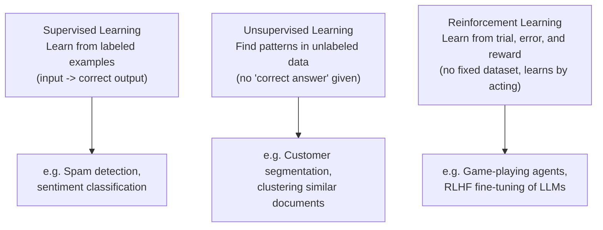

# Supervised vs Unsupervised Learning

> "What kind of learning is this?" is the fastest way to tell if a proposed AI feature even needs labeled data.

**Type:** Learn
**Prerequisites:** Math Intuition for AI
**Time:** ~20 minutes

## Learning Objectives

- Explain the difference between supervised, unsupervised, and reinforcement learning
- Treat "we need labeled data" as a specific, checkable requirement, not a vague ask
- Recognize which category common AI product features fall into
- Formulate the right questions when a data science team proposes a new modeling approach

## What It Is

Machine learning approaches fall into three broad categories, distinguished by what data and feedback they use:

- **Supervised learning**: trained on examples where the correct answer is already known (labeled data). Given an email and the label "spam" or "not spam", it learns to predict the label for new emails.
- **Unsupervised learning**: finds structure in data without being told any correct answer, for example grouping similar customers (clustering).
- **Reinforcement learning (RL)**: an "agent" learns by taking actions and receiving rewards or penalties, improving through trial and error rather than from a fixed dataset.

## Why It Matters

A team wants a feature that groups similar support tickets. Someone asks "do we need to label all our historical tickets first?" The honest answer depends entirely on which category the approach falls into. A TPM who does not know the difference cannot tell whether "we need 10,000 labeled examples" is a real blocker or an avoidable one, and labeling is often the single biggest cost and schedule risk in a project.

## How It Works

**Supervised.** The team collects inputs paired with correct outputs, trains the model to reproduce those pairings, then tests it on examples it has not seen. Simple illustration: a spam filter learns from five labeled messages that words like "free", "win", and "prize" appear in spam; it then scores new messages by how many of those cues appear. If the training set contained only spam and no legitimate examples, the model would have nothing to contrast against and would learn to call everything spam. Labeled data needs both sides.

**Unsupervised.** No labels are required, which removes labeling cost. The catch: the output (say, three clusters of customers) has no built-in meaning. Humans must decide whether "cluster 2" represents high-value repeat buyers or just an artifact of the data.

**Reinforcement.** There is no fixed dataset. The agent acts, gets a reward signal, and adjusts. In LLMs this appears as **RLHF (Reinforcement Learning from Human Feedback)**: humans rank responses, and the rankings become the reward that nudges the model toward preferred behavior.

## Architecture and Workflow



```archify
src: diagrams/learning-types.html
title: Supervised, unsupervised, and reinforcement learning with examples
aspect: 840/432
```

## A Real-World Example

Recognizing the category clarifies requirements immediately:

- **"Classify tickets by urgency"**: supervised. Needs labeled examples of urgent and non-urgent tickets. If three support leads must label 5,000 tickets at about 30 seconds each, that is roughly 42 hours of labeling, which belongs in the plan.
- **"Group similar customers for a campaign"**: unsupervised. No predefined correct grouping; budget time for analysts to interpret the clusters.
- **"Make the chatbot's tone more helpful based on thumbs-up/down"**: reinforcement learning, RLHF-style, learning from reward signals over time.

A common pattern: start unsupervised to explore unfamiliar data and discover what categories exist, then use those findings to define labels and move to supervised learning once the patterns are understood.

## What a TPM Needs to Understand

- "Do we need labeled data?" is one of the highest-leverage scoping questions: it predicts cost and timeline.
- Correct categorization lets you push back on inflated data requirements or catch an underestimated labeling effort before it derails the roadmap.
- Labeling quality matters as much as quantity; inconsistent labelers produce a confused model.
- Unsupervised results are not self-validating and need a named human owner.

## Risks, Dependencies, and Trade-Offs

| Approach | Data Requirement | Upfront Cost | Best For |
| :--- | :--- | :--- | :--- |
| **Supervised Learning** | Labeled examples (input + correct output) | High (labeling cost/time) | Well-defined prediction tasks (classification, scoring) |
| **Unsupervised Learning** | Unlabeled data only | Lower data cost, but needs human interpretation | Exploratory pattern discovery, segmentation |
| **Reinforcement Learning** | Reward/feedback signal, often no fixed dataset | High engineering complexity, ongoing feedback loop | Sequential decision-making, preference alignment (RLHF) |

Failure scenarios: labels were produced by too few or inconsistent labelers; training data has only one class; clusters are delivered with no one accountable for interpreting them; reward signals are gamed or noisy. Dependencies: labeling vendor or internal annotators, data access and privacy approval, and ongoing feedback collection for RL.

## Questions to Ask Engineers

1. *"Is this feature supervised (needs labeled examples), unsupervised (finds patterns without labels), or reinforcement-learning-based (learns from ongoing feedback/reward)?"*
2. *"If this is supervised, how many labeled examples do we actually need, who will label them, and how will we validate labeling quality?"*
3. *"If this is unsupervised, who will interpret and validate that the resulting patterns/clusters are actually meaningful and useful?"*

## Scenario Exercise

A support organization wants (a) automatic duplicate-ticket detection, (b) urgency scoring, and (c) a chatbot that improves from user ratings.

1. **Easy**: Duplicate detection with no pre-labeled "duplicate" examples: supervised or unsupervised, and why?
2. **Medium**: For urgency scoring, engineering asks for 20,000 labeled tickets. What do you ask to test whether that number is justified, and what schedule risks do you flag?
3. **Hard**: Propose a project that starts with unsupervised exploration and then moves to supervised learning, and explain why that order reduces risk and cost.

## Key Terms

- **Supervised Learning**: Training a model on labeled examples (input paired with the correct output) to predict outputs for new inputs.
- **Unsupervised Learning**: Finding structure or patterns in unlabeled data without a predefined "correct answer."
- **Reinforcement Learning (RL)**: Training an agent to improve its behavior through trial, error, and reward signals rather than a fixed labeled dataset.
- **RLHF (Reinforcement Learning from Human Feedback)**: A technique using human preference signals as the reward to align a model's behavior, widely used in fine-tuning modern LLMs.
- **Labeled Data**: Data paired with the "correct answer," required for supervised learning and often the most expensive part of a project.
