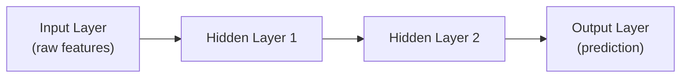

# Neural Networks Basics

> A neural network is just weighted addition and simple math, repeated millions of times, arranged in layers.

**Type:** Learn
**Languages:** Python
**Prerequisites:** Supervised vs Unsupervised Learning
**Time:** ~35 minutes

## Learning Objectives

- Understand what a neuron, a layer, and a neural network actually are, mechanically
- Understand the role of weights, biases, and activation functions
- Recognize why "more layers" and "more parameters" aren't automatically better
- Formulate the right questions when engineering proposes a specific model architecture or size

## The Problem

A team proposes using "a bigger model with more layers" to improve accuracy. Without understanding what a layer or a parameter is, a TPM can't evaluate whether this is likely to help, whether it will make training slower and more expensive, or whether it risks a well-known failure mode (overfitting) instead of actually improving the product.

## The Concept

A neural network is built from simple units (**neurons**) arranged in **layers**, each doing a small, understandable calculation:



### What a Single Neuron Does

A neuron takes several numeric inputs, multiplies each by a learned **weight**, adds a learned **bias**, sums the result, and passes it through an **activation function** that decides how strongly the neuron "fires":

```
neuron_output = activation(w1*x1 + w2*x2 + w3*x3 + ... + bias)
```

- **Weights**: learned numbers determining how much each input matters to this neuron — this is what gradient descent (from the math intuition lesson) actually adjusts during training.
- **Bias**: a learned adjustment that shifts the neuron's output up or down independent of the inputs.
- **Activation function**: a simple, non-linear function (like ReLU or sigmoid) that lets the network model complex, non-straight-line relationships. Without it, stacking layers would be mathematically no different than having just one layer.

### Layers and Depth

Stacking layers lets a network build up increasingly abstract representations — early layers might detect simple patterns, later layers combine those into more complex ones. This is why "deep learning" (many layers) can learn more complex relationships than a single-layer model — but more layers also means more parameters to train, more compute required, and more risk of **overfitting** (memorizing training data instead of learning generalizable patterns).

## Build It

A minimal neural network — a single neuron doing exactly the math described above, with no libraries:

```python
import math

def sigmoid(x):
    return 1 / (1 + math.exp(-x))

def relu(x):
    return max(0, x)

def neuron(inputs, weights, bias, activation=relu):
    weighted_sum = sum(i * w for i, w in zip(inputs, weights)) + bias
    return activation(weighted_sum)

inputs = [1.5, -0.5, 2.0]
weights = [0.4, 0.9, -0.2]
bias = 0.1

output_relu = neuron(inputs, weights, bias, activation=relu)
output_sigmoid = neuron(inputs, weights, bias, activation=sigmoid)

print(f"Inputs: {inputs}")
print(f"Weighted sum + bias: {sum(i*w for i,w in zip(inputs, weights)) + bias:.4f}")
print(f"After ReLU activation: {output_relu:.4f}")
print(f"After Sigmoid activation: {output_sigmoid:.4f}")

def two_neuron_layer(inputs, neurons_config):
    return [neuron(inputs, w, b) for w, b in neurons_config]

layer_config = [
    ([0.4, 0.9, -0.2], 0.1),
    ([-0.3, 0.6, 0.8], -0.2),
]
layer_output = two_neuron_layer(inputs, layer_config)
print(f"\nHidden layer output (2 neurons): {[round(v, 4) for v in layer_output]}")
```

A full neural network is exactly this pattern — many neurons, arranged in many layers — repeated at a scale of millions or billions of weights, with the weights learned via gradient descent instead of hand-set.

## Use It

This vocabulary maps directly onto real architecture discussions:

- **"Parameter count"** (e.g. "a 7B parameter model") refers to the total number of weights and biases across all neurons and layers.
- **"Overfitting"**: a model with too much capacity (too many parameters relative to training data) memorizes the training set instead of learning general patterns, performing well on training data but poorly on new data.
- **"Underfitting"**: the opposite — a model too simple to capture the real pattern, performing poorly even on training data.

## Exercises

1. **Easy**: In the code above, what happens to `output_relu` if all the inputs are negative? (Try changing `inputs` and re-running.)
2. **Medium**: Explain in plain English why an activation function is needed — what would happen if you stacked layers using only weighted sums with no activation function at all?
3. **Hard**: A model performs 99% accuracy on training data but only 60% on new, unseen data. Name this phenomenon and propose two possible fixes.

## TPM Perspective

### Strategic Executive Summary
"More layers" or "more parameters" is not automatically an improvement — it's a trade-off between capacity to learn complex patterns and the risk of overfitting, plus a direct, often significant increase in training cost and inference latency. A TPM should treat a proposed architecture change the same way they'd treat any other engineering trade-off: what evidence suggests this will help, and what's the cost if it doesn't?

### Questions to Challenge Engineering
1. *"Is our current model underfitting (too simple, poor even on training data) or overfitting (great on training data, poor on new data) — because 'add more layers' is the right fix for one and the wrong fix for the other?"*
2. *"What's the expected increase in training time, inference latency, and infrastructure cost from this larger architecture, and is that trade-off justified by the expected accuracy gain?"*
3. *"How are we validating that gains on the training/validation set will hold up on real production traffic?"*

### Trade-Off Matrix

| Model Size | Training Cost | Risk of Overfitting | Ability to Learn Complex Patterns |
| :--- | :--- | :--- | :--- |
| **Small (few layers/parameters)** | Low | Low, but risk of underfitting | Limited |
| **Large (many layers/parameters)** | High | Higher, especially with limited data | High, if enough quality data exists |

## Key Terms

- **Neuron**: A basic computational unit that combines weighted inputs and a bias, then applies an activation function.
- **Weight**: A learned number determining how much a given input matters to a neuron's output; adjusted during training via gradient descent.
- **Bias**: A learned adjustment added to a neuron's weighted sum, independent of the inputs.
- **Activation Function**: A non-linear function (e.g. ReLU, sigmoid) applied to a neuron's output, enabling networks to model complex relationships.
- **Overfitting**: When a model learns training data too specifically (including its noise), performing well on training data but poorly on new, unseen data.
