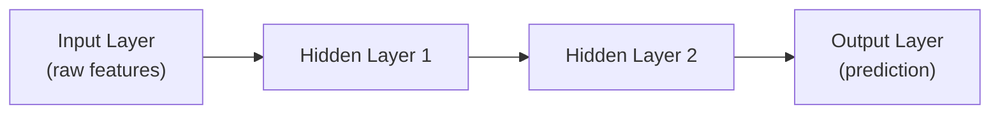

# Neural Networks Basics

> A neural network is just weighted addition and simple math, repeated millions of times, arranged in layers.

**Type:** Learn
**Prerequisites:** Supervised vs Unsupervised Learning
**Time:** ~25 minutes

## Learning Objectives

- Explain what a neuron, a layer, and a neural network actually are, mechanically
- Describe the role of weights, biases, and activation functions
- Recognize why "more layers" and "more parameters" aren't automatically better
- Formulate the right questions when engineering proposes a specific model architecture or size

## What It Is

A neural network is built from simple units (**neurons**) arranged in **layers**. Each neuron takes several numeric inputs, multiplies each by a learned **weight**, adds a learned **bias**, sums the result, and passes it through an **activation function** that decides how strongly the neuron "fires."

- **Weights**: learned numbers saying how much each input matters to this neuron. These are what gradient descent adjusts during training.
- **Bias**: a learned shift that moves the neuron's output up or down regardless of inputs.
- **Activation function**: a simple non-linear function (such as ReLU, which outputs zero for negative values and passes positives through, or sigmoid, which squashes values into a 0-to-1 range). Without it, stacking layers would be mathematically no different from a single layer.

## Why It Matters

A team proposes "a bigger model with more layers" to improve accuracy. Without understanding what a layer or a parameter is, a TPM cannot judge whether this will help, whether it makes training slower and costlier, or whether it risks a well-known failure (overfitting) instead of improving the product.

## How It Works

**One neuron, worked by hand.** Take three inputs 1.5, -0.5, and 2.0 with weights 0.4, 0.9, and -0.2 and a bias of 0.1. Multiply and add: 0.6 - 0.45 - 0.4 = -0.25, plus the bias gives -0.15. With ReLU the neuron outputs 0 (negative values are switched off). With sigmoid it outputs about 0.46. A second neuron in the same layer with different weights might produce 0.65. A **layer** is simply several such neurons looking at the same inputs; the layer's outputs become the next layer's inputs.

**Layers and depth.** Stacking layers lets a network build increasingly abstract representations: early layers detect simple patterns, later layers combine them into complex ones. This is why deep learning (many layers) can learn more complex relationships. But more layers also mean more parameters to train, more compute, and more risk of **overfitting** (memorizing training data instead of learning patterns that generalize).

**Learning.** The weights start essentially arbitrary and are set by gradient descent over the training data, not by hand. A full network is this same pattern at the scale of millions or billions of weights.

## Architecture and Workflow



```archify
src: diagrams/network-layers.html
title: Input, hidden, and output layers of a neural network
aspect: 970/188
```

## A Real-World Example

A churn-prediction model scores 99% on training data but 60% on new customers. Engineering proposes doubling the layers. A TPM recognizes the symptom: the model is overfitting (memorizing), so adding capacity will likely make it worse, not better. Better fixes are more or more varied training data, a smaller model, or techniques that penalize memorization. Contrast with a model scoring poorly on both training and new data: that is underfitting, and a larger model may well be the right answer. Same request, opposite verdicts, depending on the diagnosis.

Vocabulary in architecture discussions: **"parameter count"** (e.g. "7B parameters") is the total number of weights and biases across all neurons and layers.

## What a TPM Needs to Understand

- "More layers" or "more parameters" trades capacity for overfitting risk, plus a direct increase in training cost and inference latency.
- Treat an architecture proposal like any engineering trade-off: what evidence says this will help, and what is the cost if it does not?
- Training performance alone is never proof; ask about performance on unseen data.
- Parameter count is a proxy for cost: bigger models need more memory, more GPUs, and respond slower.

## Risks, Dependencies, and Trade-Offs

| Model Size | Training Cost | Risk of Overfitting | Ability to Learn Complex Patterns |
| :--- | :--- | :--- | :--- |
| **Small (few layers/parameters)** | Low | Low, but risk of underfitting | Limited |
| **Large (many layers/parameters)** | High | Higher, especially with limited data | High, if enough quality data exists |

Failure scenarios: overfitting hidden by reporting only training accuracy; underfitting misdiagnosed as a data problem; a larger model blowing the latency or cost budget in production. Dependencies: quantity and quality of training data, GPU capacity, and inference-latency targets.

## Questions to Ask Engineers

1. *"Is our current model underfitting (too simple, poor even on training data) or overfitting (great on training data, poor on new data) — because 'add more layers' is the right fix for one and the wrong fix for the other?"*
2. *"What's the expected increase in training time, inference latency, and infrastructure cost from this larger architecture, and is that trade-off justified by the expected accuracy gain?"*
3. *"How are we validating that gains on the training/validation set will hold up on real production traffic?"*

## Scenario Exercise

Your team's fraud model hits 99% on training data and 60% on a fresh sample, and engineering asks for a 4x larger model and extra GPU budget.

1. **Easy**: What is this phenomenon called, and which is it likely to be: underfitting or overfitting?
2. **Medium**: Explain in plain English why an activation function is needed: what happens if layers use only weighted sums with none?
3. **Hard**: Name two alternatives to the 4x model, and describe how you would structure the go/no-go decision, including cost, latency, and evidence required.

## Key Terms

- **Neuron**: A basic computational unit that combines weighted inputs and a bias, then applies an activation function.
- **Weight**: A learned number determining how much a given input matters to a neuron's output; adjusted during training via gradient descent.
- **Bias**: A learned adjustment added to a neuron's weighted sum, independent of the inputs.
- **Activation Function**: A non-linear function (e.g. ReLU, sigmoid) applied to a neuron's output, enabling networks to model complex relationships.
- **Overfitting**: When a model learns training data too specifically (including its noise), performing well on training data but poorly on new, unseen data.
