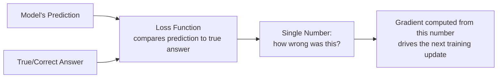

# Loss Functions and Optimization

> "The loss is going down" only means the model is getting better at whatever the loss function actually measures — and that's not always what you care about.

**Type:** Learn
**Prerequisites:** Neural Networks Basics
**Time:** ~20 minutes

## Learning Objectives

- Explain what a loss function is and why training is really just "minimize this number"
- Recognize common loss functions and what kind of task each is suited for
- Explain why a decreasing loss doesn't automatically mean a better product outcome
- Formulate the right questions when engineering reports training progress via loss curves

## What It Is

A **loss function** is a formula that turns "how wrong was this prediction?" into a single number. Training is, mechanically, the process of adjusting weights (via gradient descent) to make this number as small as possible across the training data.

Common loss functions:

- **Mean Squared Error (MSE)**: for predicting continuous numbers (a price, a temperature). Squares each error, so large errors are penalized far more than small ones.
- **Mean Absolute Error (MAE)**: for the same task, but treats every error proportionally.
- **Cross-Entropy Loss**: for classification ("spam or not", "which of 10 categories"). Measures how far predicted probabilities are from the correct category.
- **Perplexity**: for language models. Roughly how "surprised" the model is by the actual next word; lower is better next-word prediction.

## Why It Matters

An engineer shows a chart of training loss steadily decreasing and says training is going well. A TPM who does not know what loss measures might assume this guarantees the product will work for users. In reality a loss function is a narrow proxy for "wrongness," and a model can have excellent loss numbers while failing the real product goal if the loss does not measure the right thing.

## How It Works

Each training step: the model predicts, the loss function compares the prediction to the true answer, and the resulting number produces a gradient that drives the next weight update.

**Worked comparison.** Suppose a model predicts 10, 20, 30, and 100 where the true values are 12, 19, 31, and 40. The errors are 2, 1, 1, and 60. MAE averages the absolute errors: 64 / 4 = 16. MSE squares them first (4, 1, 1, 3,600) and averages: 3,606 / 4 = 901.5. One large miss dominates MSE almost entirely. That is a real design choice: MSE is right when rare big mistakes are especially costly, while MAE is more forgiving of outliers.

**Why a falling loss is not the whole story.** The loss is a **proxy**, chosen because it is mathematically convenient to optimize. A chatbot's loss may measure "did it predict the next word," while the product goal is "was this response helpful and safe." Those two do not always move together.

## Architecture and Workflow



```archify
src: diagrams/loss-to-gradient.html
title: How a loss value drives the next training update
aspect: 1330/328
```

## A Real-World Example

Three conversations a TPM will hear:

- **"Training loss is decreasing but validation loss is increasing"**: a classic overfitting signal. The model is getting better at the training data specifically, not at generalizing.
- **"We switched from MSE to a custom loss"**: usually the team decided standard math did not reflect what mattered, for example penalizing underestimates of price more than overestimates because underpricing loses money.
- **"Loss looks great but the demo feels wrong"**: a strong sign the loss is a poor proxy for the user-facing goal, and that evaluation metrics closer to real outcomes are needed (next lesson).

## What a TPM Needs to Understand

- A loss curve is a training-time signal, not a product-quality guarantee. It answers "is the model learning something," not "is it achieving what we need."
- Always ask what the loss actually measures and how faithful a proxy it is for the product goal.
- Insist on evaluation metrics that get closer to the real goal.
- Training loss and validation loss must be read together.

## Risks, Dependencies, and Trade-Offs

| Loss Function | Best For | Weakness |
| :--- | :--- | :--- |
| **Mean Squared Error (MSE)** | Continuous predictions where large errors are especially costly | Overly sensitive to rare, large errors/outliers |
| **Mean Absolute Error (MAE)** | Continuous predictions where all errors should be weighted proportionally | Less sensitive to genuinely dangerous large errors |
| **Cross-Entropy Loss** | Classification tasks with clear correct categories | Doesn't directly measure real-world usefulness or safety |
| **Perplexity** | Language model next-word prediction quality | Low perplexity doesn't guarantee helpful, safe, or on-topic responses |

Failure scenarios: a team ships on loss numbers alone and discovers poor user outcomes; outliers in the data dominate MSE and distort the model; validation loss diverges unnoticed. Dependencies: a validation set separate from training data and an evaluation plan tied to product outcomes.

## Questions to Ask Engineers

1. *"What exactly does this loss function measure, and how closely does that map to the actual product outcome we care about?"*
2. *"Is training loss decreasing while validation loss is flat or increasing — and if so, are we treating that as an overfitting signal?"*
3. *"If the loss numbers look good but a manual review of outputs feels wrong, what does that tell us about whether we're optimizing the right thing?"*

## Scenario Exercise

Engineering reports that a support chatbot's perplexity improved 12% this sprint, but reviewers say answers feel less helpful.

1. **Easy**: In the 10/20/30/100 example, which of MSE or MAE would you choose to be especially harsh on large errors, and why?
2. **Medium**: Explain in plain English why "perplexity went down" does not automatically mean users will find responses more helpful.
3. **Hard**: Propose a product scenario where optimizing purely for a standard loss (such as cross-entropy) yields a technically accurate but unhelpful or unsafe model, and what evaluation you would add.

## Key Terms

- **Loss Function**: A formula that converts "how wrong was this prediction?" into a single number that training tries to minimize.
- **Mean Squared Error (MSE)**: A loss function for continuous predictions that squares errors, heavily penalizing large mistakes.
- **Cross-Entropy Loss**: A loss function for classification tasks, measuring the gap between predicted and true category probabilities.
- **Perplexity**: A loss-related metric for language models measuring how well the model predicts the next word in a sequence.
- **Proxy Metric**: A measurable stand-in for a real goal that is hard to measure directly, useful but not guaranteed to fully align with that real goal.
