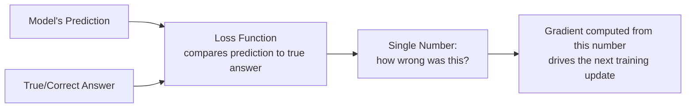

# Loss Functions and Optimization

> "The loss is going down" only means the model is getting better at whatever the loss function actually measures — and that's not always what you care about.

**Type:** Learn
**Languages:** Python
**Prerequisites:** Neural Networks Basics
**Time:** ~25 minutes

## Learning Objectives

- Understand what a loss function is and why training is really just "minimize this number"
- Recognize common loss functions and what kind of task each is suited for
- Understand why a decreasing loss doesn't automatically mean a better product outcome
- Formulate the right questions when engineering reports training progress via loss curves

## The Problem

An engineer shows a chart of "training loss" steadily decreasing over time and says training is going well. A TPM without knowing what "loss" measures might assume this guarantees the product will work well for users. In reality, a loss function is a specific, narrow proxy for "wrongness" — and a model can have excellent loss numbers while still failing at the actual product goal, if the loss function doesn't measure the right thing.

## The Concept

A **loss function** is a formula that turns "how wrong was this prediction?" into a single number. Training a model is, mechanically, the process of adjusting weights (via gradient descent, from the math intuition lesson) to make this number as small as possible across the training data.



### Common Loss Functions

- **Mean Squared Error (MSE)**: used for predicting continuous numbers (e.g. predicting a price or a temperature) — penalizes larger errors much more than smaller ones.
- **Cross-Entropy Loss**: used for classification tasks (e.g. "is this spam or not," "which of these 10 categories") — measures how far the model's predicted probabilities are from the correct category.
- **Perplexity**: commonly used for language models — roughly measures how "surprised" the model is by the actual next word in a sequence; lower perplexity means better next-word prediction.

### Why "Loss Went Down" Isn't the Whole Story

A loss function is a **proxy** — a stand-in the team chose because it's mathematically convenient to optimize, not necessarily a direct measure of the actual product goal. A chatbot's loss function might measure "did it predict the next word correctly," but the real product goal might be "was this response actually helpful and safe" — two different things that don't always move together.

## Build It

Comparing two loss functions on the same predictions to see how differently they penalize errors:

```python
def mean_squared_error(predictions, targets):
    return sum((p - t) ** 2 for p, t in zip(predictions, targets)) / len(predictions)

def mean_absolute_error(predictions, targets):
    return sum(abs(p - t) for p, t in zip(predictions, targets)) / len(predictions)

predictions = [10, 20, 30, 100]
targets =     [12, 19, 31, 40]

mse = mean_squared_error(predictions, targets)
mae = mean_absolute_error(predictions, targets)

print(f"Predictions: {predictions}")
print(f"Targets:     {targets}")
print(f"Mean Squared Error: {mse:.2f}")
print(f"Mean Absolute Error: {mae:.2f}")
print("\nNotice: the one large error (100 vs 40) inflates MSE much more than MAE,")
print("because MSE squares each error before averaging.")
```

This shows a real design choice: MSE punishes large, rare errors heavily (useful if big mistakes are especially costly), while MAE treats all errors more proportionally.

## Use It

Understanding loss functions clarifies real training conversations:

- **"Training loss is decreasing but validation loss is increasing"** → a classic overfitting signal (from the neural networks lesson): the model is getting better at the training data specifically, not at generalizing.
- **"We switched from MSE to a custom loss function"** → usually means the team decided the standard math didn't reflect what actually mattered for the product (e.g. penalizing underestimates more than overestimates for a pricing model).
- **"Loss looks great but the demo feels wrong"** → a strong signal the loss function is a poor proxy for the actual user-facing goal, and evaluation metrics (next lesson) closer to real product outcomes are needed.

## Exercises

1. **Easy**: In the code above, which loss function (MSE or MAE) would you choose if you wanted to be especially harsh on large prediction errors, and why?
2. **Medium**: Explain in plain English why "perplexity went down" for a language model doesn't automatically mean users will find its responses more helpful.
3. **Hard**: Propose a product scenario where optimizing purely for a standard loss function (like cross-entropy) could produce a technically "accurate" but practically unhelpful or unsafe model.

## TPM Perspective

### Strategic Executive Summary
A loss curve is a training-time signal, not a product-quality guarantee. "Loss is going down" answers "is the model learning something," not "is the model achieving what we actually need." A TPM should always ask what the loss function is actually measuring and whether that measurement is a faithful proxy for the real product goal — and insist on evaluation metrics (the next lesson) that get closer to that real goal.

### Questions to Challenge Engineering
1. *"What exactly does this loss function measure, and how closely does that map to the actual product outcome we care about?"*
2. *"Is training loss decreasing while validation loss is flat or increasing — and if so, are we treating that as an overfitting signal?"*
3. *"If the loss numbers look good but a manual review of outputs feels wrong, what does that tell us about whether we're optimizing the right thing?"*

### Trade-Off Matrix

| Loss Function | Best For | Weakness |
| :--- | :--- | :--- |
| **Mean Squared Error (MSE)** | Continuous predictions where large errors are especially costly | Overly sensitive to rare, large errors/outliers |
| **Mean Absolute Error (MAE)** | Continuous predictions where all errors should be weighted proportionally | Less sensitive to genuinely dangerous large errors |
| **Cross-Entropy Loss** | Classification tasks with clear correct categories | Doesn't directly measure real-world usefulness or safety |
| **Perplexity** | Language model next-word prediction quality | Low perplexity doesn't guarantee helpful, safe, or on-topic responses |

## Key Terms

- **Loss Function**: A formula that converts "how wrong was this prediction?" into a single number that training tries to minimize.
- **Mean Squared Error (MSE)**: A loss function for continuous predictions that squares errors, heavily penalizing large mistakes.
- **Cross-Entropy Loss**: A loss function for classification tasks, measuring the gap between predicted and true category probabilities.
- **Perplexity**: A loss-related metric for language models measuring how well the model predicts the next word in a sequence.
- **Proxy Metric**: A measurable stand-in for a real goal that is hard to measure directly, useful but not guaranteed to fully align with that real goal.
