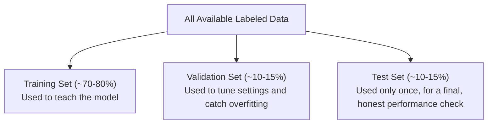

# Model Evaluation and Metrics

> "95% accurate" is meaningless until you know 95% of what, measured how, on which data.

**Type:** Learn
**Languages:** Python
**Prerequisites:** Loss Functions and Optimization
**Time:** ~30 minutes

## Learning Objectives

- Understand why "accuracy" alone is often a misleading metric
- Know the core evaluation concepts: precision, recall, and the trade-off between them
- Understand the difference between training data, validation data, and test data
- Formulate the right questions when a team reports a model's performance metrics

## The Problem

A team reports "our fraud detection model is 99% accurate." This sounds impressive — until you learn that only 1% of transactions are actually fraudulent, meaning a model that predicts "not fraud" for everything would also score 99% accurate while catching zero fraud. Without knowing this, a TPM can be misled by a technically true but practically meaningless number.

## The Concept

Evaluating a model well requires more than one number, and requires evaluating it on data it hasn't already seen.



### Why Accuracy Alone Misleads on Imbalanced Data

When one outcome (e.g. "not fraud") is much more common than another (e.g. "fraud"), a model can achieve high accuracy just by always guessing the common outcome. This is why fraud detection, rare disease diagnosis, and similar "needle in a haystack" problems need better metrics than raw accuracy.

### Precision and Recall

- **Precision**: of everything the model flagged as positive (e.g. "fraud"), what fraction actually was? High precision means few false alarms.
- **Recall**: of everything that was actually positive, what fraction did the model catch? High recall means few missed cases.

These two usually trade off against each other: a model tuned to catch every possible fraud case (high recall) will likely also flag more legitimate transactions as suspicious (lower precision), and vice versa.

```
                Actual: Fraud     Actual: Not Fraud
Predicted: Fraud     True Positive      False Positive
Predicted: Not Fraud False Negative     True Negative

Precision = True Positives / (True Positives + False Positives)
Recall    = True Positives / (True Positives + False Negatives)
```

### Train / Validation / Test Split

- **Training set**: the data the model actually learns from.
- **Validation set**: used during development to tune settings and check for overfitting — the model doesn't directly learn from it, but the team uses it to make decisions.
- **Test set**: held back and used only once, at the very end, to get an honest final performance estimate — reusing it repeatedly during development would let the team unconsciously "overfit" their decisions to it.

## Build It

Computing precision and recall from a small confusion matrix, showing why accuracy alone hides the real story:

```python
predictions = ["fraud", "not_fraud", "not_fraud", "not_fraud", "fraud", "not_fraud", "not_fraud", "not_fraud", "not_fraud", "not_fraud"]
actuals =     ["fraud", "not_fraud", "not_fraud", "not_fraud", "not_fraud", "not_fraud", "not_fraud", "not_fraud", "not_fraud", "fraud"]

true_positives = sum(1 for p, a in zip(predictions, actuals) if p == "fraud" and a == "fraud")
false_positives = sum(1 for p, a in zip(predictions, actuals) if p == "fraud" and a == "not_fraud")
false_negatives = sum(1 for p, a in zip(predictions, actuals) if p == "not_fraud" and a == "fraud")
true_negatives = sum(1 for p, a in zip(predictions, actuals) if p == "not_fraud" and a == "not_fraud")

accuracy = (true_positives + true_negatives) / len(predictions)
precision = true_positives / (true_positives + false_positives) if (true_positives + false_positives) > 0 else 0
recall = true_positives / (true_positives + false_negatives) if (true_positives + false_negatives) > 0 else 0

print(f"Accuracy:  {accuracy:.2%}")
print(f"Precision: {precision:.2%}  (of flagged fraud, how much was real)")
print(f"Recall:    {recall:.2%}  (of real fraud, how much was caught)")
print(f"\nTrue Positives: {true_positives}, False Positives: {false_positives}, False Negatives: {false_negatives}")
```

Even with reasonable accuracy, this example reveals a missed fraud case (a false negative) that accuracy alone would hide behind a high overall score, because "not fraud" is the dominant, easy-to-get-right class.

## Use It

Real teams choose evaluation metrics based on what mistake is more costly for the specific product:

- **Fraud detection, medical screening**: usually prioritize recall (catching real positives), even at some cost to precision, because missing a real case is worse than a false alarm.
- **Spam filtering**: usually prioritize precision (avoiding false alarms), because incorrectly flagging a real email as spam is often worse than letting one spam email through.
- **LLM evaluation**: often uses a combination of automated metrics (perplexity, task-specific scores) and human or LLM-judged evaluation of response quality, since "correctness" for open-ended text is harder to define than a fraud/not-fraud label.

## Exercises

1. **Easy**: In the example above, is recall or precision lower, and what does that tell you about the model's biggest weakness?
2. **Medium**: Explain in plain English why reusing the test set repeatedly during development (instead of only at the end) would give a misleadingly optimistic final performance estimate.
3. **Hard**: Propose an evaluation strategy for a customer support chatbot, where "correctness" isn't a simple fraud/not-fraud label — what would you measure, and how?

## TPM Perspective

### Strategic Executive Summary
A single accuracy number, especially on imbalanced data, can hide a model that's practically useless for its intended purpose. Precision and recall force a concrete conversation about which mistake is more costly for this specific product — and the train/validation/test discipline protects against a team unintentionally reporting an over-optimistic final number.

### Questions to Challenge Engineering
1. *"Given how rare/common the positive case is in our data, is accuracy alone a misleading metric here — what are the precision and recall numbers?"*
2. *"For this specific product, is a false positive (false alarm) or a false negative (missed case) more costly, and does our current model's precision/recall balance match that priority?"*
3. *"Was this performance number measured on a genuinely held-out test set the model never influenced decisions on, or has this same data been reused repeatedly during development?"*

### Trade-Off Matrix

| Metric Priority | Good For | Risk |
| :--- | :--- | :--- |
| **High Recall (catch everything)** | Fraud detection, medical screening, safety-critical filtering | More false alarms, higher review/operational burden |
| **High Precision (avoid false alarms)** | Spam filtering, low-tolerance-for-annoyance features | More missed real cases |
| **Accuracy alone (no precision/recall)** | Simple, balanced classification problems only | Highly misleading on imbalanced/rare-event data |

## Key Terms

- **Accuracy**: The fraction of all predictions that were correct; can be misleading when one outcome is much more common than another.
- **Precision**: Of everything predicted positive, the fraction that was actually positive.
- **Recall**: Of everything actually positive, the fraction the model correctly identified.
- **Training / Validation / Test Set**: The three-way data split used to train a model, tune it during development, and honestly evaluate its final performance exactly once.
- **False Negative / False Positive**: A missed real case (false negative) versus a false alarm (false positive) — the two error types precision and recall separately measure.
