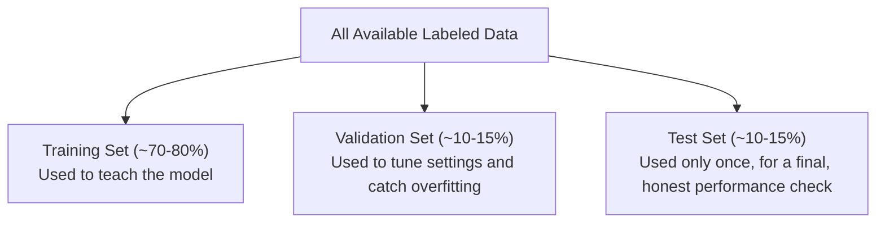

# Model Evaluation and Metrics

> "95% accurate" is meaningless until you know 95% of what, measured how, on which data.

**Type:** Learn
**Prerequisites:** Loss Functions and Optimization
**Time:** ~25 minutes

## Learning Objectives

- Explain why "accuracy" alone is often a misleading metric
- Describe precision, recall, and the trade-off between them
- Distinguish training data, validation data, and test data
- Formulate the right questions when a team reports a model's performance metrics

## What It Is

Evaluating a model well requires more than one number, and requires evaluating it on data it has not already seen.

- **Accuracy**: the fraction of all predictions that were correct.
- **Precision**: of everything the model flagged as positive (e.g. "fraud"), what fraction actually was. High precision means few false alarms.
- **Recall**: of everything actually positive, what fraction the model caught. High recall means few missed cases.
- **Train / validation / test split**: the data is divided so the model learns from one part, is tuned on another, and is honestly judged on a third.

## Why It Matters

A team reports "our fraud detection model is 99% accurate." Impressive, until you learn only 1% of transactions are fraudulent: a model that says "not fraud" for everything would also score 99% while catching zero fraud. A TPM without this knowledge can be misled by a technically true but practically meaningless number.

## How It Works

**Imbalanced data.** When one outcome is far more common, a model can score high accuracy by always guessing the common one. Fraud, rare disease, and other needle-in-a-haystack problems need better metrics.

**The four outcomes.** Every prediction lands in one of four boxes: true positive (flagged fraud, was fraud), false positive (flagged fraud, was legitimate), false negative (missed real fraud), true negative (correctly passed legitimate).

| | Actual: Fraud | Actual: Not Fraud |
| :--- | :--- | :--- |
| **Predicted: Fraud** | True Positive | False Positive |
| **Predicted: Not Fraud** | False Negative | True Negative |

Precision = true positives divided by all flagged cases. Recall = true positives divided by all real cases.

**Worked example.** Ten transactions: the model flags two as fraud, and one of those is real (1 true positive, 1 false positive). It misses one real fraud (1 false negative) and correctly passes 7 legitimate ones. Accuracy is 8 of 10, or 80%. Precision is 1 of 2, or 50%. Recall is 1 of 2, or 50%. The headline number looks fine; the model actually missed half of all fraud and half its alerts were false alarms.

**Precision and recall trade off.** Tune the model to catch every possible fraud (high recall) and it flags more legitimate transactions (lower precision), and vice versa.

**The three-way split.**
- **Training set** (about 70-80%): what the model learns from.
- **Validation set** (about 10-15%): used during development to tune settings and detect overfitting; the team makes decisions from it.
- **Test set** (about 10-15%): held back and used once at the end for an honest estimate. Reusing it repeatedly lets the team unconsciously tune decisions to it, giving an over-optimistic result.

## Architecture and Workflow



```archify
src: diagrams/data-split.html
title: Splitting labeled data into training, validation and test sets
aspect: 750/392
```

## A Real-World Example

Teams choose metrics by which mistake is more costly:

- **Fraud detection, medical screening**: prioritize recall, because missing a real case is worse than a false alarm.
- **Spam filtering**: prioritize precision, because flagging a real email as spam is usually worse than letting one spam through.
- **LLM evaluation**: combines automated metrics (perplexity, task-specific scores) with human or LLM-judged quality review, since correctness for open-ended text is harder to define than a fraud label. For a support chatbot this might mean a fixed set of 200 real questions, scored by reviewers on correctness, tone, and safety, plus tracking escalation rate in production.

## What a TPM Needs to Understand

- A single accuracy number, especially on imbalanced data, can hide a model that is useless for its purpose.
- Precision and recall force the conversation about which mistake costs more for this product, and that answer is a business decision, not just a technical one.
- Train/validation/test discipline protects against over-optimistic reporting.
- Always ask what data a metric was measured on, and whether it resembles production traffic.

## Risks, Dependencies, and Trade-Offs

| Metric Priority | Good For | Risk |
| :--- | :--- | :--- |
| **High Recall (catch everything)** | Fraud detection, medical screening, safety-critical filtering | More false alarms, higher review/operational burden |
| **High Precision (avoid false alarms)** | Spam filtering, low-tolerance-for-annoyance features | More missed real cases |
| **Accuracy alone (no precision/recall)** | Simple, balanced classification problems only | Highly misleading on imbalanced/rare-event data |

Failure scenarios: test set reused during tuning; test data that does not reflect production (stale or cleaner than reality); metrics averaged so a weak segment (one language, one customer type) is hidden. Dependencies: a trustworthy labeled test set and reviewer capacity for the cost of false alarms.

## Questions to Ask Engineers

1. *"Given how rare/common the positive case is in our data, is accuracy alone a misleading metric here — what are the precision and recall numbers?"*
2. *"For this specific product, is a false positive (false alarm) or a false negative (missed case) more costly, and does our current model's precision/recall balance match that priority?"*
3. *"Was this performance number measured on a genuinely held-out test set the model never influenced decisions on, or has this same data been reused repeatedly during development?"*

## Scenario Exercise

A fraud model reports 99% accuracy; fraud is 1% of transactions. In a sample of 10 with 2 flagged, 1 was real and 1 real fraud was missed.

1. **Easy**: In that sample, which is lower, precision or recall, and what does it tell you about the model's weakness?
2. **Medium**: Explain why reusing the test set repeatedly during development gives a misleadingly optimistic estimate.
3. **Hard**: Propose an evaluation strategy for a customer support chatbot where correctness is not a simple label: what would you measure, on what data, and who decides the pass threshold?

## Key Terms

- **Accuracy**: The fraction of all predictions that were correct; can be misleading when one outcome is much more common than another.
- **Precision**: Of everything predicted positive, the fraction that was actually positive.
- **Recall**: Of everything actually positive, the fraction the model correctly identified.
- **Training / Validation / Test Set**: The three-way data split used to train a model, tune it during development, and honestly evaluate its final performance exactly once.
- **False Negative / False Positive**: A missed real case (false negative) versus a false alarm (false positive) — the two error types precision and recall separately measure.
