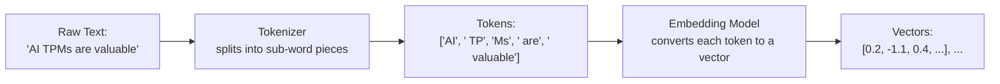

# Tokens and Embeddings

> An LLM never actually sees words — it sees a list of numbers, and everything it "understands" is encoded in those numbers.

**Type:** Learn
**Languages:** Python
**Prerequisites:** Model Evaluation and Metrics
**Time:** ~30 minutes

## Learning Objectives

- Understand how text is broken into tokens before an LLM can process it
- Understand what an embedding is and why "similar meaning" maps to "similar vectors"
- Recognize why token count (not word count or character count) drives cost, context limits, and latency
- Formulate the right questions when engineering discusses tokenization or embedding model choices

## The Problem

A product team is surprised that a "short" user question in a non-English language costs noticeably more than an equivalent English question. Without understanding tokenization, this looks like a billing bug. In reality, different languages and content types (code, emoji, non-Latin scripts) often tokenize into more pieces per character — a well-known, predictable effect once you understand what a token actually is.

## The Concept

Before any AI processing happens, text is converted through two steps: tokenization, then embedding.



### Tokenization

A **tokenizer** breaks text into smaller pieces (**tokens**) — often sub-word chunks rather than whole words. Common words might be a single token; rare words, made-up words, or non-English text often split into multiple tokens. This directly explains billing and rate-limit behavior from earlier levels: cost and rate limits are measured in tokens, not words or characters.

### Embeddings

Once text is tokenized, each token (or a whole passage) can be converted into an **embedding**: a vector (list of numbers, from the math intuition lesson) that represents its *meaning* in a way a computer can do math on. The key property: texts with similar meaning end up with similar (mathematically "close") vectors, even if they share no exact words.

```
embedding("puppy")  ≈ close to ≈  embedding("dog")
embedding("puppy")  ≈ far from ≈  embedding("stock market")
```

This "closeness" is typically measured with **cosine similarity** — a number between -1 and 1 showing how aligned two vectors are, regardless of their size.

### Why This Matters Practically

- **Cost and rate limits**: billed and throttled per token, and token count varies by language, formatting, and content type.
- **Semantic search / RAG**: retrieval systems (covered in depth in a later level) work by comparing embeddings, not exact keyword matches — this is how a search for "cheap flights" can match a document that says "affordable airfare."

## Build It

A simplified illustration of tokenization behavior and embedding-based similarity, without needing a real tokenizer library:

```python
import math

def naive_tokenize(text):
    return text.replace(",", " ,").replace(".", " .").split()

sentences = [
    "AI TPMs need technical fluency.",
    "Programa de gestion de proyectos de IA.",
    "def estimate_cost(tokens): return tokens * 0.002",
]

for s in sentences:
    tokens = naive_tokenize(s)
    print(f"'{s}' -> {len(tokens)} naive tokens: {tokens}")

def cosine_similarity(vec_a, vec_b):
    dot_product = sum(a * b for a, b in zip(vec_a, vec_b))
    magnitude_a = math.sqrt(sum(a * a for a in vec_a))
    magnitude_b = math.sqrt(sum(b * b for b in vec_b))
    return dot_product / (magnitude_a * magnitude_b)

embedding_puppy = [0.9, 0.1, 0.0]
embedding_dog = [0.85, 0.15, 0.05]
embedding_stock_market = [0.0, 0.1, 0.95]

print(f"\nSimilarity(puppy, dog) = {cosine_similarity(embedding_puppy, embedding_dog):.3f}")
print(f"Similarity(puppy, stock market) = {cosine_similarity(embedding_puppy, embedding_stock_market):.3f}")
```

The real tokenizer a production LLM uses is more sophisticated (e.g. byte-pair encoding), but the naive version above still demonstrates the core idea: the *same sentence length in words* can produce a different number of tokens depending on language and content.

## Use It

This vocabulary underpins nearly every AI product decision from here on:

- **Semantic search / RAG systems** retrieve documents by embedding similarity, not exact keyword match.
- **Cost estimation** for any LLM feature starts with estimating token counts per request, not character or word counts.
- **Context window limits** (from Level 0) are token limits, so the same "amount of content" can fit differently depending on language or format.

## Exercises

1. **Easy**: Why might a sentence in Japanese or Arabic use noticeably more tokens than an equivalent-length English sentence?
2. **Medium**: Using the `cosine_similarity` function above, predict (before running) whether `embedding("cat")` would likely be closer to `embedding("dog")` or `embedding("stock market")`, and explain why.
3. **Hard**: A RAG system returns irrelevant documents for a user's query even though the exact keywords don't match. Using what you've learned about embeddings, propose one hypothesis for why this might still be working as intended, and one hypothesis for why it might be a real bug.

## TPM Perspective

### Strategic Executive Summary
Tokenization and embeddings explain two of the most common "surprises" in AI product cost and quality: unexpected per-language cost differences, and search/retrieval results that don't match exact keywords but do match meaning. Both are precise, well-understood mechanisms, not mysterious model behavior.

### Questions to Challenge Engineering
1. *"Have we measured token counts (not word/character counts) across our actual supported languages and content types, to get an accurate cost estimate?"*
2. *"For our retrieval/search feature, are we doing embedding-based semantic search, exact keyword match, or a hybrid — and does that match what users actually expect?"*
3. *"Which embedding model are we using, and have we evaluated whether it performs well for our specific domain (e.g. technical jargon, non-English content)?"*

### Trade-Off Matrix

| Approach | Handles Synonyms/Meaning | Cost | Precision on Exact Matches |
| :--- | :--- | :--- | :--- |
| **Exact keyword search** | No | Low | High for exact matches, misses paraphrases |
| **Embedding-based semantic search** | Yes | Moderate (embedding + storage cost) | Can miss exact rare terms in favor of "similar" ones |
| **Hybrid (keyword + embedding)** | Yes | Higher (runs both) | Best of both, more engineering complexity |

## Key Terms

- **Token**: A sub-word chunk of text, the basic unit LLMs process, bill on, and rate-limit against.
- **Tokenizer**: The component that splits raw text into tokens before any model processing happens.
- **Embedding**: A vector representing the meaning of text, positioned so similar-meaning content has similar vectors.
- **Cosine Similarity**: A measure (from -1 to 1) of how aligned two vectors are, commonly used to compare embeddings.
- **Semantic Search**: Search based on meaning (via embeddings) rather than exact keyword matching.
