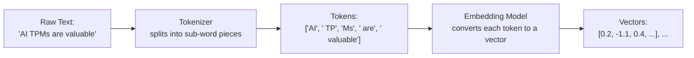

# Tokens and Embeddings

> An LLM never actually sees words — it sees a list of numbers, and everything it "understands" is encoded in those numbers.

**Type:** Learn
**Prerequisites:** Model Evaluation and Metrics
**Time:** ~20 minutes

## Learning Objectives

- Explain how text is broken into tokens before an LLM can process it
- Explain what an embedding is and why "similar meaning" maps to "similar vectors"
- Recognize why token count (not word count or character count) drives cost, context limits, and latency
- Formulate the right questions when engineering discusses tokenization or embedding model choices

## What It Is

Before any AI processing happens, text goes through two steps: tokenization, then embedding.

- A **tokenizer** breaks text into smaller pieces called **tokens**, often sub-word chunks rather than whole words. Common words may be one token; rare words, made-up words, and non-English text often split into several.
- An **embedding** is a vector (a list of numbers) that represents the *meaning* of a token or passage so a computer can do math on it. Texts with similar meaning get similar, mathematically "close" vectors, even if they share no exact words.

## Why It Matters

A product team is surprised that a "short" question in a non-English language costs noticeably more than an equivalent English one. Without understanding tokenization this looks like a billing bug. In reality, different languages and content types (code, emoji, non-Latin scripts) often split into more pieces per character, a predictable effect once you know what a token is.

Token count, not word or character count, drives cost, rate limits, context-window limits, and latency.

## How It Works

**Tokenization.** Cost and rate limits are measured in tokens. The same amount of content can differ greatly in token count: plain English prose is the cheapest, while a sentence in Japanese or Arabic, a block of source code, or text full of emoji and unusual identifiers typically breaks into more tokens. A rough planning rule for English is about 4 characters or 0.75 words per token, but real estimates must be measured on your actual languages and content.

**Embeddings and closeness.** The closeness of two vectors is usually measured with **cosine similarity**, a number from -1 to 1 showing how aligned two vectors are regardless of their size. Worked example with toy three-number embeddings: "puppy" and "dog" score about 0.996 (nearly identical direction), while "puppy" and "stock market" score about 0.01 (essentially unrelated). Real embeddings have hundreds or thousands of numbers, but the logic is the same.

**Semantic search.** Retrieval systems compare embeddings rather than exact keywords, which is how a search for "cheap flights" can match a document that says "affordable airfare."

## Architecture and Workflow



```archify
src: diagrams/text-to-vectors.html
title: From raw text to tokens to embedding vectors
aspect: 1250/172
```

## A Real-World Example

A company plans a multilingual support assistant. Finance budgets from English test traffic: roughly 300 tokens per conversation. Launch in Japanese and Arabic shows 500-700 tokens for the same conversations, and the invoice is double the forecast. Nothing is broken; the forecast used the wrong unit. The fix is to measure tokens on real samples in each supported language before budgeting.

Separately, the same team builds knowledge-base search. A customer types "can't get into my account" and the system finds the article titled "Password reset steps" because their embeddings are close. But searching for an exact error code like "E-4471" works poorly, since embeddings favor meaning over exact strings, which is why many teams run a hybrid of keyword and embedding search.

## What a TPM Needs to Understand

- Tokenization and embeddings explain two common surprises: per-language cost differences, and search results that match meaning rather than exact keywords. Both are well-understood mechanisms, not mysterious model behavior.
- Context window limits are token limits, so the same "amount of content" fits differently by language or format.
- Cost estimation for any LLM feature starts with token counts per request, measured on real data.
- Embedding model choice affects retrieval quality and is hard to change later, since stored vectors from one model are not compatible with another.

## Risks, Dependencies, and Trade-Offs

| Approach | Handles Synonyms/Meaning | Cost | Precision on Exact Matches |
| :--- | :--- | :--- | :--- |
| **Exact keyword search** | No | Low | High for exact matches, misses paraphrases |
| **Embedding-based semantic search** | Yes | Moderate (embedding + storage cost) | Can miss exact rare terms in favor of "similar" ones |
| **Hybrid (keyword + embedding)** | Yes | Higher (runs both) | Best of both, more engineering complexity |

Failure scenarios: budget built on English word counts; embedding model weak on domain jargon or non-English content, so retrieval returns plausible but wrong documents; switching embedding models later forces re-embedding the whole corpus. Dependencies: the chosen tokenizer (differs by provider, so token counts are not portable) and a vector store.

## Questions to Ask Engineers

1. *"Have we measured token counts (not word/character counts) across our actual supported languages and content types, to get an accurate cost estimate?"*
2. *"For our retrieval/search feature, are we doing embedding-based semantic search, exact keyword match, or a hybrid — and does that match what users actually expect?"*
3. *"Which embedding model are we using, and have we evaluated whether it performs well for our specific domain (e.g. technical jargon, non-English content)?"*

## Scenario Exercise

Your multilingual assistant launches and non-English cost per conversation is double the forecast, while search quality complaints focus on exact error codes.

1. **Easy**: Why might a Japanese or Arabic sentence use noticeably more tokens than an equivalent-length English one?
2. **Medium**: Would the embedding for "cat" more likely be close to "dog" or "stock market", and what does that tell you about how semantic search finds documents without matching words?
3. **Hard**: A retrieval system returns documents that do not share keywords with the query. Give one hypothesis for why this might be working as intended, one for why it might be a real defect, and what evidence you would ask for to tell them apart.

## Key Terms

- **Token**: A sub-word chunk of text, the basic unit LLMs process, bill on, and rate-limit against.
- **Tokenizer**: The component that splits raw text into tokens before any model processing happens.
- **Embedding**: A vector representing the meaning of text, positioned so similar-meaning content has similar vectors.
- **Cosine Similarity**: A measure (from -1 to 1) of how aligned two vectors are, commonly used to compare embeddings.
- **Semantic Search**: Search based on meaning (via embeddings) rather than exact keyword matching.
