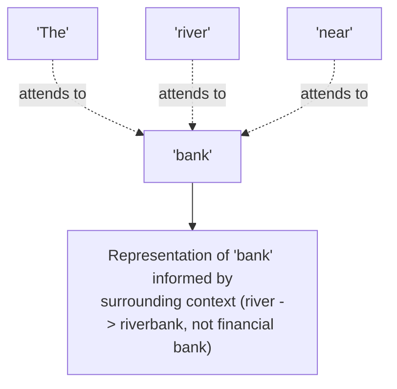

# Transformers and the Attention Mechanism

> The single idea that made modern LLMs possible: let every word look directly at every other word, instead of reading one at a time.

**Type:** Learn
**Prerequisites:** Tokens and Embeddings
**Time:** ~25 minutes

## Learning Objectives

- Explain what problem the transformer architecture and attention mechanism solve, at an intuitive level
- Describe what "attention" means: which words a model weighs most heavily when processing each token
- Recognize why attention explains both LLM capability and its main cost driver (quadratic scaling with input length)
- Formulate the right questions when engineering discusses context length, model architecture, or inference cost

## What It Is

Before transformers, earlier models (RNNs) processed text strictly one word at a time and struggled to remember context from far earlier in a long passage. The **transformer** architecture solved this with **self-attention**: every token can directly look at every other token in the input, all at once, and decide how much each one matters for understanding the current one.

For each token, attention computes a **weight** for every other token, representing how relevant that other token is. This is how the same word ("bank") gets a different internal representation in "river bank" than in "savings bank": the model is not looking the word up in a fixed dictionary, it is building context-aware understanding on the fly.

## Why It Matters

A team wants to double a chatbot's context window and is surprised the cost roughly quadruples rather than doubles. Without understanding attention, that estimate looks unreasonable. It is a direct, well-known consequence of how attention works.

## How It Works

**Weighting by relevance.** Take "The river bank was flooded." Scoring how similar each word is to "bank", the words "river" and "flooded" (which disambiguate meaning) and "bank" itself score high, while filler words like "The" and "was" score low. A normalizing step (**softmax**) turns those raw scores into weights that sum to 1. In a deliberately simplified toy version, "river" and "flooded" each receive about 25% of the weight and "The" and "was" about 14% each. Real transformers do this with learned weights across many dimensions and many layers, but the principle is the same: score relevance, then weight accordingly.

**Why attention is expensive.** Because every token attends to every other token, computation grows roughly with the square of input length.

| Input length | Attention computations | Relative cost |
| :--- | :--- | :--- |
| 1,000 tokens | ~1,000,000 | 1x |
| 2,000 tokens | ~4,000,000 | 4x, not 2x |
| 10,000 tokens | ~100,000,000 | 100x |

This ties directly to the KV cache and memory pressure seen in the memory hierarchy lesson.

**Multi-head attention.** Transformers run several attention computations in parallel ("heads"), each potentially tracking a different relationship (grammar, topic, reference), then combine results. This is why architectures are described as "12-head" or "32-head."

## Architecture and Workflow



```archify
src: diagrams/attention-bank.html
title: Attention: surrounding words inform the meaning of "bank"
aspect: 1040/392
```

## A Real-World Example

Product wants a document assistant that reads 200-page contracts, and asks engineering to raise the context window from 8,000 to 32,000 tokens. Four times the length means roughly 16 times the attention computation, plus a much larger KV cache in GPU memory, so latency and per-request cost rise sharply and fewer concurrent users fit per GPU. Engineering proposes an alternative: retrieve only the relevant clauses (RAG) and send about 3,000 tokens per request, which fixes the product goal at a fraction of the attention cost.

Attention also explains why models handle ambiguous pronouns well: it lets a pronoun connect directly to the specific earlier word it refers to, regardless of distance. Techniques like sparse attention, sliding-window attention, and paged attention exist to reduce the quadratic cost for long inputs.

## What a TPM Needs to Understand

- The quadratic cost of attention is the main reason "just increase the context window" is an expensive request, not a free one.
- Context-length increases have a superlinear cost curve; never estimate linearly.
- Alternatives (RAG, summarization, sliding windows) each solve the same problem with different trade-offs.
- Bigger context does not guarantee better use of it; long prompts can dilute focus.

## Risks, Dependencies, and Trade-Offs

| Approach | Handles Long-Range Context | Compute Cost Scaling | Complexity |
| :--- | :--- | :--- | :--- |
| **Full self-attention (standard transformer)** | Excellent | Quadratic with input length | Standard, well-supported |
| **Sparse / sliding window attention** | Good for nearby context, weaker for very distant | Roughly linear | Higher engineering complexity |
| **RAG (retrieve relevant chunks instead of full context)** | Good, if retrieval quality is high | Low, bounded by retrieved chunk size | Requires a retrieval pipeline (later level) |

Failure scenarios: a linear cost estimate blows the budget after launch; latency targets missed at long context; sliding-window models miss a clause far from the question. Dependencies: GPU memory capacity, the provider's context-length pricing tiers, and retrieval quality if RAG is chosen.

## Questions to Ask Engineers

1. *"Given attention's quadratic scaling, what's our actual expected cost/latency increase for this context-length change — has it been benchmarked, not just estimated linearly?"*
2. *"Are we using any attention optimization techniques (sparse attention, sliding window, paged attention) to manage cost at our target context length?"*
3. *"Would a RAG-based approach (retrieving only relevant context) achieve the same product goal at a fraction of the attention cost of a much longer context window?"*

## Scenario Exercise

Product asks to quadruple a chatbot's context window from 8K to 32K tokens "since it's just a config change."

1. **Easy**: In plain English, why does doubling context length roughly quadruple attention cost?
2. **Medium**: In "The river bank was flooded," which words would "flooded" attend to most, and why does that help the model understand it?
3. **Hard**: Propose a product design (summarizing older messages, RAG, etc.) that reduces dependence on long context, and explain how it reduces cost and what quality risk it introduces.

## Key Terms

- **Transformer**: The neural network architecture underlying modern LLMs, built around the self-attention mechanism.
- **Self-Attention**: The mechanism letting every token directly weigh the relevance of every other token when building its contextual representation.
- **Multi-Head Attention**: Running several attention computations in parallel, each potentially capturing a different type of relationship between tokens.
- **Quadratic Scaling**: A growth pattern where computation grows with the square of input size — doubling input roughly quadruples the work, as with standard attention.
- **Softmax**: A function converting raw scores into a probability-like distribution that sums to 1, used to turn attention scores into weights.
