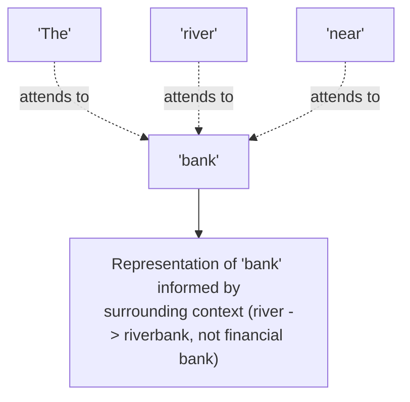

# Transformers and the Attention Mechanism

> The single idea that made modern LLMs possible: let every word look directly at every other word, instead of reading one at a time.

**Type:** Learn
**Languages:** Python, Concept
**Prerequisites:** Tokens and Embeddings
**Time:** ~35 minutes

## Learning Objectives

- Understand what problem the transformer architecture and attention mechanism solve, at an intuitive level
- Understand what "attention" means mechanically: which words a model weighs most heavily when processing each token
- Recognize why attention explains both LLM capability and its main cost driver (quadratic scaling with input length)
- Formulate the right questions when engineering discusses context length, model architecture, or inference cost

## The Problem

A team wants to double a chatbot's context window and is surprised the cost doesn't just double — it roughly quadruples. Without understanding attention, this looks like an unreasonable estimate. In reality, it's a direct, well-known mathematical consequence of how the attention mechanism works: doubling input length doesn't just double the work, it roughly quadruples it.

## The Concept

Before transformers, earlier models (RNNs) processed text strictly one word at a time, struggling to "remember" context from far earlier in a long passage. The **transformer** architecture solved this with **self-attention**: every token can directly look at every other token in the input, all at once, and decide how much each one matters for understanding the current one.



### What "Attention" Actually Computes

For each token, the attention mechanism computes a **weight** for every other token in the input, representing how relevant that other token is for understanding the current one. This is how the same word ("bank") gets a different internal representation depending on nearby context ("river bank" vs. "savings bank") — the model isn't looking the word up in a fixed dictionary, it's building a context-aware understanding on the fly.

### Why Attention Is Expensive: Quadratic Scaling

Because every token attends to every other token, the amount of computation grows roughly with the *square* of the input length. Doubling the input length roughly quadruples the attention computation — a direct, structural reason why long-context models are so much more expensive to run, tying directly back to the KV cache concept from the memory hierarchy lesson.

```
Input length: N tokens
Attention computation: roughly N x N (quadratic)

N = 1,000  -> ~1,000,000 attention computations
N = 2,000  -> ~4,000,000 attention computations (4x, not 2x)
```

### Multi-Head Attention

Transformers actually run several attention computations in parallel ("heads"), each potentially focusing on a different kind of relationship (e.g. one head tracking grammatical structure, another tracking topic) — then combine the results. This is why you'll hear terms like "12-head attention" or "32-head attention" describing a model's architecture.

## Build It

A drastically simplified illustration of attention: computing "how much should each word attend to each other word" using similarity scores, without a real transformer library:

```python
import math

words = ["The", "river", "bank", "was", "flooded"]

embeddings = {
    "The": [0.1, 0.1],
    "river": [0.9, 0.2],
    "bank": [0.7, 0.3],
    "was": [0.1, 0.05],
    "flooded": [0.8, 0.4],
}

def dot_product(a, b):
    return sum(x * y for x, y in zip(a, b))

def softmax(scores):
    max_score = max(scores)
    exp_scores = [math.exp(s - max_score) for s in scores]
    total = sum(exp_scores)
    return [e / total for e in exp_scores]

target_word = "bank"
target_vec = embeddings[target_word]

raw_scores = [dot_product(target_vec, embeddings[w]) for w in words]
attention_weights = softmax(raw_scores)

print(f"Attention weights for '{target_word}' looking at every word:\n")
for word, weight in zip(words, attention_weights):
    bar = "#" * int(weight * 50)
    print(f"  {word:10s} {weight:.3f} {bar}")
```

Notice how "bank" ends up paying the most attention to "river" and "flooded" — words that disambiguate its meaning — rather than "The" or "was," which carry little disambiguating information. Real transformers do this with learned weights across many dimensions and many layers, but the underlying idea (score relevance, then weight accordingly) is exactly this.

## Use It

Attention explains real, practical AI engineering conversations:

- **"Why is long-context inference so much more expensive?"** → because attention computation scales quadratically with input length.
- **"Why does this model handle ambiguous pronouns/references well?"** → because attention lets it directly connect a pronoun to the specific earlier word it refers to, regardless of distance.
- **Techniques like sparse attention, sliding window attention, or paged attention** (from the memory hierarchy lesson) exist specifically to reduce this quadratic cost for long inputs.

## Exercises

1. **Easy**: In plain English, explain why doubling context length roughly quadruples attention computation cost, using the "every token looks at every other token" idea.
2. **Medium**: In the code example above, change `target_word` to `"flooded"` and predict which words it will attend to most, before running it.
3. **Hard**: Propose one product design choice (e.g. summarizing older messages, using RAG instead of stuffing everything into context) that reduces reliance on very long context windows, and explain how it reduces attention cost.

## TPM Perspective

### Strategic Executive Summary
The quadratic cost of attention is the single biggest reason "just increase the context window" is an expensive request, not a free one. Understanding this lets a TPM correctly anticipate that context-length increases have a superlinear cost curve, and evaluate alternatives (RAG, summarization, sliding windows) with a clear sense of the trade-off they're solving.

### Questions to Challenge Engineering
1. *"Given attention's quadratic scaling, what's our actual expected cost/latency increase for this context-length change — has it been benchmarked, not just estimated linearly?"*
2. *"Are we using any attention optimization techniques (sparse attention, sliding window, paged attention) to manage cost at our target context length?"*
3. *"Would a RAG-based approach (retrieving only relevant context) achieve the same product goal at a fraction of the attention cost of a much longer context window?"*

### Trade-Off Matrix

| Approach | Handles Long-Range Context | Compute Cost Scaling | Complexity |
| :--- | :--- | :--- | :--- |
| **Full self-attention (standard transformer)** | Excellent | Quadratic with input length | Standard, well-supported |
| **Sparse / sliding window attention** | Good for nearby context, weaker for very distant | Roughly linear | Higher engineering complexity |
| **RAG (retrieve relevant chunks instead of full context)** | Good, if retrieval quality is high | Low, bounded by retrieved chunk size | Requires a retrieval pipeline (later level) |

## Key Terms

- **Transformer**: The neural network architecture underlying modern LLMs, built around the self-attention mechanism.
- **Self-Attention**: The mechanism letting every token directly weigh the relevance of every other token when building its contextual representation.
- **Multi-Head Attention**: Running several attention computations in parallel, each potentially capturing a different type of relationship between tokens.
- **Quadratic Scaling**: A growth pattern where computation grows with the square of input size — doubling input roughly quadruples the work, as with standard attention.
- **Softmax**: A function converting raw scores into a probability-like distribution that sums to 1, used to turn attention scores into weights.
