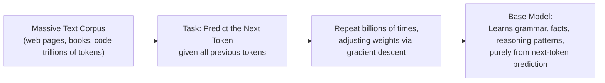

# Pre-training: How LLMs Learn Language

> Before an LLM can answer your questions, it spends months predicting the next word in trillions of sentences it will never be asked about directly.

**Type:** Learn
**Languages:** Python, Concept
**Prerequisites:** Transformers and the Attention Mechanism
**Time:** ~30 minutes

## Learning Objectives

- Understand what pre-training actually is: next-token prediction at massive scale
- Understand why pre-training is expensive, slow, and requires enormous amounts of data and compute
- Recognize the difference between a "base model" (freshly pre-trained) and an assistant-like model (fine-tuned, next lesson)
- Formulate the right questions when a team proposes pre-training a model from scratch

## The Problem

A team proposes "training our own foundation model from scratch" to have full control over an AI product. Without understanding what pre-training actually involves — the data scale, compute cost, and time required — a TPM might treat this as a reasonable, standard engineering task, when in reality it is one of the most expensive and highest-risk options on the table, usually reserved for a small number of well-funded labs.

## The Concept

**Pre-training** is the initial, foundational training phase where a model learns general language patterns from a massive amount of text, using a deceptively simple task: **predict the next token**.



By training on enough diverse text to predict "what word comes next" extremely well, the model is forced to implicitly learn grammar, facts about the world, reasoning patterns, and even some coding ability — none of these were directly labeled or taught; they emerged from the sheer scale and diversity of the prediction task.

### Why Pre-training Is So Expensive

- **Data scale**: modern frontier models are pre-trained on trillions of tokens — a scale of text collection and cleaning that itself is a massive engineering effort.
- **Compute scale**: pre-training runs on thousands of GPUs for weeks to months, representing tens to hundreds of millions of dollars in compute cost for frontier-scale models.
- **Iteration cost**: unlike a typical software bug fix, a mistake discovered late in a pre-training run (a bad architecture choice, a data quality issue) can mean re-running an enormous, expensive training job.

### Base Model vs. Assistant Model

A freshly pre-trained model (a **base model**) is very good at predicting plausible next text, but it isn't naturally good at *following instructions* or *being a helpful assistant* — it will often just continue your prompt as if it were more of the same kind of text, rather than answering it directly. Turning a base model into something like ChatGPT or Claude requires an additional step: **fine-tuning** (the next lesson).

## Build It

A tiny illustration of the "predict the next token" objective that drives pre-training, using a toy word-frequency model instead of a real neural network:

```python
import random

training_text = (
    "the cat sat on the mat the cat likes fish "
    "the dog sat on the rug the dog likes bones "
    "the cat and the dog are friends"
).split()

def build_next_word_counts(tokens):
    counts = {}
    for current_word, next_word in zip(tokens, tokens[1:]):
        counts.setdefault(current_word, {})
        counts[current_word][next_word] = counts[current_word].get(next_word, 0) + 1
    return counts

next_word_counts = build_next_word_counts(training_text)

def predict_next_word(word, counts):
    if word not in counts:
        return None
    options = counts[word]
    total = sum(options.values())
    weighted_choices = [(w, c / total) for w, c in options.items()]
    return max(weighted_choices, key=lambda pair: pair[1])

for word in ["the", "cat", "dog"]:
    prediction = predict_next_word(word, next_word_counts)
    print(f"Given '{word}', most likely next word: {prediction}")
```

This is a wildly simplified stand-in (a real LLM predicts using attention over the entire context and a vastly larger vocabulary/parameter count), but the underlying training signal is exactly this: given what came before, predict what comes next, and get incrementally better at it over enormous amounts of text.

## Use It

Understanding pre-training clarifies real strategic conversations:

- **"Should we pre-train our own model?"** → almost always no for a typical product team; the cost and expertise required rival building a new chip fab, not shipping a feature.
- **"Should we fine-tune an existing model?"** → a much more common, tractable choice — starting from an already pre-trained model and adapting it (next lesson).
- **"Why does the model sometimes state confident-sounding but wrong facts (hallucination)?"** → because pre-training optimizes for plausible next-token prediction, not verified truth — a model can be very good at sounding right without a built-in fact-checking mechanism.

## Exercises

1. **Easy**: In the toy example above, why does "the" have multiple possible next words while a rarer word might only have one?
2. **Medium**: Explain in plain English why a freshly pre-trained "base model" might respond to a question by continuing it with more questions, rather than answering it.
3. **Hard**: A team says "we'll just pre-train our own small model to avoid API costs." List three real costs/risks of this plan beyond just compute.

## TPM Perspective

### Strategic Executive Summary
Pre-training from scratch is a massive, high-risk, high-cost undertaking reserved for a small number of organizations with the data, compute, and expertise to do it well. For nearly every product team, the realistic choices are using an existing pre-trained model as-is, fine-tuning it, or prompting it effectively — not training a new one from scratch. Recognizing this distinction avoids enormously expensive, low-probability-of-success roadmap bets.

### Questions to Challenge Engineering
1. *"Are we proposing to pre-train a model from scratch, fine-tune an existing pre-trained model, or just prompt an existing model — because the cost and risk profile of these three options differ by orders of magnitude?"*
2. *"If hallucination is a concern, is that a fundamental property of next-token-prediction pre-training we need to design around (e.g. with RAG or verification), rather than something a single fix eliminates?"*
3. *"What's driving the desire to control our own base model — cost, data privacy, or capability — and are there lower-risk ways to address that specific concern?"*

### Trade-Off Matrix

| Approach | Cost | Time | Realistic For |
| :--- | :--- | :--- | :--- |
| **Pre-train a new base model from scratch** | Extremely high (tens-hundreds of millions $) | Months | Large, well-funded AI labs only |
| **Fine-tune an existing pre-trained model** | Low-Moderate | Days-Weeks | Most product teams with a specific adaptation need |
| **Prompt an existing model (no training)** | Very low | Hours | Most product teams, especially for prototyping and many production use cases |

## Key Terms

- **Pre-training**: The foundational training phase where a model learns general language patterns by predicting the next token across massive text data.
- **Base Model**: A model that has only been pre-trained, good at plausible text continuation but not naturally aligned to follow instructions helpfully.
- **Next-Token Prediction**: The core training objective of pre-training — predicting the most likely next token given all previous tokens.
- **Hallucination**: When a model states confident-sounding but incorrect or fabricated information, a natural consequence of optimizing for plausible text rather than verified truth.
- **Foundation Model**: A large, pre-trained model intended to serve as a general-purpose starting point for further fine-tuning or direct use.
