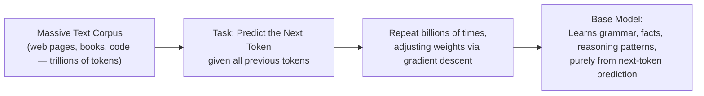

# Pre-training: How LLMs Learn Language

> Before an LLM can answer your questions, it spends months predicting the next word in trillions of sentences it will never be asked about directly.

**Type:** Learn
**Prerequisites:** Transformers and the Attention Mechanism
**Time:** ~20 minutes

## Learning Objectives

- Explain what pre-training actually is: next-token prediction at massive scale
- Explain why pre-training is expensive, slow, and requires enormous amounts of data and compute
- Distinguish a "base model" (freshly pre-trained) from an assistant-like model (fine-tuned, next lesson)
- Formulate the right questions when a team proposes pre-training a model from scratch

## What It Is

**Pre-training** is the initial, foundational training phase where a model learns general language patterns from a massive amount of text using a deceptively simple task: **predict the next token** given all previous tokens.

By getting extremely good at "what comes next" across diverse text, the model is forced to implicitly learn grammar, facts about the world, reasoning patterns, and even some coding ability. None of these were directly labeled or taught; they emerged from the scale and diversity of the task. The result is a **base model** (or **foundation model**).

## Why It Matters

A team proposes "training our own foundation model from scratch" for full control. Without understanding the data scale, compute cost, and time involved, a TPM might treat this as a standard engineering task. It is actually one of the most expensive and highest-risk options on the table, usually reserved for a small number of well-funded labs.

## How It Works

**The learning loop.** Take a sentence from the corpus, hide the next token, ask the model to guess it, measure how wrong the guess was (the loss), and adjust weights via gradient descent. Repeat billions of times.

**A toy intuition.** Imagine a model that only counts which word follows which in a tiny corpus about cats and dogs. After "the" it has seen "cat" and "dog" most often, so it predicts one of those; after a rarer word with only one observed follower, it predicts that follower with certainty. A real LLM does the same job with attention over the entire context and billions of parameters, but the training signal is identical: given what came before, predict what comes next.

**Why it is so expensive.**
- **Data scale**: trillions of tokens, and collecting and cleaning them is a massive engineering effort.
- **Compute scale**: thousands of GPUs for weeks to months, tens to hundreds of millions of dollars for frontier-scale models.
- **Iteration cost**: a mistake discovered late (bad architecture choice, data-quality issue) can mean rerunning an enormous job, unlike a normal software bug fix.

**Base model vs. assistant.** A base model is excellent at plausible text continuation but not naturally good at following instructions. Asked a question, it may continue with more questions as if writing a list, rather than answering. Turning it into an assistant takes fine-tuning (next lesson).

## Architecture and Workflow



```archify
src: diagrams/next-token-training.html
title: Pretraining: predicting the next token to produce a base model
aspect: 1060/332
```

## A Real-World Example

A startup says "we'll pre-train a small model to avoid API costs." The compute bill is only the visible part. Hidden costs include assembling and licensing a clean multi-billion-token corpus, hiring researchers who have run large training jobs, months before a first usable result, ongoing retraining as knowledge goes stale, and the fine-tuning and safety work still needed afterward. Meanwhile an API call to an existing model could ship in days. The realistic options for a typical product team are to prompt an existing model, or fine-tune one, not pre-train.

Hallucination also traces back here: pre-training optimizes for plausible next-token prediction, not verified truth, so a model can sound right with no built-in fact-checking.

## What a TPM Needs to Understand

- Pre-training from scratch is a massive, high-risk, high-cost undertaking for a few organizations; the cost and expertise rival building a chip fab, not shipping a feature.
- For nearly every team the choices are use as-is, prompt well, or fine-tune. The three differ by orders of magnitude in cost and risk.
- Hallucination is a property of how the model is trained, so it is designed around (RAG, verification), not fixed once.
- Ask what is really driving the wish to own a base model: cost, data privacy, or capability.

## Risks, Dependencies, and Trade-Offs

| Approach | Cost | Time | Realistic For |
| :--- | :--- | :--- | :--- |
| **Pre-train a new base model from scratch** | Extremely high (tens-hundreds of millions $) | Months | Large, well-funded AI labs only |
| **Fine-tune an existing pre-trained model** | Low-Moderate | Days-Weeks | Most product teams with a specific adaptation need |
| **Prompt an existing model (no training)** | Very low | Hours | Most product teams, especially for prototyping and many production use cases |

Failure scenarios: a late-discovered data defect forces a rerun; a base model that cannot follow instructions is mistaken for a finished product; knowledge cutoff leaves the model unaware of recent events. Dependencies: GPU supply, data licensing and legal review, and scarce research talent.

## Questions to Ask Engineers

1. *"Are we proposing to pre-train a model from scratch, fine-tune an existing pre-trained model, or just prompt an existing model — because the cost and risk profile of these three options differ by orders of magnitude?"*
2. *"If hallucination is a concern, is that a fundamental property of next-token-prediction pre-training we need to design around (e.g. with RAG or verification), rather than something a single fix eliminates?"*
3. *"What's driving the desire to control our own base model — cost, data privacy, or capability — and are there lower-risk ways to address that specific concern?"*

## Scenario Exercise

A director wants to pre-train a proprietary model so the company is "not dependent on a vendor."

1. **Easy**: In one sentence, what task is a model learning during pre-training?
2. **Medium**: Explain why a freshly pre-trained base model might respond to a question by continuing it with more questions instead of answering.
3. **Hard**: List three real costs or risks of the from-scratch plan beyond compute, and propose a lower-risk way to address the vendor-dependence concern.

## Key Terms

- **Pre-training**: The foundational training phase where a model learns general language patterns by predicting the next token across massive text data.
- **Base Model**: A model that has only been pre-trained, good at plausible text continuation but not naturally aligned to follow instructions helpfully.
- **Next-Token Prediction**: The core training objective of pre-training — predicting the most likely next token given all previous tokens.
- **Hallucination**: When a model states confident-sounding but incorrect or fabricated information, a natural consequence of optimizing for plausible text rather than verified truth.
- **Foundation Model**: A large, pre-trained model intended to serve as a general-purpose starting point for further fine-tuning or direct use.
