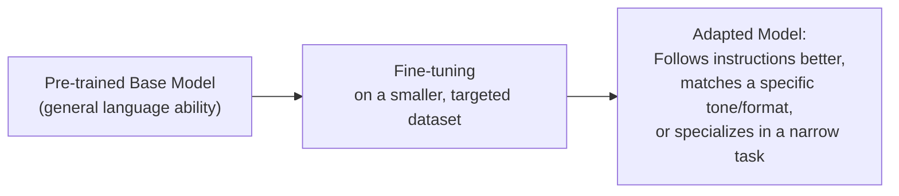

# Fine-tuning and Alignment

> Fine-tuning doesn't teach a model new facts about the world nearly as well as it teaches a model new behavior.

**Type:** Learn
**Prerequisites:** Pre-training: How LLMs Learn Language
**Time:** ~20 minutes

## Learning Objectives

- Explain what fine-tuning is, and how it differs from pre-training in cost, scale, and purpose
- Explain what "alignment" means: making a model's behavior match human intent and preferences
- Recognize when fine-tuning is (and isn't) the right tool, compared to prompting or RAG
- Formulate the right questions when a team proposes fine-tuning a model for a specific product need

## What It Is

**Fine-tuning** takes an already pre-trained base model and further trains it on a smaller, targeted dataset, adjusting its behavior rather than teaching language from scratch. **Alignment** is adjusting behavior to match human intent, preferences, and safety expectations, most famously through **RLHF**, where human raters' preferences between model outputs become the training signal (the reinforcement learning idea from the earlier phase).

## Why It Matters

A team says "the model doesn't know our internal product terminology, let's fine-tune it." It sounds reasonable, but fine-tuning is often the wrong tool for "the model doesn't know X." That is frequently better solved by giving the model the information at request time (RAG), rather than baking it into the weights, which is expensive, harder to update, and not reliably better at factual recall.

## How It Works

**What fine-tuning is good at**
- **Behavior and style**: more concise or formal responses, a specific output format, more reliable instruction following.
- **Narrow, well-defined tasks**: for example classifying support tickets into a fixed set of categories very reliably.
- **Alignment**: shaping behavior to human preferences and safety expectations.

**What it is not reliably good at**
- **Teaching new facts**: training on a document does not reliably make the model recall its specifics on demand. Retrieving and supplying the facts at request time is more reliable.
- **Fixing a wrong base model choice**: it adjusts behavior; it does not add capability a too-small or unsuitable model lacks.

**Parameter-efficient fine-tuning.** Training an entire large model is still expensive. **LoRA (Low-Rank Adaptation)** trains only a small number of added parameters, dramatically reducing cost while still adapting behavior.

**Facts at request time vs. facts in weights.** Consider a return policy. Without supplied context the model can only give a generic answer ("most companies allow returns within some window"). With the policy retrieved and included in the request, it states "returns are accepted within 30 days with a receipt." Updating the policy means editing one document, not retraining anything.

## Architecture and Workflow



```archify
src: diagrams/fine-tuning-flow.html
title: Fine-tuning a pre-trained base model into an adapted model
aspect: 775/332
```

## A Real-World Example

Decisions teams make constantly:

- **"Make responses concise and always in bullet points"**: good fine-tuning use (behavior/style), though prompting should be tried first.
- **"The model needs to know our current pricing, which changes monthly"**: RAG, because facts that change must be retrieved fresh rather than baked into static weights. Fine-tuning would require monthly retraining and still risks stale or garbled answers.
- **"Make the model reliably refuse certain request categories"**: often fine-tuning for alignment plus runtime guardrails.

A strong combined design: fine-tune for a consistent tone and output format, and use RAG to supply the facts. Each does the job it is good at.

## What a TPM Needs to Understand

- "The model doesn't know X" is frequently misdiagnosed as needing fine-tuning; RAG is usually more reliable, cheaper, and easier to update for facts.
- Fine-tuning earns its cost when the problem is behavior (tone, format, specialization, alignment).
- Fine-tuning requires quality training examples, evaluation, and maintenance whenever the base model is upgraded.
- It is a commitment, not a one-time action.

## Risks, Dependencies, and Trade-Offs

| Need | Best Tool | Why |
| :--- | :--- | :--- |
| **Consistent tone, format, or style** | Fine-tuning | Directly shapes behavior patterns across many examples |
| **Frequently changing facts (pricing, inventory, policies)** | RAG (retrieval) | Cheap and fast to update; no retraining needed |
| **Narrow, well-defined classification task** | Fine-tuning | Specializes the model reliably on a fixed task |
| **General safety/behavior alignment** | Fine-tuning (RLHF-style) + runtime guardrails | Combines learned behavior with enforced runtime checks |

Failure scenarios: fine-tuned on facts that later change; low-quality or inconsistent training examples teach bad behavior; a fine-tune tied to an old base model must be redone when the vendor retires it; fine-tuning degrades general abilities. Dependencies: a curated training dataset, an evaluation set to prove improvement, and the provider's fine-tuning support.

## Questions to Ask Engineers

1. *"Is this a behavior/style problem (favoring fine-tuning) or a factual knowledge problem (favoring RAG), and how did we determine that?"*
2. *"If this fact changes regularly (pricing, policies, inventory), how would fine-tuning keep up without expensive, frequent retraining, compared to just retrieving fresh data?"*
3. *"Are we using a parameter-efficient method like LoRA, or fine-tuning the entire model — and is that cost difference justified for this use case?"*

## Scenario Exercise

Your team's assistant gives outdated pricing and sometimes ignores the required answer format, and engineering proposes one fine-tuning project to fix both.

1. **Easy**: Is the format problem better suited to fine-tuning or RAG, and why?
2. **Medium**: A product catalog changes weekly. Explain why fine-tuning is a poor fit even though "the model doesn't know our products" sounds like a knowledge problem.
3. **Hard**: Describe a design that uses both fine-tuning and RAG, the role each plays, and what you would ask for in evaluation before approving the budget.

## Key Terms

- **Fine-tuning**: Further training an already pre-trained model on a smaller, targeted dataset to adjust its behavior or specialize it.
- **Alignment**: Adjusting a model's behavior to match human intent, preferences, and safety expectations.
- **RLHF (Reinforcement Learning from Human Feedback)**: A common alignment technique using human preference ratings between model outputs as the training signal.
- **LoRA (Low-Rank Adaptation)**: A parameter-efficient fine-tuning technique that trains a small number of additional parameters instead of the whole model.
- **RAG (Retrieval-Augmented Generation)**: Providing relevant facts to a model at request time instead of relying on it to have memorized them during training.
