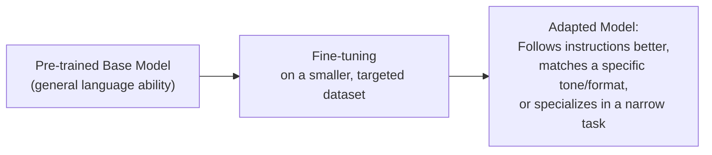

# Fine-tuning and Alignment

> Fine-tuning doesn't teach a model new facts about the world nearly as well as it teaches a model new behavior.

**Type:** Learn
**Languages:** Python, Concept
**Prerequisites:** Pre-training: How LLMs Learn Language
**Time:** ~30 minutes

## Learning Objectives

- Understand what fine-tuning is, and how it differs from pre-training in cost, scale, and purpose
- Understand what "alignment" means: making a model's behavior match human intent and preferences
- Recognize when fine-tuning is (and isn't) the right tool, compared to prompting or RAG
- Formulate the right questions when a team proposes fine-tuning a model for a specific product need

## The Problem

A team says "the model doesn't know about our internal product terminology, let's fine-tune it." This sounds reasonable, but fine-tuning is often the wrong tool for "the model doesn't know X" — that's frequently better solved by giving the model the information at request time (RAG, covered in a later level) rather than baking it into the weights, which is expensive, harder to update, and not reliably better at factual recall than simply providing the facts in the prompt.

## The Concept

**Fine-tuning** takes an already pre-trained base model and further trains it on a smaller, more targeted dataset — adjusting its behavior rather than teaching it language from scratch.



### What Fine-tuning Is Good At

- **Teaching behavior and style**: making responses more concise, more formal, matching a specific output format, or following instructions more reliably.
- **Specializing on a narrow, well-defined task**: e.g. classifying support tickets into a fixed set of categories very reliably.
- **Alignment**: adjusting a model's behavior to match human preferences and safety expectations — most famously via **RLHF (Reinforcement Learning from Human Feedback)**, where human raters' preferences between model outputs become the training signal (connecting back to reinforcement learning from Level 2).

### What Fine-tuning Is Not Reliably Good At

- **Teaching new facts**: fine-tuning on a document doesn't reliably make a model "know" and accurately recall its specific facts on demand — it's much more reliable to retrieve and provide that information at request time (RAG).
- **Fixing a fundamentally wrong base model choice**: fine-tuning adjusts behavior; it doesn't compensate for choosing a base model that's the wrong size or fundamentally lacks a needed capability.

### Parameter-Efficient Fine-tuning (a brief preview)

Fine-tuning an entire large model is still expensive. Techniques like **LoRA (Low-Rank Adaptation)** fine-tune only a small number of additional parameters instead of the entire model, dramatically reducing cost while still effectively adapting behavior — covered in depth in the Advanced AI level.

## Build It

A simplified illustration of the difference between "give the model facts at request time" (RAG-style) vs. "hope fine-tuning taught it facts," using a toy example:

```python
company_facts = {
    "return_policy": "Returns are accepted within 30 days with a receipt.",
    "support_hours": "Support is available Monday-Friday, 9am-6pm EST.",
}

def answer_without_context(question):
    return "I don't have specific information about that, but generally, most companies allow returns within some time window."

def answer_with_retrieved_context(question, facts):
    if "return" in question.lower():
        return f"Based on our policy: {facts['return_policy']}"
    if "support" in question.lower() or "hours" in question.lower():
        return f"Based on our policy: {facts['support_hours']}"
    return "I don't have specific information about that."

question = "What is your return policy?"

print("Without retrieved context (relying purely on model 'knowledge'):")
print(f"  {answer_without_context(question)}\n")

print("With retrieved context provided at request time (RAG-style):")
print(f"  {answer_with_retrieved_context(question, company_facts)}")
```

The second approach is both more reliable and far cheaper to update (just edit `company_facts`) than trying to fine-tune a model to memorize and accurately recall this information — this is exactly why RAG is usually favored over fine-tuning for "teach the model our specific facts" requests.

## Use It

Real teams make this decision constantly:

- **"Make responses more concise and always in bullet points"** → good fine-tuning use case (behavior/style).
- **"The model needs to know our current pricing, which changes monthly"** → RAG, not fine-tuning (facts that change need to be retrieved fresh, not baked into static weights).
- **"Make the model refuse specific categories of requests reliably"** → often a combination of fine-tuning (alignment) and runtime guardrails (covered in the Production AI level).

## Exercises

1. **Easy**: A team wants the model to always respond in a specific JSON format. Is this more suited to fine-tuning or RAG, and why?
2. **Medium**: A team wants the model to accurately answer questions about a product catalog that changes weekly. Explain why fine-tuning is a poor fit here, even though "the model doesn't know our products" sounds like a knowledge problem.
3. **Hard**: Propose a case where both fine-tuning (for behavior/format) and RAG (for facts) would reasonably be used together in the same product, and explain the role each plays.

## TPM Perspective

### Strategic Executive Summary
"The model doesn't know X" is a request that's frequently misdiagnosed as needing fine-tuning, when RAG is usually the more reliable, cheaper, and easier-to-update solution for factual knowledge. Fine-tuning earns its cost when the actual problem is *behavior* (tone, format, task specialization, alignment) — not when the problem is stale or missing facts.

### Questions to Challenge Engineering
1. *"Is this a behavior/style problem (favoring fine-tuning) or a factual knowledge problem (favoring RAG), and how did we determine that?"*
2. *"If this fact changes regularly (pricing, policies, inventory), how would fine-tuning keep up without expensive, frequent retraining, compared to just retrieving fresh data?"*
3. *"Are we using a parameter-efficient method like LoRA, or fine-tuning the entire model — and is that cost difference justified for this use case?"*

### Trade-Off Matrix

| Need | Best Tool | Why |
| :--- | :--- | :--- |
| **Consistent tone, format, or style** | Fine-tuning | Directly shapes behavior patterns across many examples |
| **Frequently changing facts (pricing, inventory, policies)** | RAG (retrieval) | Cheap and fast to update; no retraining needed |
| **Narrow, well-defined classification task** | Fine-tuning | Specializes the model reliably on a fixed task |
| **General safety/behavior alignment** | Fine-tuning (RLHF-style) + runtime guardrails | Combines learned behavior with enforced runtime checks |

## Key Terms

- **Fine-tuning**: Further training an already pre-trained model on a smaller, targeted dataset to adjust its behavior or specialize it.
- **Alignment**: Adjusting a model's behavior to match human intent, preferences, and safety expectations.
- **RLHF (Reinforcement Learning from Human Feedback)**: A common alignment technique using human preference ratings between model outputs as the training signal.
- **LoRA (Low-Rank Adaptation)**: A parameter-efficient fine-tuning technique that trains a small number of additional parameters instead of the whole model.
- **RAG (Retrieval-Augmented Generation)**: Providing relevant facts to a model at request time instead of relying on it to have memorized them during training.
