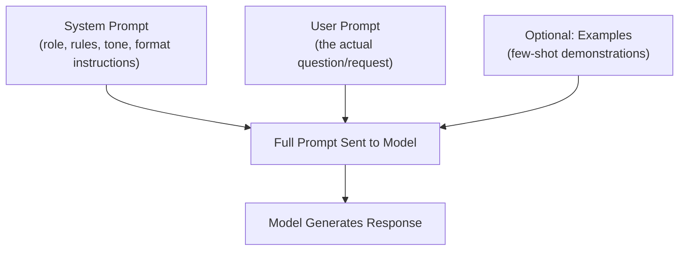

# Prompting and Prompt Engineering

> The cheapest, fastest lever on an AI feature's quality is almost always the prompt, not the model.

**Type:** Learn
**Languages:** Python
**Prerequisites:** Fine-tuning and Alignment
**Time:** ~30 minutes

## Learning Objectives

- Understand what prompt engineering is and why it's the first lever to pull before fine-tuning or switching models
- Recognize core prompting techniques: clear instructions, examples (few-shot), and structured output requests
- Understand the role of a system prompt vs. a user prompt
- Formulate the right questions when a team says a feature's quality issue needs "a bigger model" or "fine-tuning"

## The Problem

A feature produces inconsistent, sometimes low-quality outputs. The team's first proposal is "let's fine-tune a custom model" or "let's switch to a more expensive, larger model." Often, the actual issue is a vague, ambiguous, or poorly structured prompt — a much cheaper and faster fix than either of those options, and one that should typically be tried and ruled out first.

## The Concept

A **prompt** is the full input given to a model — including instructions, context, and the user's actual question — and how it's structured has an outsized effect on output quality, cost, and consistency.



### System Prompt vs. User Prompt

- **System prompt**: sets persistent instructions, role, tone, and format rules that apply across a whole conversation (e.g. "You are a helpful support assistant. Always respond in under 100 words. Never share pricing without confirming the customer's plan.").
- **User prompt**: the specific question or request for this particular turn.

### Zero-Shot vs. Few-Shot Prompting

- **Zero-shot**: asking the model to perform a task with only an instruction, no examples.
- **Few-shot**: providing a small number of example input/output pairs in the prompt itself, showing the model exactly the pattern you want — often dramatically improves consistency for tasks with a specific expected format.

### Structured Output Requests

Explicitly asking for a specific format (e.g. "respond only with valid JSON matching this schema: ...") produces far more reliable, parseable output than an open-ended request — critical for any AI feature whose output needs to be processed by other code (connecting back to the APIs/JSON lesson).

## Build It

The same task, prompted three different ways, to see how instructions and examples shape output reliability:

```python
def fake_model_call(prompt):
    if "Respond only with JSON" in prompt and "example" in prompt.lower():
        return '{"sentiment": "positive", "confidence": 0.92}'
    if "Respond only with JSON" in prompt:
        return '{"sentiment": "positive"}'
    return "This review seems pretty positive overall, I'd say roughly 90% confident."

vague_prompt = "What's the sentiment of this review: 'The product exceeded my expectations!'"

structured_prompt = """Analyze the sentiment of the review below.
Respond only with JSON in this exact format: {"sentiment": "positive|negative|neutral"}

Review: "The product exceeded my expectations!"
"""

few_shot_prompt = """Analyze the sentiment of the review below.
Respond only with JSON in this exact format: {"sentiment": "...", "confidence": 0.0-1.0}

Example:
Review: "Terrible, broke after one day."
Output: {"sentiment": "negative", "confidence": 0.95}

Review: "The product exceeded my expectations!"
"""

for label, prompt in [("Vague prompt", vague_prompt), ("Structured prompt", structured_prompt), ("Few-shot prompt", few_shot_prompt)]:
    print(f"{label}:")
    print(f"  Output: {fake_model_call(prompt)}\n")
```

The vague prompt produces free-form text that's hard for downstream code to parse reliably. The structured prompt produces clean, parseable JSON. The few-shot version demonstrates the exact desired format and even adds a field (confidence) purely by showing an example — often the fastest way to get a model to reliably match a specific pattern.

## Use It

Prompt engineering is the standard first step for most AI feature quality issues:

- **Inconsistent output format** → add explicit format instructions and/or few-shot examples before considering fine-tuning.
- **Model ignoring instructions** → check whether instructions are buried in a long prompt, contradictory, or competing with conflicting user input; clearer, more prominent system prompts often help.
- **Model being too verbose or too terse** → explicit length/format constraints in the system prompt are usually sufficient, without needing a different model.

## Exercises

1. **Easy**: Rewrite the vague prompt above to explicitly request a one-sentence answer with a confidence percentage.
2. **Medium**: Explain why few-shot examples can teach a model an output format more reliably than a written instruction alone.
3. **Hard**: A team's prompt is 3,000 words long, containing many rules, and the model still ignores some instructions. Propose two hypotheses for why (beyond "the model is bad") and how you'd test each.

## TPM Perspective

### Strategic Executive Summary
Prompt engineering is the cheapest, fastest, and most reversible lever on AI output quality — it should be the default first investigation for any quality issue, before proposing a more expensive and slower fix like fine-tuning or switching to a larger, costlier model. A well-structured prompt with clear instructions and examples often closes most of the quality gap on its own.

### Questions to Challenge Engineering
1. *"Have we tried improving the prompt (clearer instructions, few-shot examples, explicit format requests) before proposing fine-tuning or a larger model?"*
2. *"Is our system prompt clear and prioritized, or is it a long list of competing rules that may be diluting the model's attention (connecting back to how attention works)?"*
3. *"For this feature, do we need structured output (JSON) for downstream processing, and are we explicitly requesting and validating that format?"*

### Trade-Off Matrix

| Fix | Cost | Speed to Implement | When It's the Right First Move |
| :--- | :--- | :--- | :--- |
| **Improve the prompt (instructions, examples, format)** | Very low | Minutes-hours | Almost always the first thing to try |
| **Switch to a larger/more expensive model** | Moderate-High (ongoing) | Fast to test | After prompt improvements plateau |
| **Fine-tune the model** | Moderate-High (one-time + maintenance) | Days-weeks | When a specific, consistent behavior pattern is needed at scale, beyond what prompting achieves |

## Key Terms

- **Prompt**: The full input given to a model, including system instructions, context, and the user's request.
- **System Prompt**: Persistent instructions defining a model's role, tone, and rules across a conversation.
- **Zero-Shot Prompting**: Asking a model to perform a task with only an instruction and no examples.
- **Few-Shot Prompting**: Providing example input/output pairs in the prompt to demonstrate the desired pattern.
- **Structured Output**: Explicitly requesting a specific, parseable format (e.g. JSON) from a model's response.
