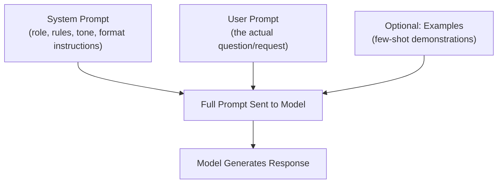

# Prompting and Prompt Engineering

> The cheapest, fastest lever on an AI feature's quality is almost always the prompt, not the model.

**Type:** Learn
**Prerequisites:** Fine-tuning and Alignment
**Time:** ~20 minutes

## Learning Objectives

- Explain what prompt engineering is and why it's the first lever to pull before fine-tuning or switching models
- Recognize core prompting techniques: clear instructions, examples (few-shot), and structured output requests
- Describe the role of a system prompt vs. a user prompt
- Formulate the right questions when a team says a feature's quality issue needs "a bigger model" or "fine-tuning"

## What It Is

A **prompt** is the full input given to a model, including instructions, context, and the user's actual question. How it is structured has an outsized effect on output quality, cost, and consistency.

- **System prompt**: persistent instructions for role, tone, and format that apply across a conversation (for example "You are a support assistant. Answer in under 100 words. Never share pricing without confirming the customer's plan.").
- **User prompt**: the specific request for this turn.
- **Zero-shot**: instruction only, no examples. **Few-shot**: a handful of example input/output pairs included in the prompt.
- **Structured output**: explicitly requesting a specific parseable format, such as JSON with named fields.

## Why It Matters

A feature produces inconsistent, sometimes low-quality outputs. The team's first proposal is "fine-tune a custom model" or "switch to a larger, more expensive model." Often the real issue is a vague, ambiguous, or poorly structured prompt, a much cheaper and faster fix that should be tried and ruled out first.

## How It Works

Consider the same sentiment-analysis task prompted three ways on the review "The product exceeded my expectations!":

| Prompt style | What the team writes | Typical result |
| :--- | :--- | :--- |
| **Vague** | "What's the sentiment of this review?" | Free-form prose ("seems pretty positive, maybe 90% sure") that downstream systems cannot parse reliably |
| **Structured** | Adds "respond only with the required fields and nothing else" and names the allowed values | Clean, machine-readable output with one field |
| **Few-shot** | Adds one worked example (a negative review with its correct output, including a confidence field) | Output matches the demonstrated pattern, including the extra field, purely by example |

Few-shot examples often teach a format more reliably than a written instruction, because the model imitates the pattern it sees.

When instructions are ignored, common causes are instructions buried in a very long prompt, contradictory rules, or conflicting user input. Clearer, more prominent system prompts usually help; too many competing rules can dilute the model's attention (see the attention lesson).

## Architecture and Workflow



```archify
src: diagrams/prompt-assembly.html
title: How system prompt, user prompt and examples combine into the full prompt
aspect: 1090/392
```

## A Real-World Example

An insurance team's claims-summary feature returns inconsistent formats, and engineers propose fine-tuning, a two-to-three week project. A TPM asks whether prompt changes were tried. In an afternoon the team rewrites the system prompt with a clear role and fixed output fields, adds two few-shot examples, and adds an explicit length limit. Format consistency goes from roughly 70% to over 95% on a 100-case test set, no training needed. Fine-tuning is shelved until prompting plateaus.

Typical mappings:

- **Inconsistent format**: explicit format instructions and few-shot examples first.
- **Instructions ignored**: check for buried, contradictory, or conflicting instructions.
- **Too verbose or too terse**: explicit length constraints in the system prompt.

## What a TPM Needs to Understand

- Prompt engineering is the cheapest, fastest, and most reversible lever on quality; make it the default first investigation.
- A well-structured prompt with clear instructions and examples often closes most of the gap on its own.
- Prompts are versioned assets: changes need test sets and review like code changes, or quality silently regresses.
- Longer prompts cost more tokens on every call, so prompt size affects cost and latency.

## Risks, Dependencies, and Trade-Offs

| Fix | Cost | Speed to Implement | When It's the Right First Move |
| :--- | :--- | :--- | :--- |
| **Improve the prompt (instructions, examples, format)** | Very low | Minutes-hours | Almost always the first thing to try |
| **Switch to a larger/more expensive model** | Moderate-High (ongoing) | Fast to test | After prompt improvements plateau |
| **Fine-tune the model** | Moderate-High (one-time + maintenance) | Days-weeks | When a specific, consistent behavior pattern is needed at scale, beyond what prompting achieves |

Failure scenarios: an untested prompt edit breaks a downstream parser; a model upgrade changes behavior for an existing prompt; long rule lists get partially ignored; user input overrides system instructions (prompt injection). Dependencies: an evaluation set to compare prompt versions, prompt version control, and output validation downstream.

## Questions to Ask Engineers

1. *"Have we tried improving the prompt (clearer instructions, few-shot examples, explicit format requests) before proposing fine-tuning or a larger model?"*
2. *"Is our system prompt clear and prioritized, or is it a long list of competing rules that may be diluting the model's attention (connecting back to how attention works)?"*
3. *"For this feature, do we need structured output (JSON) for downstream processing, and are we explicitly requesting and validating that format?"*

## Scenario Exercise

A feature's output quality is inconsistent, and the team asks for a larger model and two weeks to fine-tune.

1. **Easy**: Name two prompt changes that could make a vague request produce a one-sentence answer with a confidence percentage.
2. **Medium**: Explain why few-shot examples can teach an output format more reliably than a written instruction alone.
3. **Hard**: A 3,000-word prompt full of rules is still partly ignored. Give two hypotheses beyond "the model is bad," and how you would test each before approving a costlier fix.

## Key Terms

- **Prompt**: The full input given to a model, including system instructions, context, and the user's request.
- **System Prompt**: Persistent instructions defining a model's role, tone, and rules across a conversation.
- **Zero-Shot Prompting**: Asking a model to perform a task with only an instruction and no examples.
- **Few-Shot Prompting**: Providing example input/output pairs in the prompt to demonstrate the desired pattern.
- **Structured Output**: Explicitly requesting a specific, parseable format (e.g. JSON) from a model's response.
