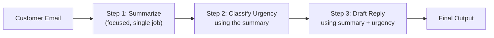

# Prompt Chaining

> One giant prompt asking for five things at once usually does all five worse than five small prompts asking for one thing each.

**Type:** Learn
**Languages:** Python
**Prerequisites:** Prompting and Prompt Engineering
**Time:** ~30 minutes

## Learning Objectives

- Understand what prompt chaining is: breaking a complex task into a sequence of smaller LLM calls
- Recognize when chaining improves reliability versus when it just adds cost and latency
- Understand how each step's output becomes the next step's input
- Formulate the right questions when reviewing a multi-step AI feature's design

## The Problem

A team builds a feature that reads a customer email, summarizes it, classifies its urgency, and drafts a reply — all in a single giant prompt. It works inconsistently: sometimes the summary is good but the classification is wrong, or the reply ignores the classification entirely. The single-prompt approach is asking one model call to juggle four distinct jobs at once, and quality suffers exactly where a human would also struggle if asked to do four things simultaneously without pausing between them.

## The Concept

**Prompt chaining** breaks a complex task into a sequence of smaller, focused LLM calls, where each step's output feeds into the next step's input — similar to a pipeline of specialized workers instead of one generalist doing everything at once.



### Why Smaller Steps Often Work Better

Each individual step is simpler for the model to get right, because it only has one job. It's also easier for a human to debug: if the final reply is wrong, you can look at each intermediate output (the summary, the urgency classification) and pinpoint exactly which step introduced the problem — something impossible with a single opaque call doing everything at once.

### The Real Trade-off: Reliability vs. Cost and Latency

Chaining isn't free: each step is a separate API call, meaning more total tokens billed, more total latency (especially if steps run sequentially rather than concurrently, connecting back to the async programming lesson), and more places a call could fail. The right amount of chaining balances reliability gains against this added cost and complexity — not every task needs to be split into five steps.

## Build It

The same "summarize, classify, draft reply" task, implemented as a chain of three focused calls instead of one giant prompt:

```python
def fake_llm_call(prompt):
    if "Summarize" in prompt:
        return "Customer's order arrived damaged and they want a replacement urgently."
    if "Classify the urgency" in prompt:
        return "high"
    if "Draft a reply" in prompt:
        return "Hi, we're sorry your order arrived damaged. We're shipping a free replacement today, no return needed."
    return "unknown"

def summarize_email(email_text):
    prompt = f"Summarize this customer email in one sentence:\n\n{email_text}"
    return fake_llm_call(prompt)

def classify_urgency(summary):
    prompt = f"Classify the urgency of this issue as low, medium, or high:\n\n{summary}"
    return fake_llm_call(prompt)

def draft_reply(summary, urgency):
    prompt = f"Draft a reply. Summary: {summary}\nUrgency: {urgency}"
    return fake_llm_call(prompt)

email = "Hi, I ordered a laptop stand last week and it arrived cracked. I need this fixed ASAP for a work trip."

summary = summarize_email(email)
urgency = classify_urgency(summary)
reply = draft_reply(summary, urgency)

print(f"Step 1 (Summary): {summary}")
print(f"Step 2 (Urgency): {urgency}")
print(f"Step 3 (Reply): {reply}")
```

If the final reply had been wrong, this structure makes it obvious to check: was the summary accurate? Was the urgency classification correct? Only then look at whether the reply-drafting step used that information well.

## Use It

Real AI applications use chaining constantly:

- **Document processing pipelines**: extract key fields, then validate them, then generate a summary — as separate steps.
- **Multi-step reasoning tasks**: plan an approach first, then execute each planned step, rather than asking for a final answer directly (a technique closely related to agentic patterns, covered in a later level).
- **Content moderation + response generation**: check if input violates policy first (a fast, focused call), only generating a full response if it passes — avoiding wasted cost on requests that will be rejected anyway.

## Exercises

1. **Easy**: In the email example above, if `classify_urgency` returned the wrong value, which single step would you look at first to debug it?
2. **Medium**: Propose a scenario where chaining would be overkill — where a single well-crafted prompt would be simpler and just as reliable.
3. **Hard**: The three steps above currently run one after another (sequentially). Explain why they can't simply be made to run concurrently with async, given that each step depends on the previous one's output.

## TPM Perspective

### Strategic Executive Summary
Prompt chaining trades some additional cost and latency for meaningfully better reliability and debuggability on complex, multi-part tasks. It's a design decision with a clear cost/benefit trade-off, not automatically "more engineering for no reason" — but it also shouldn't be applied reflexively to simple tasks that don't need it.

### Questions to Challenge Engineering
1. *"Is this feature's inconsistent quality caused by asking one prompt to do too many distinct jobs at once, and would splitting it into focused steps likely help?"*
2. *"For this multi-step feature, what's the added latency and token cost of chaining, and is that acceptable for the user experience we need?"*
3. *"When this feature produces a wrong final output, can we inspect the intermediate outputs of each step to pinpoint exactly where it went wrong?"*

### Trade-Off Matrix

| Approach | Reliability on Complex Tasks | Cost | Latency | Debuggability |
| :--- | :--- | :--- | :--- | :--- |
| **Single giant prompt** | Lower for multi-part tasks | Lowest (one call) | Lowest | Poor — hard to isolate what went wrong |
| **Prompt chain (multiple focused calls)** | Higher for multi-part tasks | Higher (multiple calls) | Higher (unless parallelized where possible) | Good — each step's output is inspectable |

## Key Terms

- **Prompt Chaining**: Breaking a complex task into a sequence of smaller, focused LLM calls, where each step's output feeds the next.
- **Pipeline**: The overall sequence of processing steps a request passes through, each performing a specific transformation.
- **Intermediate Output**: The result of one step in a chain, used as input to the next step and useful for debugging.
- **Sequential Dependency**: When a later step requires the output of an earlier step, preventing those steps from running concurrently.
