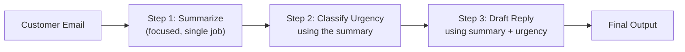

# Prompt Chaining

> One giant prompt asking for five things at once usually does all five worse than five small prompts asking for one thing each.

**Type:** Learn
**Prerequisites:** Prompting and Prompt Engineering
**Time:** ~20 minutes

## Learning Objectives

- Explain what prompt chaining is: breaking a complex task into a sequence of smaller LLM calls
- Recognize when chaining improves reliability versus when it just adds cost and latency
- Describe how each step's output becomes the next step's input
- Formulate the right questions when reviewing a multi-step AI feature's design

## What It Is

**Prompt chaining** breaks a complex task into a sequence of smaller, focused LLM calls, where each step's output feeds the next step's input. Think of a pipeline of specialized workers instead of one generalist doing everything at once.

## Why It Matters

A team builds a feature that reads a customer email, summarizes it, classifies its urgency, and drafts a reply, all in one giant prompt. It works inconsistently: sometimes the summary is good but the urgency is wrong, or the reply ignores the urgency entirely. One model call is juggling four distinct jobs, and quality suffers exactly where a human would also struggle if asked to do four things at once without pausing between them.

## How It Works

1. The first call does one narrow job (for example, summarize the email in one sentence).
2. Its output is passed, as plain text, into the second call (classify urgency as low, medium, or high).
3. The third call receives both earlier outputs and drafts the reply.
4. Each intermediate output can be stored and inspected.

Each step is simpler for the model to get right because it has one job. It is also far easier to debug: if the final reply is wrong, you can look at the summary and the urgency label and see which step introduced the problem, which is impossible with one opaque call.

The price is that each step is a separate API call: more tokens billed, more total latency (steps that depend on each other cannot run at the same time), and more places a call can fail.

## Architecture and Workflow



```archify
src: diagrams/support-email-chain.html
title: Prompt chain from customer email to final reply
aspect: 1250/172
```

## A Real-World Example

A support team receives: "I ordered a laptop stand last week and it arrived cracked. I need this fixed ASAP for a work trip."

| Step | Input | Output |
| :--- | :--- | :--- |
| 1. Summarize | Raw email | "Order arrived damaged; customer wants a replacement urgently." |
| 2. Classify urgency | The summary | "high" |
| 3. Draft reply | Summary + "high" | Apology plus an offer to ship a free replacement today |

If the reply is wrong, the team checks step 1 (was the summary accurate?), then step 2 (was "high" correct?), and only then step 3. Other common uses:

- **Document pipelines**: extract key fields, validate them, then generate a summary.
- **Plan then execute**: plan an approach first, then carry out each planned step (closely related to the agent patterns in a later level).
- **Moderation first**: a fast, cheap policy check runs before the full response, so rejected requests do not waste a full-cost call.

## What a TPM Needs to Understand

- Chaining trades extra cost and latency for better reliability and debuggability on multi-part tasks. It is a design decision with a clear cost/benefit, not automatic over-engineering, and not something to apply reflexively to simple tasks.
- The signal that chaining may help: inconsistent quality on a prompt that asks for several distinct jobs.
- Steps with a sequential dependency cannot be parallelized, so latency adds up. Independent steps can run concurrently.
- Intermediate outputs should be logged; that is what makes failures diagnosable.

## Risks, Dependencies, and Trade-Offs

| Approach | Reliability on Complex Tasks | Cost | Latency | Debuggability |
| :--- | :--- | :--- | :--- | :--- |
| **Single giant prompt** | Lower for multi-part tasks | Lowest (one call) | Lowest | Poor, hard to isolate what went wrong |
| **Prompt chain (multiple focused calls)** | Higher for multi-part tasks | Higher (multiple calls) | Higher (unless parallelized where possible) | Good, each step's output is inspectable |

Failure scenarios: an early step's mistake is passed down and amplified by later steps (error propagation); one failed call in the middle breaks the whole chain unless retries are designed in; chains with many steps can push response time past what users tolerate. Dependency: every step relies on the same provider, so rate limits and outages affect the whole pipeline.

## Questions to Ask Engineers

1. *"Is this feature's inconsistent quality caused by asking one prompt to do too many distinct jobs at once, and would splitting it into focused steps likely help?"*
2. *"For this multi-step feature, what's the added latency and token cost of chaining, and is that acceptable for the user experience we need?"*
3. *"When this feature produces a wrong final output, can we inspect the intermediate outputs of each step to pinpoint exactly where it went wrong?"*

## Scenario Exercise

Your team's email-triage feature (summarize, classify, draft reply) is live. Users report that some replies are cheerful in response to angry emails.

1. **Easy**: Which step's output would you inspect first to find out whether the urgency or tone information was wrong, and why?
2. **Medium**: Describe a feature where chaining would be overkill, and a single well-written prompt would be simpler and just as reliable.
3. **Hard**: Leadership wants the three steps to run at the same time to cut latency. Explain why that does not work here, and propose two other ways to reduce response time (for example, a faster model on the classification step).

## Key Terms

- **Prompt Chaining**: Breaking a complex task into a sequence of smaller, focused LLM calls, where each step's output feeds the next.
- **Pipeline**: The overall sequence of processing steps a request passes through, each performing a specific transformation.
- **Intermediate Output**: The result of one step in a chain, used as input to the next step and useful for debugging.
- **Sequential Dependency**: When a later step requires the output of an earlier step, preventing those steps from running concurrently.
